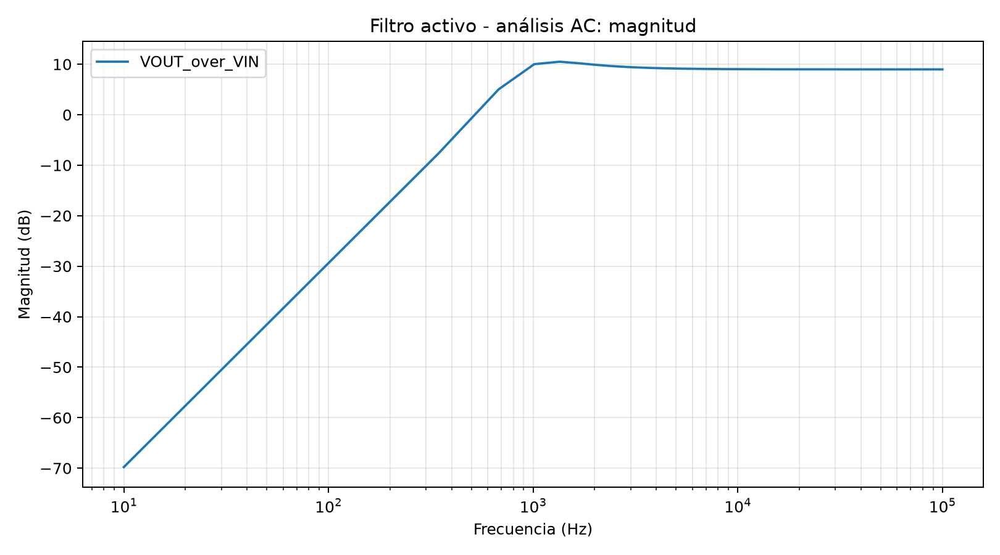
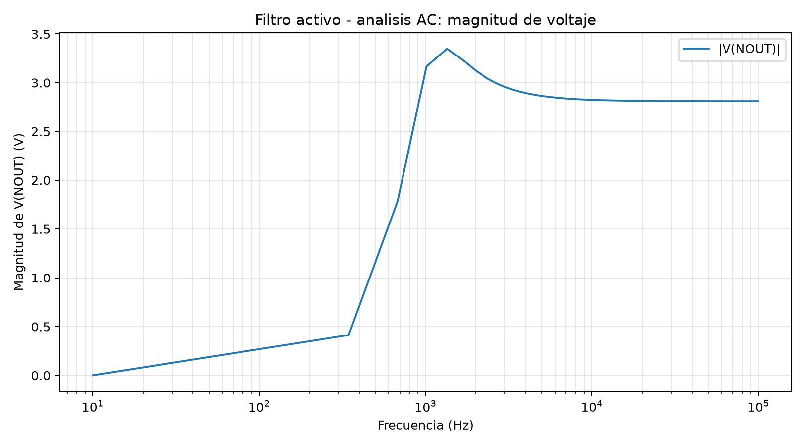
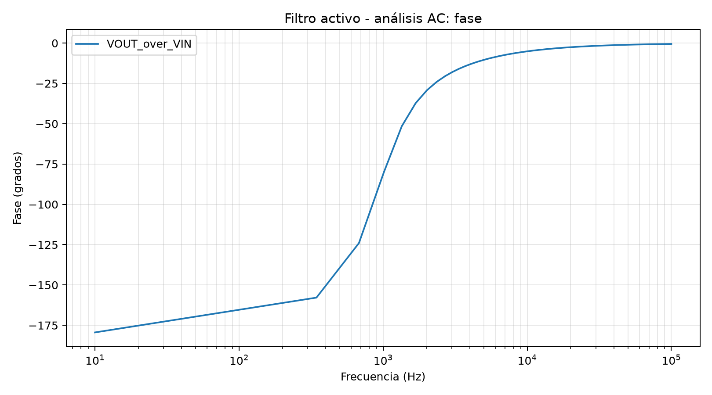

# Reporte de simulación de circuito

- **Fuente:** filtro_activo.cir
- **Método:** MNA
- **Ejecución:** <sin run_id>
- **Estado:** PASS

## Netlist original

```spice
* Filtro activo objetivo, valores tomados del diagrama suministrado
V1 IN 0 AC 1 0
C1 IN N1 0.1u
C2 N1 NP 0.1u
RG1 N1 OUT 1.27k
RG2 NP 0 2.3k
RB OUT NM 2.3k
RA NM 0 1.27k
.OPAMP U1 NP NM OUT IDEAL
.AC LIN 300 10 100k
.END

```

## Componentes normalizados

| Componente | Tipo | Desde | Hacia | Valor SI | Unidad | Rama | L?nea |
| ---------- | ---- | ----- | ----- | -------: | ------ | ---- | ----: |
| V1         | V    | IN    | 0     |        1 | volt   | B1   |     2 |
| C1         | C    | IN    | N1    |    1e-07 | farad  | B2   |     3 |
| C2         | C    | N1    | NP    |    1e-07 | farad  | B3   |     4 |
| RG1        | R    | N1    | OUT   |     1270 | ohm    | B4   |     5 |
| RG2        | R    | NP    | 0     |     2300 | ohm    | B5   |     6 |
| RB         | R    | OUT   | NM    |     2300 | ohm    | B6   |     7 |
| RA         | R    | NM    | 0     |     1270 | ohm    | B7   |     8 |

## Amplificadores operacionales ideales

Modelo MNA ideal lineal: corrientes de entrada nulas, restriccion V(n+)=V(n-) y corriente auxiliar en la salida. No modela rieles ni saturacion.

| Op-amp | Entrada + | Entrada - | Salida | Linea |
| ------ | --------- | --------- | ------ | ----: |
| U1     | NP        | NM        | OUT    |     9 |

## Nodos

| Nodo | Referencia | Índice completo | Índice reducido |
| ---- | :--------: | --------------: | --------------: |
| 0    |     sí     |               0 |            None |
| IN   |     no     |               1 |               0 |
| N1   |     no     |               2 |               1 |
| NM   |     no     |               3 |               2 |
| NP   |     no     |               4 |               3 |
| OUT  |     no     |               5 |               4 |

## Topología

Conectado: **True**

| Desde | Hacia | Rama | Componente |
| ----- | ----- | ---- | ---------- |
| IN    | 0     | B1   | V1         |
| IN    | N1    | B2   | C1         |
| N1    | NP    | B3   | C2         |
| N1    | OUT   | B4   | RG1        |
| NM    | 0     | B7   | RA         |
| NP    | 0     | B5   | RG2        |
| OUT   | NM    | B6   | RB         |

## Matriz de incidencia reducida

|     | B1  | B2  | B3  | B4  | B5  | B6  | B7  |
| --- | --- | --- | --- | --- | --- | --- | --- |
| IN  | 1   | 1   | 0   | 0   | 0   | 0   | 0   |
| N1  | 0   | -1  | 1   | 1   | 0   | 0   | 0   |
| NM  | 0   | 0   | 0   | 0   | 0   | -1  | 1   |
| NP  | 0   | 0   | -1  | 0   | 1   | 0   | 0   |
| OUT | 0   | 0   | 0   | -1  | 0   | 1   | 0   |

## Ecuaciones constitutivas

| Rama | Componente | Ecuación      | Línea de origen |
| ---- | ---------- | ------------- | --------------: |
| B1   | V1         | V = E         |               2 |
| B2   | C1         | s*C*V - I = 0 |               3 |
| B3   | C2         | s*C*V - I = 0 |               4 |
| B4   | RG1        | V - R*I = 0   |               5 |
| B5   | RG2        | V - R*I = 0   |               6 |
| B6   | RB         | V - R*I = 0   |               7 |
| B7   | RA         | V - R*I = 0   |               8 |

### Matriz Y

|     | B1  | B2                 | B3                 | B4  | B5  | B6  | B7  |
| --- | --- | ------------------ | ------------------ | --- | --- | --- | --- |
| B1  | 1   | 0                  | 0                  | 0   | 0   | 0   | 0   |
| B2  | 0   | 0 + j6.2831853e-06 | 0                  | 0   | 0   | 0   | 0   |
| B3  | 0   | 0                  | 0 + j6.2831853e-06 | 0   | 0   | 0   | 0   |
| B4  | 0   | 0                  | 0                  | 1   | 0   | 0   | 0   |
| B5  | 0   | 0                  | 0                  | 0   | 1   | 0   | 0   |
| B6  | 0   | 0                  | 0                  | 0   | 0   | 1   | 0   |
| B7  | 0   | 0                  | 0                  | 0   | 0   | 0   | 1   |

### Matriz Z

|     | B1  | B2  | B3  | B4    | B5    | B6    | B7    |
| --- | --- | --- | --- | ----- | ----- | ----- | ----- |
| B1  | 0   | 0   | 0   | 0     | 0     | 0     | 0     |
| B2  | 0   | -1  | 0   | 0     | 0     | 0     | 0     |
| B3  | 0   | 0   | -1  | 0     | 0     | 0     | 0     |
| B4  | 0   | 0   | 0   | -1270 | 0     | 0     | 0     |
| B5  | 0   | 0   | 0   | 0     | -2300 | 0     | 0     |
| B6  | 0   | 0   | 0   | 0     | 0     | -2300 | 0     |
| B7  | 0   | 0   | 0   | 0     | 0     | 0     | -1270 |

### Vector W

| Label | Value |
| ----- | ----- |
| B1    | 1     |
| B2    | 0     |
| B3    | 0     |
| B4    | 0     |
| B5    | 0     |
| B6    | 0     |
| B7    | 0     |

## Sistema ensamblado

Formulación: `MNA`; dimensiones: `7 × 7`.

|                | V(NIN)             | V(NN1)                         | V(NNM)         | V(NNP)                         | V(NOUT)        | I(V1) | I(U1) |
| -------------- | ------------------ | ------------------------------ | -------------- | ------------------------------ | -------------- | ----- | ----- |
| KCL(NIN)       | 0 + j6.2831853e-06 | 0 - j6.2831853e-06             | 0              | 0                              | 0              | 1     | 0     |
| KCL(NN1)       | 0 - j6.2831853e-06 | 0.00078740157 + j1.2566371e-05 | 0              | 0 - j6.2831853e-06             | -0.00078740157 | 0     | 0     |
| KCL(NNM)       | 0                  | 0                              | 0.0012221842   | 0                              | -0.00043478261 | 0     | 0     |
| KCL(NNP)       | 0                  | 0 - j6.2831853e-06             | 0              | 0.00043478261 + j6.2831853e-06 | 0              | 0     | 0     |
| KCL(NOUT)      | 0                  | -0.00078740157                 | -0.00043478261 | 0                              | 0.0012221842   | 0     | 1     |
| VSOURCE(V1)    | 1                  | 0                              | 0              | 0                              | 0              | 0     | 0     |
| OPAMP_DIFF(U1) | 0                  | 0                              | -1             | 1                              | 0              | 0     | 0     |

### Vector del lado derecho

| Label          | Value |
| -------------- | ----- |
| KCL(NIN)       | -0    |
| KCL(NN1)       | -0    |
| KCL(NNM)       | -0    |
| KCL(NNP)       | -0    |
| KCL(NOUT)      | -0    |
| VSOURCE(V1)    | 1     |
| OPAMP_DIFF(U1) | 0     |

## Resultados AC

Barrido `LIN`; estado global: **PASS**.

| Frecuencia (Hz) | Estado | Transferencias calculadas                                                    |
| --------------: | ------ | ---------------------------------------------------------------------------- |
|              10 | PASS   | VOUT_over_VIN: magnitud=0.00032417776, fase=-179.41483 grados, dB=-69.784336 |
|       344.41472 | PASS   | VOUT_over_VIN: magnitud=0.41252277, fase=-157.83069 grados, dB=-7.6910415    |
|       678.82943 | PASS   | VOUT_over_VIN: magnitud=1.7851286, fase=-124.05729 grados, dB=5.0333901      |
|       1013.2441 | PASS   | VOUT_over_VIN: magnitud=3.1665664, fase=-79.921878 grados, dB=10.011772      |
|       1347.6589 | PASS   | VOUT_over_VIN: magnitud=3.3482009, fase=-51.509838 grados, dB=10.49623       |
|       1682.0736 | PASS   | VOUT_over_VIN: magnitud=3.2284025, fase=-37.204738 grados, dB=10.179753      |
|       2016.4883 | PASS   | VOUT_over_VIN: magnitud=3.1198347, fase=-29.17149 grados, dB=9.8826317       |
|        2350.903 | PASS   | VOUT_over_VIN: magnitud=3.044126, fase=-24.075716 grados, dB=9.6692526       |
|       2685.3177 | PASS   | VOUT_over_VIN: magnitud=2.9919621, fase=-20.549749 grados, dB=9.5191216      |
|       3019.7324 | PASS   | VOUT_over_VIN: magnitud=2.9551192, fase=-17.957031 grados, dB=9.4115001      |
|       3354.1472 | PASS   | VOUT_over_VIN: magnitud=2.9283202, fase=-15.964878 grados, dB=9.3323711      |
|       3688.5619 | PASS   | VOUT_over_VIN: magnitud=2.9082857, fase=-14.382871 grados, dB=9.2727413      |
|       4022.9766 | PASS   | VOUT_over_VIN: magnitud=2.8929434, fase=-13.094056 grados, dB=9.2267986      |
|       4357.3913 | PASS   | VOUT_over_VIN: magnitud=2.8809465, fase=-12.022507 grados, dB=9.1907038      |
|        4691.806 | PASS   | VOUT_over_VIN: magnitud=2.8713943, fase=-11.116698 grados, dB=9.1618568      |
|       5026.2207 | PASS   | VOUT_over_VIN: magnitud=2.8636681, fase=-10.340368 grados, dB=9.1384536      |
|       5360.6355 | PASS   | VOUT_over_VIN: magnitud=2.857332, fase=-9.667223 grados, dB=9.119214         |
|       5695.0502 | PASS   | VOUT_over_VIN: magnitud=2.8520723, fase=-9.0777079 grados, dB=9.1032107      |
|       6029.4649 | PASS   | VOUT_over_VIN: magnitud=2.847659, fase=-8.5569626 grados, dB=9.0897596       |
|       6363.8796 | PASS   | VOUT_over_VIN: magnitud=2.84392, fase=-8.0934829 grados, dB=9.0783475        |
|       6698.2943 | PASS   | VOUT_over_VIN: magnitud=2.8407249, fase=-7.6782171 grados, dB=9.0685834      |
|        7032.709 | PASS   | VOUT_over_VIN: magnitud=2.8379731, fase=-7.3039416 grados, dB=9.0601656      |
|       7367.1237 | PASS   | VOUT_over_VIN: magnitud=2.8355865, fase=-6.9648183 grados, dB=9.052858       |
|       7701.5385 | PASS   | VOUT_over_VIN: magnitud=2.8335032, fase=-6.6560759 grados, dB=9.0464741      |
|       8035.9532 | PASS   | VOUT_over_VIN: magnitud=2.8316739, fase=-6.3737748 grados, dB=9.0408648      |
|       8370.3679 | PASS   | VOUT_over_VIN: magnitud=2.830059, fase=-6.1146332 grados, dB=9.0359099       |
|       8704.7826 | PASS   | VOUT_over_VIN: magnitud=2.8286264, fase=-5.875894 grados, dB=9.0315117       |
|       9039.1973 | PASS   | VOUT_over_VIN: magnitud=2.8273495, fase=-5.6552235 grados, dB=9.0275898      |
|        9373.612 | PASS   | VOUT_over_VIN: magnitud=2.8262065, fase=-5.4506331 grados, dB=9.024078       |
|       9708.0268 | PASS   | VOUT_over_VIN: magnitud=2.8251795, fase=-5.2604169 grados, dB=9.0209211      |
|       10042.441 | PASS   | VOUT_over_VIN: magnitud=2.8242533, fase=-5.0831034 grados, dB=9.0180729      |
|       10376.856 | PASS   | VOUT_over_VIN: magnitud=2.823415, fase=-4.9174164 grados, dB=9.0154944       |
|       10711.271 | PASS   | VOUT_over_VIN: magnitud=2.822654, fase=-4.7622431 grados, dB=9.0131528       |
|       11045.686 | PASS   | VOUT_over_VIN: magnitud=2.8219609, fase=-4.6166092 grados, dB=9.0110198      |
|         11380.1 | PASS   | VOUT_over_VIN: magnitud=2.821328, fase=-4.4796574 grados, dB=9.0090715       |
|       11714.515 | PASS   | VOUT_over_VIN: magnitud=2.8207484, fase=-4.3506307 grados, dB=9.007287       |
|        12048.93 | PASS   | VOUT_over_VIN: magnitud=2.8202164, fase=-4.228858 grados, dB=9.0056487       |
|       12383.344 | PASS   | VOUT_over_VIN: magnitud=2.8197269, fase=-4.113742 grados, dB=9.0041409       |
|       12717.759 | PASS   | VOUT_over_VIN: magnitud=2.8192754, fase=-4.0047495 grados, dB=9.0027501      |
|       13052.174 | PASS   | VOUT_over_VIN: magnitud=2.8188582, fase=-3.9014029 grados, dB=9.0014646      |
|       13386.589 | PASS   | VOUT_over_VIN: magnitud=2.8184719, fase=-3.8032733 grados, dB=9.000274       |
|       13721.003 | PASS   | VOUT_over_VIN: magnitud=2.8181134, fase=-3.7099741 grados, dB=8.9991692      |
|       14055.418 | PASS   | VOUT_over_VIN: magnitud=2.8177802, fase=-3.6211563 grados, dB=8.9981422      |
|       14389.833 | PASS   | VOUT_over_VIN: magnitud=2.8174699, fase=-3.5365036 grados, dB=8.9971857      |
|       14724.247 | PASS   | VOUT_over_VIN: magnitud=2.8171805, fase=-3.455729 grados, dB=8.9962935       |
|       15058.662 | PASS   | VOUT_over_VIN: magnitud=2.8169102, fase=-3.3785713 grados, dB=8.9954601      |
|       15393.077 | PASS   | VOUT_over_VIN: magnitud=2.8166573, fase=-3.3047923 grados, dB=8.9946802      |
|       15727.492 | PASS   | VOUT_over_VIN: magnitud=2.8164203, fase=-3.2341744 grados, dB=8.9939495      |
|       16061.906 | PASS   | VOUT_over_VIN: magnitud=2.816198, fase=-3.1665181 grados, dB=8.9932638       |
|       16396.321 | PASS   | VOUT_over_VIN: magnitud=2.8159892, fase=-3.1016406 grados, dB=8.9926196      |
|       16730.736 | PASS   | VOUT_over_VIN: magnitud=2.8157927, fase=-3.0393737 grados, dB=8.9920136      |
|       17065.151 | PASS   | VOUT_over_VIN: magnitud=2.8156077, fase=-2.9795628 grados, dB=8.9914429      |
|       17399.565 | PASS   | VOUT_over_VIN: magnitud=2.8154332, fase=-2.9220651 grados, dB=8.9909046      |
|        17733.98 | PASS   | VOUT_over_VIN: magnitud=2.8152685, fase=-2.8667485 grados, dB=8.9903965      |
|       18068.395 | PASS   | VOUT_over_VIN: magnitud=2.8151129, fase=-2.8134912 grados, dB=8.9899163      |
|       18402.809 | PASS   | VOUT_over_VIN: magnitud=2.8149657, fase=-2.76218 grados, dB=8.989462         |
|       18737.224 | PASS   | VOUT_over_VIN: magnitud=2.8148262, fase=-2.71271 grados, dB=8.9890318        |
|       19071.639 | PASS   | VOUT_over_VIN: magnitud=2.8146941, fase=-2.6649837 grados, dB=8.988624       |
|       19406.054 | PASS   | VOUT_over_VIN: magnitud=2.8145687, fase=-2.6189103 grados, dB=8.988237       |
|       19740.468 | PASS   | VOUT_over_VIN: magnitud=2.8144496, fase=-2.5744054 grados, dB=8.9878696      |
|       20074.883 | PASS   | VOUT_over_VIN: magnitud=2.8143365, fase=-2.53139 grados, dB=8.9875203        |
|       20409.298 | PASS   | VOUT_over_VIN: magnitud=2.8142288, fase=-2.4897905 grados, dB=8.9871881      |
|       20743.712 | PASS   | VOUT_over_VIN: magnitud=2.8141263, fase=-2.449538 grados, dB=8.9868717       |
|       21078.127 | PASS   | VOUT_over_VIN: magnitud=2.8140287, fase=-2.410568 grados, dB=8.9865703       |
|       21412.542 | PASS   | VOUT_over_VIN: magnitud=2.8139355, fase=-2.3728202 grados, dB=8.9862829      |
|       21746.957 | PASS   | VOUT_over_VIN: magnitud=2.8138467, fase=-2.3362379 grados, dB=8.9860086      |
|       22081.371 | PASS   | VOUT_over_VIN: magnitud=2.8137618, fase=-2.3007678 grados, dB=8.9857467      |
|       22415.786 | PASS   | VOUT_over_VIN: magnitud=2.8136808, fase=-2.2663599 grados, dB=8.9854964      |
|       22750.201 | PASS   | VOUT_over_VIN: magnitud=2.8136032, fase=-2.2329671 grados, dB=8.9852571      |
|       23084.615 | PASS   | VOUT_over_VIN: magnitud=2.813529, fase=-2.2005452 grados, dB=8.9850281       |
|        23419.03 | PASS   | VOUT_over_VIN: magnitud=2.813458, fase=-2.1690524 grados, dB=8.9848088       |
|       23753.445 | PASS   | VOUT_over_VIN: magnitud=2.81339, fase=-2.1384492 grados, dB=8.9845987        |
|        24087.86 | PASS   | VOUT_over_VIN: magnitud=2.8133247, fase=-2.1086984 grados, dB=8.9843973      |
|       24422.274 | PASS   | VOUT_over_VIN: magnitud=2.8132621, fase=-2.0797649 grados, dB=8.984204       |
|       24756.689 | PASS   | VOUT_over_VIN: magnitud=2.8132021, fase=-2.0516154 grados, dB=8.9840186      |
|       25091.104 | PASS   | VOUT_over_VIN: magnitud=2.8131444, fase=-2.0242184 grados, dB=8.9838405      |
|       25425.518 | PASS   | VOUT_over_VIN: magnitud=2.813089, fase=-1.9975442 grados, dB=8.9836694       |
|       25759.933 | PASS   | VOUT_over_VIN: magnitud=2.8130357, fase=-1.9715645 grados, dB=8.983505       |
|       26094.348 | PASS   | VOUT_over_VIN: magnitud=2.8129845, fase=-1.9462525 grados, dB=8.9833467      |
|       26428.763 | PASS   | VOUT_over_VIN: magnitud=2.8129352, fase=-1.9215827 grados, dB=8.9831945      |
|       26763.177 | PASS   | VOUT_over_VIN: magnitud=2.8128877, fase=-1.897531 grados, dB=8.9830479       |
|       27097.592 | PASS   | VOUT_over_VIN: magnitud=2.812842, fase=-1.8740745 grados, dB=8.9829068       |
|       27432.007 | PASS   | VOUT_over_VIN: magnitud=2.8127979, fase=-1.8511912 grados, dB=8.9827707      |
|       27766.421 | PASS   | VOUT_over_VIN: magnitud=2.8127555, fase=-1.8288605 grados, dB=8.9826395      |
|       28100.836 | PASS   | VOUT_over_VIN: magnitud=2.8127145, fase=-1.8070625 grados, dB=8.982513       |
|       28435.251 | PASS   | VOUT_over_VIN: magnitud=2.812675, fase=-1.7857784 grados, dB=8.9823909       |
|       28769.666 | PASS   | VOUT_over_VIN: magnitud=2.8126368, fase=-1.7649902 grados, dB=8.9822731      |
|        29104.08 | PASS   | VOUT_over_VIN: magnitud=2.8125999, fase=-1.7446807 grados, dB=8.9821593      |
|       29438.495 | PASS   | VOUT_over_VIN: magnitud=2.8125643, fase=-1.7248337 grados, dB=8.9820493      |
|        29772.91 | PASS   | VOUT_over_VIN: magnitud=2.8125299, fase=-1.7054334 grados, dB=8.981943       |
|       30107.324 | PASS   | VOUT_over_VIN: magnitud=2.8124966, fase=-1.686465 grados, dB=8.9818403       |
|       30441.739 | PASS   | VOUT_over_VIN: magnitud=2.8124645, fase=-1.6679141 grados, dB=8.9817409      |
|       30776.154 | PASS   | VOUT_over_VIN: magnitud=2.8124333, fase=-1.6497672 grados, dB=8.9816447      |
|       31110.569 | PASS   | VOUT_over_VIN: magnitud=2.8124032, fase=-1.6320112 grados, dB=8.9815516      |
|       31444.983 | PASS   | VOUT_over_VIN: magnitud=2.812374, fase=-1.6146335 grados, dB=8.9814615       |
|       31779.398 | PASS   | VOUT_over_VIN: magnitud=2.8123457, fase=-1.5976222 grados, dB=8.9813742      |
|       32113.813 | PASS   | VOUT_over_VIN: magnitud=2.8123183, fase=-1.5809658 grados, dB=8.9812896      |
|       32448.227 | PASS   | VOUT_over_VIN: magnitud=2.8122918, fase=-1.5646534 grados, dB=8.9812076      |
|       32782.642 | PASS   | VOUT_over_VIN: magnitud=2.8122661, fase=-1.5486743 grados, dB=8.9811281      |
|       33117.057 | PASS   | VOUT_over_VIN: magnitud=2.8122411, fase=-1.5330185 grados, dB=8.981051       |
|       33451.472 | PASS   | VOUT_over_VIN: magnitud=2.8122169, fase=-1.5176762 grados, dB=8.9809762      |
|       33785.886 | PASS   | VOUT_over_VIN: magnitud=2.8121934, fase=-1.5026382 grados, dB=8.9809036      |
|       34120.301 | PASS   | VOUT_over_VIN: magnitud=2.8121706, fase=-1.4878953 grados, dB=8.9808331      |
|       34454.716 | PASS   | VOUT_over_VIN: magnitud=2.8121484, fase=-1.4734391 grados, dB=8.9807647      |
|        34789.13 | PASS   | VOUT_over_VIN: magnitud=2.8121269, fase=-1.4592613 grados, dB=8.9806982      |
|       35123.545 | PASS   | VOUT_over_VIN: magnitud=2.812106, fase=-1.4453538 grados, dB=8.9806337       |
|        35457.96 | PASS   | VOUT_over_VIN: magnitud=2.8120857, fase=-1.431709 grados, dB=8.9805709       |
|       35792.375 | PASS   | VOUT_over_VIN: magnitud=2.8120659, fase=-1.4183196 grados, dB=8.9805099      |
|       36126.789 | PASS   | VOUT_over_VIN: magnitud=2.8120467, fase=-1.4051784 grados, dB=8.9804506      |
|       36461.204 | PASS   | VOUT_over_VIN: magnitud=2.812028, fase=-1.3922786 grados, dB=8.9803929       |
|       36795.619 | PASS   | VOUT_over_VIN: magnitud=2.8120098, fase=-1.3796136 grados, dB=8.9803367      |
|       37130.033 | PASS   | VOUT_over_VIN: magnitud=2.8119922, fase=-1.367177 grados, dB=8.9802821       |
|       37464.448 | PASS   | VOUT_over_VIN: magnitud=2.8119749, fase=-1.3549627 grados, dB=8.9802289      |
|       37798.863 | PASS   | VOUT_over_VIN: magnitud=2.8119582, fase=-1.3429649 grados, dB=8.9801772      |
|       38133.278 | PASS   | VOUT_over_VIN: magnitud=2.8119419, fase=-1.3311777 grados, dB=8.9801268      |
|       38467.692 | PASS   | VOUT_over_VIN: magnitud=2.811926, fase=-1.3195958 grados, dB=8.9800777       |
|       38802.107 | PASS   | VOUT_over_VIN: magnitud=2.8119105, fase=-1.3082137 grados, dB=8.9800298      |
|       39136.522 | PASS   | VOUT_over_VIN: magnitud=2.8118954, fase=-1.2970263 grados, dB=8.9799832      |
|       39470.936 | PASS   | VOUT_over_VIN: magnitud=2.8118807, fase=-1.2860288 grados, dB=8.9799378      |
|       39805.351 | PASS   | VOUT_over_VIN: magnitud=2.8118663, fase=-1.2752162 grados, dB=8.9798935      |
|       40139.766 | PASS   | VOUT_over_VIN: magnitud=2.8118524, fase=-1.2645841 grados, dB=8.9798503      |
|       40474.181 | PASS   | VOUT_over_VIN: magnitud=2.8118387, fase=-1.2541278 grados, dB=8.9798082      |
|       40808.595 | PASS   | VOUT_over_VIN: magnitud=2.8118254, fase=-1.2438431 grados, dB=8.9797671      |
|        41143.01 | PASS   | VOUT_over_VIN: magnitud=2.8118124, fase=-1.2337257 grados, dB=8.979727       |
|       41477.425 | PASS   | VOUT_over_VIN: magnitud=2.8117998, fase=-1.2237717 grados, dB=8.9796878      |
|       41811.839 | PASS   | VOUT_over_VIN: magnitud=2.8117874, fase=-1.213977 grados, dB=8.9796496       |
|       42146.254 | PASS   | VOUT_over_VIN: magnitud=2.8117753, fase=-1.204338 grados, dB=8.9796124       |
|       42480.669 | PASS   | VOUT_over_VIN: magnitud=2.8117636, fase=-1.1948508 grados, dB=8.9795759      |
|       42815.084 | PASS   | VOUT_over_VIN: magnitud=2.811752, fase=-1.1855121 grados, dB=8.9795404       |
|       43149.498 | PASS   | VOUT_over_VIN: magnitud=2.8117408, fase=-1.1763182 grados, dB=8.9795056      |
|       43483.913 | PASS   | VOUT_over_VIN: magnitud=2.8117298, fase=-1.1672658 grados, dB=8.9794717      |
|       43818.328 | PASS   | VOUT_over_VIN: magnitud=2.8117191, fase=-1.1583518 grados, dB=8.9794385      |
|       44152.742 | PASS   | VOUT_over_VIN: magnitud=2.8117086, fase=-1.1495729 grados, dB=8.9794061      |
|       44487.157 | PASS   | VOUT_over_VIN: magnitud=2.8116983, fase=-1.1409261 grados, dB=8.9793744      |
|       44821.572 | PASS   | VOUT_over_VIN: magnitud=2.8116883, fase=-1.1324085 grados, dB=8.9793434      |
|       45155.987 | PASS   | VOUT_over_VIN: magnitud=2.8116785, fase=-1.1240172 grados, dB=8.9793131      |
|       45490.401 | PASS   | VOUT_over_VIN: magnitud=2.8116689, fase=-1.1157493 grados, dB=8.9792835      |
|       45824.816 | PASS   | VOUT_over_VIN: magnitud=2.8116595, fase=-1.1076022 grados, dB=8.9792545      |
|       46159.231 | PASS   | VOUT_over_VIN: magnitud=2.8116503, fase=-1.0995733 grados, dB=8.9792261      |
|       46493.645 | PASS   | VOUT_over_VIN: magnitud=2.8116413, fase=-1.0916599 grados, dB=8.9791984      |
|        46828.06 | PASS   | VOUT_over_VIN: magnitud=2.8116325, fase=-1.0838597 grados, dB=8.9791712      |
|       47162.475 | PASS   | VOUT_over_VIN: magnitud=2.8116239, fase=-1.0761702 grados, dB=8.9791447      |
|        47496.89 | PASS   | VOUT_over_VIN: magnitud=2.8116155, fase=-1.068589 grados, dB=8.9791186       |
|       47831.304 | PASS   | VOUT_over_VIN: magnitud=2.8116073, fase=-1.061114 grados, dB=8.9790932       |
|       48165.719 | PASS   | VOUT_over_VIN: magnitud=2.8115992, fase=-1.0537428 grados, dB=8.9790682      |
|       48500.134 | PASS   | VOUT_over_VIN: magnitud=2.8115913, fase=-1.0464733 grados, dB=8.9790438      |
|       48834.548 | PASS   | VOUT_over_VIN: magnitud=2.8115835, fase=-1.0393035 grados, dB=8.9790198      |
|       49168.963 | PASS   | VOUT_over_VIN: magnitud=2.8115759, fase=-1.0322313 grados, dB=8.9789964      |
|       49503.378 | PASS   | VOUT_over_VIN: magnitud=2.8115685, fase=-1.0252547 grados, dB=8.9789734      |
|       49837.793 | PASS   | VOUT_over_VIN: magnitud=2.8115612, fase=-1.0183718 grados, dB=8.9789509      |
|       50172.207 | PASS   | VOUT_over_VIN: magnitud=2.8115541, fase=-1.0115808 grados, dB=8.9789288      |
|       50506.622 | PASS   | VOUT_over_VIN: magnitud=2.8115471, fase=-1.0048797 grados, dB=8.9789072      |
|       50841.037 | PASS   | VOUT_over_VIN: magnitud=2.8115402, fase=-0.99826683 grados, dB=8.978886      |
|       51175.452 | PASS   | VOUT_over_VIN: magnitud=2.8115335, fase=-0.99174045 grados, dB=8.9788652     |
|       51509.866 | PASS   | VOUT_over_VIN: magnitud=2.8115269, fase=-0.98529888 grados, dB=8.9788448     |
|       51844.281 | PASS   | VOUT_over_VIN: magnitud=2.8115204, fase=-0.97894047 grados, dB=8.9788248     |
|       52178.696 | PASS   | VOUT_over_VIN: magnitud=2.8115141, fase=-0.97266361 grados, dB=8.9788052     |
|        52513.11 | PASS   | VOUT_over_VIN: magnitud=2.8115078, fase=-0.96646675 grados, dB=8.978786      |
|       52847.525 | PASS   | VOUT_over_VIN: magnitud=2.8115017, fase=-0.96034837 grados, dB=8.9787671     |
|        53181.94 | PASS   | VOUT_over_VIN: magnitud=2.8114957, fase=-0.95430698 grados, dB=8.9787486     |
|       53516.355 | PASS   | VOUT_over_VIN: magnitud=2.8114899, fase=-0.94834115 grados, dB=8.9787304     |
|       53850.769 | PASS   | VOUT_over_VIN: magnitud=2.8114841, fase=-0.94244945 grados, dB=8.9787126     |
|       54185.184 | PASS   | VOUT_over_VIN: magnitud=2.8114784, fase=-0.93663053 grados, dB=8.9786951     |
|       54519.599 | PASS   | VOUT_over_VIN: magnitud=2.8114729, fase=-0.93088304 grados, dB=8.9786779     |
|       54854.013 | PASS   | VOUT_over_VIN: magnitud=2.8114674, fase=-0.92520566 grados, dB=8.978661      |
|       55188.428 | PASS   | VOUT_over_VIN: magnitud=2.811462, fase=-0.91959714 grados, dB=8.9786445      |
|       55522.843 | PASS   | VOUT_over_VIN: magnitud=2.8114568, fase=-0.91405621 grados, dB=8.9786282     |
|       55857.258 | PASS   | VOUT_over_VIN: magnitud=2.8114516, fase=-0.90858167 grados, dB=8.9786122     |
|       56191.672 | PASS   | VOUT_over_VIN: magnitud=2.8114465, fase=-0.90317232 grados, dB=8.9785965     |
|       56526.087 | PASS   | VOUT_over_VIN: magnitud=2.8114415, fase=-0.89782702 grados, dB=8.9785811     |
|       56860.502 | PASS   | VOUT_over_VIN: magnitud=2.8114366, fase=-0.89254463 grados, dB=8.978566      |
|       57194.916 | PASS   | VOUT_over_VIN: magnitud=2.8114318, fase=-0.88732405 grados, dB=8.9785511     |
|       57529.331 | PASS   | VOUT_over_VIN: magnitud=2.8114271, fase=-0.88216419 grados, dB=8.9785365     |
|       57863.746 | PASS   | VOUT_over_VIN: magnitud=2.8114224, fase=-0.877064 grados, dB=8.9785221       |
|       58198.161 | PASS   | VOUT_over_VIN: magnitud=2.8114179, fase=-0.87202246 grados, dB=8.978508      |
|       58532.575 | PASS   | VOUT_over_VIN: magnitud=2.8114134, fase=-0.86703856 grados, dB=8.9784941     |
|        58866.99 | PASS   | VOUT_over_VIN: magnitud=2.811409, fase=-0.86211132 grados, dB=8.9784805      |
|       59201.405 | PASS   | VOUT_over_VIN: magnitud=2.8114046, fase=-0.85723977 grados, dB=8.9784671     |
|       59535.819 | PASS   | VOUT_over_VIN: magnitud=2.8114003, fase=-0.85242297 grados, dB=8.9784539     |
|       59870.234 | PASS   | VOUT_over_VIN: magnitud=2.8113962, fase=-0.84766001 grados, dB=8.9784409     |
|       60204.649 | PASS   | VOUT_over_VIN: magnitud=2.811392, fase=-0.84295 grados, dB=8.9784282         |
|       60539.064 | PASS   | VOUT_over_VIN: magnitud=2.811388, fase=-0.83829204 grados, dB=8.9784156      |
|       60873.478 | PASS   | VOUT_over_VIN: magnitud=2.811384, fase=-0.83368529 grados, dB=8.9784033      |
|       61207.893 | PASS   | VOUT_over_VIN: magnitud=2.81138, fase=-0.8291289 grados, dB=8.9783912        |
|       61542.308 | PASS   | VOUT_over_VIN: magnitud=2.8113762, fase=-0.82462205 grados, dB=8.9783792     |
|       61876.722 | PASS   | VOUT_over_VIN: magnitud=2.8113724, fase=-0.82016394 grados, dB=8.9783675     |
|       62211.137 | PASS   | VOUT_over_VIN: magnitud=2.8113686, fase=-0.81575378 grados, dB=8.9783559     |
|       62545.552 | PASS   | VOUT_over_VIN: magnitud=2.811365, fase=-0.8113908 grados, dB=8.9783446       |
|       62879.967 | PASS   | VOUT_over_VIN: magnitud=2.8113613, fase=-0.80707425 grados, dB=8.9783334     |
|       63214.381 | PASS   | VOUT_over_VIN: magnitud=2.8113578, fase=-0.8028034 grados, dB=8.9783224      |
|       63548.796 | PASS   | VOUT_over_VIN: magnitud=2.8113543, fase=-0.79857751 grados, dB=8.9783115     |
|       63883.211 | PASS   | VOUT_over_VIN: magnitud=2.8113508, fase=-0.79439589 grados, dB=8.9783009     |
|       64217.625 | PASS   | VOUT_over_VIN: magnitud=2.8113474, fase=-0.79025783 grados, dB=8.9782904     |
|        64552.04 | PASS   | VOUT_over_VIN: magnitud=2.8113441, fase=-0.78616268 grados, dB=8.97828       |
|       64886.455 | PASS   | VOUT_over_VIN: magnitud=2.8113408, fase=-0.78210975 grados, dB=8.9782698     |
|        65220.87 | PASS   | VOUT_over_VIN: magnitud=2.8113375, fase=-0.7780984 grados, dB=8.9782598      |
|       65555.284 | PASS   | VOUT_over_VIN: magnitud=2.8113343, fase=-0.77412799 grados, dB=8.97825       |
|       65889.699 | PASS   | VOUT_over_VIN: magnitud=2.8113312, fase=-0.7701979 grados, dB=8.9782402      |
|       66224.114 | PASS   | VOUT_over_VIN: magnitud=2.8113281, fase=-0.76630753 grados, dB=8.9782307     |
|       66558.528 | PASS   | VOUT_over_VIN: magnitud=2.811325, fase=-0.76245626 grados, dB=8.9782212      |
|       66892.943 | PASS   | VOUT_over_VIN: magnitud=2.811322, fase=-0.75864351 grados, dB=8.9782119      |
|       67227.358 | PASS   | VOUT_over_VIN: magnitud=2.8113191, fase=-0.75486871 grados, dB=8.9782028     |
|       67561.773 | PASS   | VOUT_over_VIN: magnitud=2.8113162, fase=-0.7511313 grados, dB=8.9781938      |
|       67896.187 | PASS   | VOUT_over_VIN: magnitud=2.8113133, fase=-0.74743071 grados, dB=8.9781849     |
|       68230.602 | PASS   | VOUT_over_VIN: magnitud=2.8113105, fase=-0.74376642 grados, dB=8.9781761     |
|       68565.017 | PASS   | VOUT_over_VIN: magnitud=2.8113077, fase=-0.74013788 grados, dB=8.9781675     |
|       68899.431 | PASS   | VOUT_over_VIN: magnitud=2.8113049, fase=-0.73654458 grados, dB=8.978159      |
|       69233.846 | PASS   | VOUT_over_VIN: magnitud=2.8113022, fase=-0.73298601 grados, dB=8.9781507     |
|       69568.261 | PASS   | VOUT_over_VIN: magnitud=2.8112995, fase=-0.72946166 grados, dB=8.9781424     |
|       69902.676 | PASS   | VOUT_over_VIN: magnitud=2.8112969, fase=-0.72597104 grados, dB=8.9781343     |
|        70237.09 | PASS   | VOUT_over_VIN: magnitud=2.8112943, fase=-0.72251368 grados, dB=8.9781262     |
|       70571.505 | PASS   | VOUT_over_VIN: magnitud=2.8112917, fase=-0.7190891 grados, dB=8.9781183      |
|        70905.92 | PASS   | VOUT_over_VIN: magnitud=2.8112892, fase=-0.71569683 grados, dB=8.9781105     |
|       71240.334 | PASS   | VOUT_over_VIN: magnitud=2.8112867, fase=-0.71233641 grados, dB=8.9781029     |
|       71574.749 | PASS   | VOUT_over_VIN: magnitud=2.8112843, fase=-0.70900742 grados, dB=8.9780953     |
|       71909.164 | PASS   | VOUT_over_VIN: magnitud=2.8112819, fase=-0.70570939 grados, dB=8.9780878     |
|       72243.579 | PASS   | VOUT_over_VIN: magnitud=2.8112795, fase=-0.70244191 grados, dB=8.9780804     |
|       72577.993 | PASS   | VOUT_over_VIN: magnitud=2.8112771, fase=-0.69920455 grados, dB=8.9780732     |
|       72912.408 | PASS   | VOUT_over_VIN: magnitud=2.8112748, fase=-0.6959969 grados, dB=8.978066       |
|       73246.823 | PASS   | VOUT_over_VIN: magnitud=2.8112725, fase=-0.69281854 grados, dB=8.9780589     |
|       73581.237 | PASS   | VOUT_over_VIN: magnitud=2.8112703, fase=-0.68966909 grados, dB=8.978052      |
|       73915.652 | PASS   | VOUT_over_VIN: magnitud=2.811268, fase=-0.68654814 grados, dB=8.9780451      |
|       74250.067 | PASS   | VOUT_over_VIN: magnitud=2.8112658, fase=-0.68345532 grados, dB=8.9780383     |
|       74584.482 | PASS   | VOUT_over_VIN: magnitud=2.8112637, fase=-0.68039024 grados, dB=8.9780316     |
|       74918.896 | PASS   | VOUT_over_VIN: magnitud=2.8112615, fase=-0.67735253 grados, dB=8.978025      |
|       75253.311 | PASS   | VOUT_over_VIN: magnitud=2.8112594, fase=-0.67434183 grados, dB=8.9780185     |
|       75587.726 | PASS   | VOUT_over_VIN: magnitud=2.8112573, fase=-0.67135778 grados, dB=8.978012      |
|        75922.14 | PASS   | VOUT_over_VIN: magnitud=2.8112553, fase=-0.66840002 grados, dB=8.9780057     |
|       76256.555 | PASS   | VOUT_over_VIN: magnitud=2.8112533, fase=-0.66546822 grados, dB=8.9779994     |
|        76590.97 | PASS   | VOUT_over_VIN: magnitud=2.8112513, fase=-0.66256202 grados, dB=8.9779932     |
|       76925.385 | PASS   | VOUT_over_VIN: magnitud=2.8112493, fase=-0.6596811 grados, dB=8.9779871      |
|       77259.799 | PASS   | VOUT_over_VIN: magnitud=2.8112473, fase=-0.65682512 grados, dB=8.9779811     |
|       77594.214 | PASS   | VOUT_over_VIN: magnitud=2.8112454, fase=-0.65399378 grados, dB=8.9779752     |
|       77928.629 | PASS   | VOUT_over_VIN: magnitud=2.8112435, fase=-0.65118673 grados, dB=8.9779693     |
|       78263.043 | PASS   | VOUT_over_VIN: magnitud=2.8112416, fase=-0.64840369 grados, dB=8.9779635     |
|       78597.458 | PASS   | VOUT_over_VIN: magnitud=2.8112398, fase=-0.64564433 grados, dB=8.9779578     |
|       78931.873 | PASS   | VOUT_over_VIN: magnitud=2.811238, fase=-0.64290837 grados, dB=8.9779521      |
|       79266.288 | PASS   | VOUT_over_VIN: magnitud=2.8112361, fase=-0.64019549 grados, dB=8.9779466     |
|       79600.702 | PASS   | VOUT_over_VIN: magnitud=2.8112344, fase=-0.63750542 grados, dB=8.9779411     |
|       79935.117 | PASS   | VOUT_over_VIN: magnitud=2.8112326, fase=-0.63483786 grados, dB=8.9779356     |
|       80269.532 | PASS   | VOUT_over_VIN: magnitud=2.8112309, fase=-0.63219253 grados, dB=8.9779303     |
|       80603.946 | PASS   | VOUT_over_VIN: magnitud=2.8112292, fase=-0.62956916 grados, dB=8.977925      |
|       80938.361 | PASS   | VOUT_over_VIN: magnitud=2.8112275, fase=-0.62696747 grados, dB=8.9779197     |
|       81272.776 | PASS   | VOUT_over_VIN: magnitud=2.8112258, fase=-0.6243872 grados, dB=8.9779145      |
|       81607.191 | PASS   | VOUT_over_VIN: magnitud=2.8112241, fase=-0.62182809 grados, dB=8.9779094     |
|       81941.605 | PASS   | VOUT_over_VIN: magnitud=2.8112225, fase=-0.61928986 grados, dB=8.9779044     |
|        82276.02 | PASS   | VOUT_over_VIN: magnitud=2.8112209, fase=-0.61677228 grados, dB=8.9778994     |
|       82610.435 | PASS   | VOUT_over_VIN: magnitud=2.8112193, fase=-0.61427508 grados, dB=8.9778945     |
|       82944.849 | PASS   | VOUT_over_VIN: magnitud=2.8112177, fase=-0.61179803 grados, dB=8.9778896     |
|       83279.264 | PASS   | VOUT_over_VIN: magnitud=2.8112162, fase=-0.60934088 grados, dB=8.9778848     |
|       83613.679 | PASS   | VOUT_over_VIN: magnitud=2.8112146, fase=-0.60690338 grados, dB=8.9778801     |
|       83948.094 | PASS   | VOUT_over_VIN: magnitud=2.8112131, fase=-0.60448531 grados, dB=8.9778754     |
|       84282.508 | PASS   | VOUT_over_VIN: magnitud=2.8112116, fase=-0.60208643 grados, dB=8.9778707     |
|       84616.923 | PASS   | VOUT_over_VIN: magnitud=2.8112101, fase=-0.59970652 grados, dB=8.9778661     |
|       84951.338 | PASS   | VOUT_over_VIN: magnitud=2.8112087, fase=-0.59734535 grados, dB=8.9778616     |
|       85285.753 | PASS   | VOUT_over_VIN: magnitud=2.8112072, fase=-0.59500271 grados, dB=8.9778571     |
|       85620.167 | PASS   | VOUT_over_VIN: magnitud=2.8112058, fase=-0.59267837 grados, dB=8.9778527     |
|       85954.582 | PASS   | VOUT_over_VIN: magnitud=2.8112044, fase=-0.59037211 grados, dB=8.9778484     |
|       86288.997 | PASS   | VOUT_over_VIN: magnitud=2.811203, fase=-0.58808374 grados, dB=8.977844       |
|       86623.411 | PASS   | VOUT_over_VIN: magnitud=2.8112016, fase=-0.58581304 grados, dB=8.9778398     |
|       86957.826 | PASS   | VOUT_over_VIN: magnitud=2.8112002, fase=-0.58355981 grados, dB=8.9778355     |
|       87292.241 | PASS   | VOUT_over_VIN: magnitud=2.8111989, fase=-0.58132385 grados, dB=8.9778314     |
|       87626.656 | PASS   | VOUT_over_VIN: magnitud=2.8111975, fase=-0.57910496 grados, dB=8.9778272     |
|        87961.07 | PASS   | VOUT_over_VIN: magnitud=2.8111962, fase=-0.57690295 grados, dB=8.9778232     |
|       88295.485 | PASS   | VOUT_over_VIN: magnitud=2.8111949, fase=-0.57471761 grados, dB=8.9778191     |
|         88629.9 | PASS   | VOUT_over_VIN: magnitud=2.8111936, fase=-0.57254878 grados, dB=8.9778152     |
|       88964.314 | PASS   | VOUT_over_VIN: magnitud=2.8111923, fase=-0.57039625 grados, dB=8.9778112     |
|       89298.729 | PASS   | VOUT_over_VIN: magnitud=2.8111911, fase=-0.56825985 grados, dB=8.9778073     |
|       89633.144 | PASS   | VOUT_over_VIN: magnitud=2.8111898, fase=-0.56613939 grados, dB=8.9778035     |
|       89967.559 | PASS   | VOUT_over_VIN: magnitud=2.8111886, fase=-0.5640347 grados, dB=8.9777996      |
|       90301.973 | PASS   | VOUT_over_VIN: magnitud=2.8111874, fase=-0.56194561 grados, dB=8.9777959     |
|       90636.388 | PASS   | VOUT_over_VIN: magnitud=2.8111862, fase=-0.55987193 grados, dB=8.9777922     |
|       90970.803 | PASS   | VOUT_over_VIN: magnitud=2.811185, fase=-0.5578135 grados, dB=8.9777885       |
|       91305.217 | PASS   | VOUT_over_VIN: magnitud=2.8111838, fase=-0.55577016 grados, dB=8.9777848     |
|       91639.632 | PASS   | VOUT_over_VIN: magnitud=2.8111826, fase=-0.55374173 grados, dB=8.9777812     |
|       91974.047 | PASS   | VOUT_over_VIN: magnitud=2.8111815, fase=-0.55172805 grados, dB=8.9777777     |
|       92308.462 | PASS   | VOUT_over_VIN: magnitud=2.8111803, fase=-0.54972897 grados, dB=8.9777741     |
|       92642.876 | PASS   | VOUT_over_VIN: magnitud=2.8111792, fase=-0.54774432 grados, dB=8.9777706     |
|       92977.291 | PASS   | VOUT_over_VIN: magnitud=2.8111781, fase=-0.54577395 grados, dB=8.9777672     |
|       93311.706 | PASS   | VOUT_over_VIN: magnitud=2.811177, fase=-0.54381771 grados, dB=8.9777638      |
|        93646.12 | PASS   | VOUT_over_VIN: magnitud=2.8111759, fase=-0.54187544 grados, dB=8.9777604     |
|       93980.535 | PASS   | VOUT_over_VIN: magnitud=2.8111748, fase=-0.539947 grados, dB=8.977757        |
|        94314.95 | PASS   | VOUT_over_VIN: magnitud=2.8111737, fase=-0.53803224 grados, dB=8.9777537     |
|       94649.365 | PASS   | VOUT_over_VIN: magnitud=2.8111727, fase=-0.536131 grados, dB=8.9777505       |
|       94983.779 | PASS   | VOUT_over_VIN: magnitud=2.8111716, fase=-0.53424316 grados, dB=8.9777472     |
|       95318.194 | PASS   | VOUT_over_VIN: magnitud=2.8111706, fase=-0.53236857 grados, dB=8.977744      |
|       95652.609 | PASS   | VOUT_over_VIN: magnitud=2.8111696, fase=-0.53050709 grados, dB=8.9777409     |
|       95987.023 | PASS   | VOUT_over_VIN: magnitud=2.8111686, fase=-0.52865858 grados, dB=8.9777377     |
|       96321.438 | PASS   | VOUT_over_VIN: magnitud=2.8111675, fase=-0.52682291 grados, dB=8.9777346     |
|       96655.853 | PASS   | VOUT_over_VIN: magnitud=2.8111666, fase=-0.52499995 grados, dB=8.9777315     |
|       96990.268 | PASS   | VOUT_over_VIN: magnitud=2.8111656, fase=-0.52318956 grados, dB=8.9777285     |
|       97324.682 | PASS   | VOUT_over_VIN: magnitud=2.8111646, fase=-0.52139161 grados, dB=8.9777255     |
|       97659.097 | PASS   | VOUT_over_VIN: magnitud=2.8111636, fase=-0.51960598 grados, dB=8.9777225     |
|       97993.512 | PASS   | VOUT_over_VIN: magnitud=2.8111627, fase=-0.51783254 grados, dB=8.9777196     |
|       98327.926 | PASS   | VOUT_over_VIN: magnitud=2.8111617, fase=-0.51607116 grados, dB=8.9777167     |
|       98662.341 | PASS   | VOUT_over_VIN: magnitud=2.8111608, fase=-0.51432172 grados, dB=8.9777138     |
|       98996.756 | PASS   | VOUT_over_VIN: magnitud=2.8111599, fase=-0.51258411 grados, dB=8.9777109     |
|       99331.171 | PASS   | VOUT_over_VIN: magnitud=2.811159, fase=-0.5108582 grados, dB=8.9777081       |
|       99665.585 | PASS   | VOUT_over_VIN: magnitud=2.8111581, fase=-0.50914387 grados, dB=8.9777053     |
|          100000 | PASS   | VOUT_over_VIN: magnitud=2.8111572, fase=-0.50744102 grados, dB=8.9777025     |

### Vector de voltajes nodales Vn por frecuencia

Fasores complejos en V; se excluye el nodo de referencia 0. Los puntos sin solucion conservan su estado y se indican como `n/a`.

| Frecuencia (Hz) | Estado | V(NIN) (V) |                     V(NN1) (V) |                      V(NNM) (V) |                      V(NNP) (V) |                     V(NOUT) (V) |
| --------------: | ------ | ---------: | -----------------------------: | ------------------------------: | ------------------------------: | ------------------------------: |
|              10 | PASS   |          1 | -0.00019681937 + j0.0079785554 | -0.00011531773 - j1.1778069e-06 | -0.00011531773 - j1.1778069e-06 | -0.00032416086 - j3.3108429e-06 |
|       344.41472 | PASS   |          1 |      -0.24716115 + j0.21767208 |      -0.13590285 - j0.055376027 |      -0.13590285 - j0.055376027 |       -0.38202614 - j0.15566332 |
|       678.82943 | PASS   |          1 |      -0.89195148 - j0.16359351 |       -0.35563935 - j0.52612142 |       -0.35563935 - j0.52612142 |        -0.99971062 - j1.4789397 |
|       1013.2441 | PASS   |          1 |       -0.56031731 - j1.2437225 |          0.1971239 - j1.1091001 |          0.1971239 - j1.1091001 |         0.55411994 - j3.1177065 |
|       1347.6589 | PASS   |          1 |        0.26261551 - j1.3129299 |        0.74131506 - j0.93228928 |        0.74131506 - j0.93228928 |          2.0838541 - j2.6206872 |
|       1682.0736 | PASS   |          1 |        0.62905712 - j1.0707548 |        0.91474071 - j0.69444521 |        0.91474071 - j0.69444521 |          2.5713577 - j1.9521019 |
|       2016.4883 | PASS   |          1 |       0.78344807 - j0.87352462 |        0.96908813 - j0.54097239 |        0.96908813 - j0.54097239 |          2.7241296 - j1.5206862 |
|        2350.903 | PASS   |          1 |       0.85868407 - j0.73279673 |          0.98871772 - j0.441772 |          0.98871772 - j0.441772 |          2.7793089 - j1.2418315 |
|       2685.3177 | PASS   |          1 |       0.90036277 - j0.63043828 |        0.99663937 - j0.37361484 |        0.99663937 - j0.37361484 |          2.8015768 - j1.0502401 |
|       3019.7324 | PASS   |          1 |       0.92578195 - j0.55327156 |         1.0000519 - j0.32410758 |         1.0000519 - j0.32410758 |         2.8111694 - j0.91107406 |
|       3354.1472 | PASS   |          1 |        0.9424368 - j0.49314973 |         1.0015484 - j0.28652508 |         1.0015484 - j0.28652508 |         2.8153762 - j0.80542876 |
|       3688.5619 | PASS   |          1 |       0.95396071 - j0.44500375 |         1.0021732 - j0.25699501 |         1.0021732 - j0.25699501 |         2.8171326 - j0.72241905 |
|       4022.9766 | PASS   |          1 |       0.96228035 - j0.40556901 |         1.0023841 - j0.23315246 |         1.0023841 - j0.23315246 |         2.8177253 - j0.65539706 |
|       4357.3913 | PASS   |          1 |        0.9684934 - j0.37266305 |         1.0023948 - j0.21347718 |         1.0023948 - j0.21347718 |         2.8177554 - j0.60008939 |
|        4691.806 | PASS   |          1 |       0.97326268 - j0.34477595 |           1.00231 - j0.19694877 |           1.00231 - j0.19694877 |          2.817517 - j0.55362764 |
|       5026.2207 | PASS   |          1 |       0.97700794 - j0.32083103 |         1.0021825 - j0.18285694 |         1.0021825 - j0.18285694 |         2.8171587 - j0.51401517 |
|       5360.6355 | PASS   |          1 |       0.98000583 - j0.30004019 |         1.0020396 - j0.17069184 |         1.0020396 - j0.17069184 |          2.816757 - j0.47981879 |
|       5695.0502 | PASS   |          1 |       0.98244485 - j0.28181325 |         1.0018951 - j0.16007782 |         1.0018951 - j0.16007782 |         2.8163509 - j0.44998252 |
|       6029.4649 | PASS   |          1 |        0.9844572 - j0.26569939 |         1.0017561 - j0.15073178 |         1.0017561 - j0.15073178 |         2.8159601 - j0.42371059 |
|       6363.8796 | PASS   |          1 |       0.98613791 - j0.25134824 |         1.0016257 - j0.14243622 |         1.0016257 - j0.14243622 |         2.8155936 - j0.40039157 |
|       6698.2943 | PASS   |          1 |       0.98755675 - j0.23848325 |         1.0015053 - j0.13502114 |         1.0015053 - j0.13502114 |          2.8152551 - j0.3795476 |
|        7032.709 | PASS   |          1 |       0.98876592 - j0.22688317 |          1.001395 - j0.12835168 |          1.001395 - j0.12835168 |           2.814945 - j0.3607996 |
|       7367.1237 | PASS   |          1 |       0.98980517 - j0.21636885 |         1.0012944 - j0.12231944 |         1.0012944 - j0.12231944 |         2.8146621 - j0.34384283 |
|       7701.5385 | PASS   |          1 |       0.99070517 - j0.20679363 |         1.0012028 - j0.11683624 |         1.0012028 - j0.11683624 |         2.8144048 - j0.32842942 |
|       8035.9532 | PASS   |          1 |       0.99148994 - j0.19803626 |         1.0011196 - j0.11182959 |         1.0011196 - j0.11182959 |         2.8141709 - j0.31435561 |
|       8370.3679 | PASS   |          1 |        0.99217848 - j0.1899956 |          1.001044 - j0.10723933 |          1.001044 - j0.10723933 |         2.8139582 - j0.30145229 |
|       8704.7826 | PASS   |          1 |       0.99278603 - j0.18258662 |          1.0009751 - j0.1030151 |          1.0009751 - j0.1030151 |         2.8137647 - j0.28957787 |
|       9039.1973 | PASS   |          1 |        0.9933249 - j0.17573728 |        1.0009124 - j0.099114398 |        1.0009124 - j0.099114398 |         2.8135884 - j0.27861291 |
|        9373.612 | PASS   |          1 |       0.99380512 - j0.16938617 |        1.0008552 - j0.095501119 |        1.0008552 - j0.095501119 |          2.8134276 - j0.2684559 |
|       9708.0268 | PASS   |          1 |       0.99423497 - j0.16348055 |        1.0008029 - j0.092144364 |        1.0008029 - j0.092144364 |         2.8132807 - j0.25901999 |
|       10042.441 | PASS   |          1 |       0.99462129 - j0.15797493 |        1.0007551 - j0.089017545 |        1.0007551 - j0.089017545 |         2.8131462 - j0.25023042 |
|       10376.856 | PASS   |          1 |       0.99496981 - j0.15282982 |        1.0007112 - j0.086097647 |        1.0007112 - j0.086097647 |         2.8130228 - j0.24202252 |
|       10711.271 | PASS   |          1 |       0.99528531 - j0.14801078 |        1.0006709 - j0.083364646 |        1.0006709 - j0.083364646 |         2.8129095 - j0.23433999 |
|       11045.686 | PASS   |          1 |       0.99557188 - j0.14348765 |        1.0006338 - j0.080801038 |        1.0006338 - j0.080801038 |         2.8128053 - j0.22713363 |
|         11380.1 | PASS   |          1 |       0.99583295 - j0.13923388 |        1.0005996 - j0.078391449 |        1.0005996 - j0.078391449 |         2.8127092 - j0.22036022 |
|       11714.515 | PASS   |          1 |       0.99607148 - j0.13522601 |         1.000568 - j0.076122322 |         1.000568 - j0.076122322 |         2.8126204 - j0.21398165 |
|        12048.93 | PASS   |          1 |       0.99629001 - j0.13144326 |        1.0005388 - j0.073981653 |        1.0005388 - j0.073981653 |         2.8125383 - j0.20796418 |
|       12383.344 | PASS   |          1 |       0.99649071 - j0.12786711 |        1.0005117 - j0.071958777 |        1.0005117 - j0.071958777 |         2.8124622 - j0.20227782 |
|       12717.759 | PASS   |          1 |       0.99667548 - j0.12448103 |         1.0004866 - j0.07004418 |         1.0004866 - j0.07004418 |         2.8123915 - j0.19689584 |
|       13052.174 | PASS   |          1 |       0.99684598 - j0.12127022 |        1.0004633 - j0.068229352 |        1.0004633 - j0.068229352 |         2.8123258 - j0.19179432 |
|       13386.589 | PASS   |          1 |       0.99700364 - j0.11822137 |        1.0004415 - j0.066506658 |        1.0004415 - j0.066506658 |         2.8122647 - j0.18695179 |
|       13721.003 | PASS   |          1 |       0.99714972 - j0.11532249 |        1.0004212 - j0.064869222 |        1.0004212 - j0.064869222 |         2.8122076 - j0.18234892 |
|       14055.418 | PASS   |          1 |       0.99728534 - j0.11256276 |        1.0004023 - j0.063310841 |        1.0004023 - j0.063310841 |         2.8121544 - j0.17796827 |
|       14389.833 | PASS   |          1 |       0.99741147 - j0.10993238 |        1.0003845 - j0.061825902 |        1.0003845 - j0.061825902 |         2.8121046 - j0.17379407 |
|       14724.247 | PASS   |          1 |       0.99752897 - j0.10742242 |         1.000368 - j0.060409311 |         1.000368 - j0.060409311 |            2.812058 - j0.169812 |
|       15058.662 | PASS   |          1 |       0.99763863 - j0.10502479 |        1.0003524 - j0.059056438 |        1.0003524 - j0.059056438 |         2.8120142 - j0.16600904 |
|       15393.077 | PASS   |          1 |        0.99774113 - j0.1027321 |        1.0003378 - j0.057763063 |        1.0003378 - j0.057763063 |         2.8119732 - j0.16237334 |
|       15727.492 | PASS   |          1 |       0.99783708 - j0.10053758 |        1.0003241 - j0.056525332 |        1.0003241 - j0.056525332 |         2.8119346 - j0.15889404 |
|       16061.906 | PASS   |          1 |      0.99792702 - j0.098435057 |        1.0003112 - j0.055339717 |        1.0003112 - j0.055339717 |         2.8118983 - j0.15556125 |
|       16396.321 | PASS   |          1 |       0.99801145 - j0.09641885 |         1.000299 - j0.054202983 |         1.000299 - j0.054202983 |         2.8118641 - j0.15236587 |
|       16730.736 | PASS   |          1 |      0.99809081 - j0.094483739 |        1.0002875 - j0.053112159 |        1.0002875 - j0.053112159 |         2.8118318 - j0.14929953 |
|       17065.151 | PASS   |          1 |       0.99816551 - j0.09262492 |        1.0002767 - j0.052064512 |        1.0002767 - j0.052064512 |         2.8118014 - j0.14635457 |
|       17399.565 | PASS   |          1 |       0.99823589 - j0.09083796 |        1.0002664 - j0.051057518 |        1.0002664 - j0.051057518 |         2.8117726 - j0.14352389 |
|        17733.98 | PASS   |          1 |      0.99830229 - j0.089118764 |        1.0002568 - j0.050088852 |        1.0002568 - j0.050088852 |         2.8117454 - j0.14080095 |
|       18068.395 | PASS   |          1 |        0.998365 - j0.087463543 |        1.0002476 - j0.049156358 |        1.0002476 - j0.049156358 |         2.8117196 - j0.13817968 |
|       18402.809 | PASS   |          1 |       0.9984243 - j0.085868786 |        1.0002389 - j0.048258044 |        1.0002389 - j0.048258044 |          2.8116951 - j0.1356545 |
|       18737.224 | PASS   |          1 |      0.99848041 - j0.084331233 |        1.0002306 - j0.047392058 |        1.0002306 - j0.047392058 |         2.8116719 - j0.13322019 |
|       19071.639 | PASS   |          1 |      0.99853358 - j0.082847857 |        1.0002228 - j0.046556682 |        1.0002228 - j0.046556682 |         2.8116499 - j0.13087193 |
|       19406.054 | PASS   |          1 |         0.998584 - j0.08141584 |        1.0002154 - j0.045750318 |        1.0002154 - j0.045750318 |          2.811629 - j0.12860522 |
|       19740.468 | PASS   |          1 |      0.99863186 - j0.080032557 |        1.0002083 - j0.044971476 |        1.0002083 - j0.044971476 |         2.8116091 - j0.12641588 |
|       20074.883 | PASS   |          1 |      0.99867732 - j0.078695556 |        1.0002015 - j0.044218769 |        1.0002015 - j0.044218769 |             2.8115902 - j0.1243 |
|       20409.298 | PASS   |          1 |      0.99872056 - j0.077402552 |        1.0001951 - j0.043490899 |        1.0001951 - j0.043490899 |         2.8115721 - j0.12225394 |
|       20743.712 | PASS   |          1 |       0.9987617 - j0.076151405 |         1.000189 - j0.042786654 |         1.000189 - j0.042786654 |          2.8115549 - j0.1202743 |
|       21078.127 | PASS   |          1 |      0.99880089 - j0.074940112 |        1.0001832 - j0.042104901 |        1.0001832 - j0.042104901 |         2.8115385 - j0.11835787 |
|       21412.542 | PASS   |          1 |      0.99883824 - j0.073766797 |        1.0001776 - j0.041444576 |        1.0001776 - j0.041444576 |         2.8115228 - j0.11650168 |
|       21746.957 | PASS   |          1 |      0.99887388 - j0.072629698 |        1.0001723 - j0.040804684 |        1.0001723 - j0.040804684 |         2.8115079 - j0.11470293 |
|       22081.371 | PASS   |          1 |      0.99890789 - j0.071527164 |        1.0001672 - j0.040184287 |        1.0001672 - j0.040184287 |         2.8114935 - j0.11295898 |
|       22415.786 | PASS   |          1 |      0.99894039 - j0.070457639 |        1.0001623 - j0.039582508 |        1.0001623 - j0.039582508 |         2.8114799 - j0.11126737 |
|       22750.201 | PASS   |          1 |      0.99897145 - j0.069419662 |        1.0001576 - j0.038998519 |        1.0001576 - j0.038998519 |         2.8114668 - j0.10962576 |
|       23084.615 | PASS   |          1 |      0.99900117 - j0.068411855 |        1.0001532 - j0.038431541 |        1.0001532 - j0.038431541 |         2.8114542 - j0.10803197 |
|        23419.03 | PASS   |          1 |      0.99902961 - j0.067432921 |        1.0001489 - j0.037880841 |        1.0001489 - j0.037880841 |         2.8114422 - j0.10648394 |
|       23753.445 | PASS   |          1 |      0.99905686 - j0.066481635 |        1.0001448 - j0.037345726 |        1.0001448 - j0.037345726 |         2.8114307 - j0.10497972 |
|        24087.86 | PASS   |          1 |      0.99908297 - j0.065556841 |        1.0001409 - j0.036825542 |        1.0001409 - j0.036825542 |         2.8114196 - j0.10351747 |
|       24422.274 | PASS   |          1 |      0.99910801 - j0.064657447 |        1.0001371 - j0.036319674 |        1.0001371 - j0.036319674 |          2.811409 - j0.10209546 |
|       24756.689 | PASS   |          1 |       0.99913204 - j0.06378242 |        1.0001335 - j0.035827536 |        1.0001335 - j0.035827536 |         2.8113988 - j0.10071205 |
|       25091.104 | PASS   |          1 |       0.9991551 - j0.062930781 |          1.00013 - j0.035348576 |          1.00013 - j0.035348576 |         2.811389 - j0.099365683 |
|       25425.518 | PASS   |          1 |      0.99917726 - j0.062101604 |        1.0001266 - j0.034882272 |        1.0001266 - j0.034882272 |        2.8113795 - j0.098054891 |
|       25759.933 | PASS   |          1 |      0.99919856 - j0.061294012 |        1.0001234 - j0.034428127 |        1.0001234 - j0.034428127 |        2.8113705 - j0.096778279 |
|       26094.348 | PASS   |          1 |      0.99921904 - j0.060507172 |        1.0001203 - j0.033985672 |        1.0001203 - j0.033985672 |        2.8113618 - j0.095534528 |
|       26428.763 | PASS   |          1 |      0.99923875 - j0.059740294 |         1.0001173 - j0.03355446 |         1.0001173 - j0.03355446 |        2.8113533 - j0.094322381 |
|       26763.177 | PASS   |          1 |      0.99925772 - j0.058992627 |        1.0001144 - j0.033134068 |        1.0001144 - j0.033134068 |        2.8113453 - j0.093140648 |
|       27097.592 | PASS   |          1 |      0.99927598 - j0.058263457 |        1.0001116 - j0.032724093 |        1.0001116 - j0.032724093 |        2.8113375 - j0.091988197 |
|       27432.007 | PASS   |          1 |      0.99929358 - j0.057552106 |         1.000109 - j0.032324151 |         1.000109 - j0.032324151 |        2.8113299 - j0.090863952 |
|       27766.421 | PASS   |          1 |      0.99931055 - j0.056857928 |        1.0001064 - j0.031933879 |        1.0001064 - j0.031933879 |        2.8113227 - j0.089766889 |
|       28100.836 | PASS   |          1 |      0.99932691 - j0.056180308 |         1.0001039 - j0.03155293 |         1.0001039 - j0.03155293 |        2.8113157 - j0.088696032 |
|       28435.251 | PASS   |          1 |       0.99934269 - j0.05551866 |        1.0001015 - j0.031180973 |        1.0001015 - j0.031180973 |        2.8113089 - j0.087650452 |
|       28769.666 | PASS   |          1 |      0.99935793 - j0.054872427 |        1.0000992 - j0.030817693 |        1.0000992 - j0.030817693 |        2.8113024 - j0.086629264 |
|        29104.08 | PASS   |          1 |      0.99937264 - j0.054241074 |         1.0000969 - j0.03046279 |         1.0000969 - j0.03046279 |        2.8112961 - j0.085631624 |
|       29438.495 | PASS   |          1 |      0.99938685 - j0.053624094 |        1.0000948 - j0.030115977 |        1.0000948 - j0.030115977 |          2.81129 - j0.084656724 |
|        29772.91 | PASS   |          1 |      0.99940059 - j0.053021001 |        1.0000927 - j0.029776981 |        1.0000927 - j0.029776981 |        2.8112841 - j0.083703796 |
|       30107.324 | PASS   |          1 |      0.99941386 - j0.052431332 |        1.0000906 - j0.029445538 |        1.0000906 - j0.029445538 |        2.8112784 - j0.082772104 |
|       30441.739 | PASS   |          1 |       0.9994267 - j0.051854641 |        1.0000887 - j0.029121401 |        1.0000887 - j0.029121401 |        2.8112729 - j0.081860946 |
|       30776.154 | PASS   |          1 |      0.99943912 - j0.051290506 |        1.0000868 - j0.028804329 |        1.0000868 - j0.028804329 |        2.8112675 - j0.080969649 |
|       31110.569 | PASS   |          1 |      0.99945115 - j0.050738521 |        1.0000849 - j0.028494094 |        1.0000849 - j0.028494094 |        2.8112624 - j0.080097571 |
|       31444.983 | PASS   |          1 |      0.99946279 - j0.050198297 |        1.0000831 - j0.028190476 |        1.0000831 - j0.028190476 |        2.8112573 - j0.079244095 |
|       31779.398 | PASS   |          1 |      0.99947406 - j0.049669462 |        1.0000814 - j0.027893267 |        1.0000814 - j0.027893267 |        2.8112525 - j0.078408633 |
|       32113.813 | PASS   |          1 |      0.99948498 - j0.049151659 |        1.0000797 - j0.027602265 |        1.0000797 - j0.027602265 |         2.8112478 - j0.07759062 |
|       32448.227 | PASS   |          1 |      0.99949557 - j0.048644547 |        1.0000781 - j0.027317278 |        1.0000781 - j0.027317278 |        2.8112432 - j0.076789513 |
|       32782.642 | PASS   |          1 |      0.99950583 - j0.048147797 |         1.0000765 - j0.02703812 |         1.0000765 - j0.02703812 |        2.8112388 - j0.076004794 |
|       33117.057 | PASS   |          1 |      0.99951578 - j0.047661095 |         1.000075 - j0.026764615 |         1.000075 - j0.026764615 |        2.8112345 - j0.075235965 |
|       33451.472 | PASS   |          1 |       0.99952543 - j0.04718414 |        1.0000735 - j0.026496593 |        1.0000735 - j0.026496593 |        2.8112303 - j0.074482548 |
|       33785.886 | PASS   |          1 |       0.9995348 - j0.046716641 |        1.0000721 - j0.026233889 |        1.0000721 - j0.026233889 |        2.8112263 - j0.073744082 |
|       34120.301 | PASS   |          1 |      0.99954389 - j0.046258319 |        1.0000707 - j0.025976348 |        1.0000707 - j0.025976348 |        2.8112224 - j0.073020128 |
|       34454.716 | PASS   |          1 |      0.99955272 - j0.045808907 |        1.0000694 - j0.025723818 |        1.0000694 - j0.025723818 |        2.8112186 - j0.072310261 |
|        34789.13 | PASS   |          1 |       0.9995613 - j0.045368147 |         1.000068 - j0.025476155 |         1.000068 - j0.025476155 |        2.8112149 - j0.071614074 |
|       35123.545 | PASS   |          1 |      0.99956963 - j0.044935792 |        1.0000668 - j0.025233219 |        1.0000668 - j0.025233219 |        2.8112113 - j0.070931175 |
|        35457.96 | PASS   |          1 |      0.99957772 - j0.044511603 |        1.0000655 - j0.024994876 |        1.0000655 - j0.024994876 |        2.8112078 - j0.070261186 |
|       35792.375 | PASS   |          1 |      0.99958559 - j0.044095352 |        1.0000643 - j0.024760996 |        1.0000643 - j0.024760996 |        2.8112044 - j0.069603745 |
|       36126.789 | PASS   |          1 |      0.99959324 - j0.043686817 |        1.0000631 - j0.024531456 |        1.0000631 - j0.024531456 |         2.811201 - j0.068958503 |
|       36461.204 | PASS   |          1 |      0.99960068 - j0.043285786 |         1.000062 - j0.024306136 |         1.000062 - j0.024306136 |        2.8111978 - j0.068325122 |
|       36795.619 | PASS   |          1 |      0.99960792 - j0.042892053 |         1.0000609 - j0.02408492 |         1.0000609 - j0.02408492 |        2.8111947 - j0.067703278 |
|       37130.033 | PASS   |          1 |      0.99961496 - j0.042505422 |        1.0000598 - j0.023867697 |        1.0000598 - j0.023867697 |        2.8111916 - j0.067092659 |
|       37464.448 | PASS   |          1 |      0.99962182 - j0.042125702 |        1.0000587 - j0.023654359 |        1.0000587 - j0.023654359 |        2.8111887 - j0.066492963 |
|       37798.863 | PASS   |          1 |      0.99962849 - j0.041752708 |        1.0000577 - j0.023444805 |        1.0000577 - j0.023444805 |          2.8111858 - j0.0659039 |
|       38133.278 | PASS   |          1 |      0.99963499 - j0.041386265 |        1.0000567 - j0.023238933 |        1.0000567 - j0.023238933 |         2.811183 - j0.065325189 |
|       38467.692 | PASS   |          1 |        0.99964132 - j0.0410262 |        1.0000557 - j0.023036647 |        1.0000557 - j0.023036647 |        2.8111802 - j0.064756559 |
|       38802.107 | PASS   |          1 |      0.99964748 - j0.040672348 |        1.0000548 - j0.022837855 |        1.0000548 - j0.022837855 |         2.8111776 - j0.06419775 |
|       39136.522 | PASS   |          1 |      0.99965349 - j0.040324551 |        1.0000538 - j0.022642467 |        1.0000538 - j0.022642467 |        2.8111749 - j0.063648508 |
|       39470.936 | PASS   |          1 |      0.99965934 - j0.039982653 |        1.0000529 - j0.022450395 |        1.0000529 - j0.022450395 |         2.8111724 - j0.06310859 |
|       39805.351 | PASS   |          1 |      0.99966505 - j0.039646506 |         1.000052 - j0.022261556 |         1.000052 - j0.022261556 |        2.8111699 - j0.062577761 |
|       40139.766 | PASS   |          1 |      0.99967062 - j0.039315967 |         1.0000512 - j0.02207587 |         1.0000512 - j0.02207587 |        2.8111675 - j0.062055793 |
|       40474.181 | PASS   |          1 |      0.99967605 - j0.038990895 |        1.0000504 - j0.021893258 |        1.0000504 - j0.021893258 |        2.8111652 - j0.061542465 |
|       40808.595 | PASS   |          1 |      0.99968134 - j0.038671156 |        1.0000495 - j0.021713643 |        1.0000495 - j0.021713643 |        2.8111629 - j0.061037564 |
|        41143.01 | PASS   |          1 |      0.99968651 - j0.038356621 |        1.0000487 - j0.021536954 |        1.0000487 - j0.021536954 |        2.8111606 - j0.060540885 |
|       41477.425 | PASS   |          1 |      0.99969155 - j0.038047162 |         1.000048 - j0.021363118 |         1.000048 - j0.021363118 |        2.8111584 - j0.060052229 |
|       41811.839 | PASS   |          1 |      0.99969647 - j0.037742659 |        1.0000472 - j0.021192067 |        1.0000472 - j0.021192067 |        2.8111563 - j0.059571402 |
|       42146.254 | PASS   |          1 |      0.99970128 - j0.037442992 |        1.0000465 - j0.021023736 |        1.0000465 - j0.021023736 |        2.8111542 - j0.059098218 |
|       42480.669 | PASS   |          1 |      0.99970597 - j0.037148048 |        1.0000457 - j0.020858059 |        1.0000457 - j0.020858059 |        2.8111522 - j0.058632496 |
|       42815.084 | PASS   |          1 |      0.99971055 - j0.036857716 |         1.000045 - j0.020694974 |         1.000045 - j0.020694974 |         2.8111502 - j0.05817406 |
|       43149.498 | PASS   |          1 |      0.99971502 - j0.036571888 |         1.0000443 - j0.02053442 |         1.0000443 - j0.02053442 |        2.8111482 - j0.057722741 |
|       43483.913 | PASS   |          1 |      0.99971939 - j0.036290461 |         1.0000437 - j0.02037634 |         1.0000437 - j0.02037634 |        2.8111463 - j0.057278374 |
|       43818.328 | PASS   |          1 |      0.99972367 - j0.036013333 |         1.000043 - j0.020220677 |         1.000043 - j0.020220677 |          2.8111445 - j0.0568408 |
|       44152.742 | PASS   |          1 |      0.99972784 - j0.035740406 |        1.0000423 - j0.020067375 |        1.0000423 - j0.020067375 |        2.8111427 - j0.056409865 |
|       44487.157 | PASS   |          1 |      0.99973192 - j0.035471587 |        1.0000417 - j0.019916381 |        1.0000417 - j0.019916381 |        2.8111409 - j0.055985417 |
|       44821.572 | PASS   |          1 |      0.99973591 - j0.035206782 |        1.0000411 - j0.019767643 |        1.0000411 - j0.019767643 |        2.8111391 - j0.055567312 |
|       45155.987 | PASS   |          1 |      0.99973981 - j0.034945902 |        1.0000405 - j0.019621112 |        1.0000405 - j0.019621112 |        2.8111374 - j0.055155409 |
|       45490.401 | PASS   |          1 |      0.99974363 - j0.034688862 |        1.0000399 - j0.019476738 |        1.0000399 - j0.019476738 |         2.8111358 - j0.05474957 |
|       45824.816 | PASS   |          1 |      0.99974736 - j0.034435576 |        1.0000393 - j0.019334474 |        1.0000393 - j0.019334474 |        2.8111342 - j0.054349663 |
|       46159.231 | PASS   |          1 |      0.99975101 - j0.034185963 |        1.0000388 - j0.019194274 |        1.0000388 - j0.019194274 |        2.8111326 - j0.053955557 |
|       46493.645 | PASS   |          1 |      0.99975459 - j0.033939944 |        1.0000382 - j0.019056094 |        1.0000382 - j0.019056094 |         2.811131 - j0.053567129 |
|        46828.06 | PASS   |          1 |      0.99975808 - j0.033697441 |        1.0000377 - j0.018919889 |        1.0000377 - j0.018919889 |        2.8111295 - j0.053184256 |
|       47162.475 | PASS   |          1 |       0.99976151 - j0.03345838 |        1.0000371 - j0.018785619 |        1.0000371 - j0.018785619 |         2.811128 - j0.052806819 |
|        47496.89 | PASS   |          1 |      0.99976486 - j0.033222688 |        1.0000366 - j0.018653242 |        1.0000366 - j0.018653242 |        2.8111265 - j0.052434705 |
|       47831.304 | PASS   |          1 |      0.99976814 - j0.032990294 |        1.0000361 - j0.018522719 |        1.0000361 - j0.018522719 |          2.8111251 - j0.0520678 |
|       48165.719 | PASS   |          1 |      0.99977135 - j0.032761129 |         1.0000356 - j0.01839401 |         1.0000356 - j0.01839401 |        2.8111237 - j0.051705996 |
|       48500.134 | PASS   |          1 |      0.99977449 - j0.032535127 |        1.0000351 - j0.018267078 |        1.0000351 - j0.018267078 |        2.8111223 - j0.051349187 |
|       48834.548 | PASS   |          1 |      0.99977757 - j0.032312223 |        1.0000346 - j0.018141886 |        1.0000346 - j0.018141886 |         2.811121 - j0.050997271 |
|       49168.963 | PASS   |          1 |      0.99978059 - j0.032092353 |          1.0000342 - j0.0180184 |          1.0000342 - j0.0180184 |        2.8111197 - j0.050650148 |
|       49503.378 | PASS   |          1 |      0.99978355 - j0.031875455 |        1.0000337 - j0.017896584 |        1.0000337 - j0.017896584 |         2.8111184 - j0.05030772 |
|       49837.793 | PASS   |          1 |      0.99978645 - j0.031661471 |        1.0000333 - j0.017776405 |        1.0000333 - j0.017776405 |        2.8111171 - j0.049969893 |
|       50172.207 | PASS   |          1 |       0.99978929 - j0.03145034 |        1.0000328 - j0.017657829 |        1.0000328 - j0.017657829 |        2.8111159 - j0.049636575 |
|       50506.622 | PASS   |          1 |      0.99979207 - j0.031242008 |        1.0000324 - j0.017540826 |        1.0000324 - j0.017540826 |        2.8111147 - j0.049307676 |
|       50841.037 | PASS   |          1 |       0.9997948 - j0.031036418 |         1.000032 - j0.017425363 |         1.000032 - j0.017425363 |        2.8111135 - j0.048983108 |
|       51175.452 | PASS   |          1 |      0.99979747 - j0.030833517 |        1.0000316 - j0.017311411 |        1.0000316 - j0.017311411 |        2.8111123 - j0.048662786 |
|       51509.866 | PASS   |          1 |       0.9998001 - j0.030633252 |        1.0000311 - j0.017198941 |        1.0000311 - j0.017198941 |        2.8111112 - j0.048346628 |
|       51844.281 | PASS   |          1 |      0.99980267 - j0.030435572 |        1.0000307 - j0.017087922 |        1.0000307 - j0.017087922 |        2.8111101 - j0.048034554 |
|       52178.696 | PASS   |          1 |      0.99980519 - j0.030240428 |        1.0000304 - j0.016978329 |        1.0000304 - j0.016978329 |         2.811109 - j0.047726483 |
|        52513.11 | PASS   |          1 |       0.99980767 - j0.03004777 |          1.00003 - j0.016870132 |          1.00003 - j0.016870132 |        2.8111079 - j0.047422341 |
|       52847.525 | PASS   |          1 |       0.9998101 - j0.029857553 |        1.0000296 - j0.016763307 |        1.0000296 - j0.016763307 |        2.8111068 - j0.047122052 |
|        53181.94 | PASS   |          1 |      0.99981248 - j0.029669729 |        1.0000292 - j0.016657826 |        1.0000292 - j0.016657826 |        2.8111058 - j0.046825543 |
|       53516.355 | PASS   |          1 |      0.99981482 - j0.029484254 |        1.0000289 - j0.016553665 |        1.0000289 - j0.016553665 |        2.8111048 - j0.046532743 |
|       53850.769 | PASS   |          1 |      0.99981711 - j0.029301084 |        1.0000285 - j0.016450799 |        1.0000285 - j0.016450799 |        2.8111038 - j0.046243583 |
|       54185.184 | PASS   |          1 |      0.99981937 - j0.029120176 |        1.0000282 - j0.016349203 |        1.0000282 - j0.016349203 |        2.8111028 - j0.045957997 |
|       54519.599 | PASS   |          1 |      0.99982158 - j0.028941489 |        1.0000278 - j0.016248856 |        1.0000278 - j0.016248856 |        2.8111018 - j0.045675917 |
|       54854.013 | PASS   |          1 |      0.99982375 - j0.028764981 |        1.0000275 - j0.016149732 |        1.0000275 - j0.016149732 |        2.8111009 - j0.045397279 |
|       55188.428 | PASS   |          1 |      0.99982588 - j0.028590614 |        1.0000271 - j0.016051812 |        1.0000271 - j0.016051812 |        2.8110999 - j0.045122022 |
|       55522.843 | PASS   |          1 |      0.99982797 - j0.028418349 |        1.0000268 - j0.015955072 |        1.0000268 - j0.015955072 |         2.811099 - j0.044850084 |
|       55857.258 | PASS   |          1 |      0.99983003 - j0.028248147 |        1.0000265 - j0.015859491 |        1.0000265 - j0.015859491 |        2.8110981 - j0.044581404 |
|       56191.672 | PASS   |          1 |      0.99983205 - j0.028079973 |        1.0000262 - j0.015765049 |        1.0000262 - j0.015765049 |        2.8110972 - j0.044315926 |
|       56526.087 | PASS   |          1 |      0.99983403 - j0.027913789 |        1.0000259 - j0.015671726 |        1.0000259 - j0.015671726 |        2.8110964 - j0.044053592 |
|       56860.502 | PASS   |          1 |      0.99983598 - j0.027749561 |        1.0000256 - j0.015579501 |        1.0000256 - j0.015579501 |        2.8110955 - j0.043794346 |
|       57194.916 | PASS   |          1 |      0.99983789 - j0.027587255 |        1.0000253 - j0.015488356 |        1.0000253 - j0.015488356 |        2.8110947 - j0.043538134 |
|       57529.331 | PASS   |          1 |      0.99983977 - j0.027426836 |         1.000025 - j0.015398271 |         1.000025 - j0.015398271 |        2.8110939 - j0.043284904 |
|       57863.746 | PASS   |          1 |      0.99984162 - j0.027268273 |        1.0000247 - j0.015309228 |        1.0000247 - j0.015309228 |         2.811093 - j0.043034603 |
|       58198.161 | PASS   |          1 |      0.99984343 - j0.027111533 |         1.0000244 - j0.01522121 |         1.0000244 - j0.01522121 |        2.8110923 - j0.042787181 |
|       58532.575 | PASS   |          1 |      0.99984522 - j0.026956585 |        1.0000241 - j0.015134198 |        1.0000241 - j0.015134198 |        2.8110915 - j0.042542589 |
|        58866.99 | PASS   |          1 |      0.99984697 - j0.026803398 |        1.0000239 - j0.015048176 |        1.0000239 - j0.015048176 |        2.8110907 - j0.042300778 |
|       59201.405 | PASS   |          1 |       0.9998487 - j0.026651942 |        1.0000236 - j0.014963126 |        1.0000236 - j0.014963126 |          2.81109 - j0.042061701 |
|       59535.819 | PASS   |          1 |       0.9998504 - j0.026502189 |        1.0000233 - j0.014879032 |        1.0000233 - j0.014879032 |        2.8110892 - j0.041825312 |
|       59870.234 | PASS   |          1 |       0.99985206 - j0.02635411 |        1.0000231 - j0.014795879 |        1.0000231 - j0.014795879 |        2.8110885 - j0.041591566 |
|       60204.649 | PASS   |          1 |       0.9998537 - j0.026207676 |         1.0000228 - j0.01471365 |         1.0000228 - j0.01471365 |        2.8110878 - j0.041360418 |
|       60539.064 | PASS   |          1 |      0.99985532 - j0.026062861 |         1.0000226 - j0.01463233 |         1.0000226 - j0.01463233 |        2.8110871 - j0.041131827 |
|       60873.478 | PASS   |          1 |       0.9998569 - j0.025919638 |        1.0000223 - j0.014551905 |        1.0000223 - j0.014551905 |        2.8110864 - j0.040905749 |
|       61207.893 | PASS   |          1 |      0.99985846 - j0.025777981 |        1.0000221 - j0.014472359 |        1.0000221 - j0.014472359 |        2.8110857 - j0.040682143 |
|       61542.308 | PASS   |          1 |         0.99986 - j0.025637864 |        1.0000218 - j0.014393678 |        1.0000218 - j0.014393678 |         2.811085 - j0.040460969 |
|       61876.722 | PASS   |          1 |      0.99986151 - j0.025499262 |        1.0000216 - j0.014315848 |        1.0000216 - j0.014315848 |        2.8110844 - j0.040242187 |
|       62211.137 | PASS   |          1 |       0.99986299 - j0.02536215 |        1.0000214 - j0.014238856 |        1.0000214 - j0.014238856 |         2.8110837 - j0.04002576 |
|       62545.552 | PASS   |          1 |      0.99986446 - j0.025226506 |        1.0000211 - j0.014162687 |        1.0000211 - j0.014162687 |        2.8110831 - j0.039811648 |
|       62879.967 | PASS   |          1 |      0.99986589 - j0.025092305 |         1.0000209 - j0.01408733 |         1.0000209 - j0.01408733 |        2.8110824 - j0.039599816 |
|       63214.381 | PASS   |          1 |      0.99986731 - j0.024959525 |         1.0000207 - j0.01401277 |         1.0000207 - j0.01401277 |        2.8110818 - j0.039390226 |
|       63548.796 | PASS   |          1 |       0.9998687 - j0.024828142 |        1.0000205 - j0.013938995 |        1.0000205 - j0.013938995 |        2.8110812 - j0.039182844 |
|       63883.211 | PASS   |          1 |      0.99987008 - j0.024698136 |        1.0000203 - j0.013865993 |        1.0000203 - j0.013865993 |        2.8110806 - j0.038977635 |
|       64217.625 | PASS   |          1 |      0.99987143 - j0.024569484 |        1.0000201 - j0.013793753 |        1.0000201 - j0.013793753 |          2.81108 - j0.038774564 |
|        64552.04 | PASS   |          1 |      0.99987276 - j0.024442166 |        1.0000199 - j0.013722261 |        1.0000199 - j0.013722261 |        2.8110794 - j0.038573599 |
|       64886.455 | PASS   |          1 |      0.99987407 - j0.024316161 |        1.0000197 - j0.013651506 |        1.0000197 - j0.013651506 |        2.8110789 - j0.038374707 |
|        65220.87 | PASS   |          1 |      0.99987535 - j0.024191448 |        1.0000195 - j0.013581478 |        1.0000195 - j0.013581478 |        2.8110783 - j0.038177856 |
|       65555.284 | PASS   |          1 |      0.99987662 - j0.024068008 |        1.0000193 - j0.013512165 |        1.0000193 - j0.013512165 |        2.8110777 - j0.037983014 |
|       65889.699 | PASS   |          1 |      0.99987787 - j0.023945822 |        1.0000191 - j0.013443555 |        1.0000191 - j0.013443555 |        2.8110772 - j0.037790151 |
|       66224.114 | PASS   |          1 |        0.9998791 - j0.02382487 |        1.0000189 - j0.013375639 |        1.0000189 - j0.013375639 |        2.8110767 - j0.037599238 |
|       66558.528 | PASS   |          1 |      0.99988032 - j0.023705135 |        1.0000187 - j0.013308406 |        1.0000187 - j0.013308406 |        2.8110761 - j0.037410244 |
|       66892.943 | PASS   |          1 |      0.99988151 - j0.023586596 |        1.0000185 - j0.013241846 |        1.0000185 - j0.013241846 |        2.8110756 - j0.037223141 |
|       67227.358 | PASS   |          1 |      0.99988269 - j0.023469238 |        1.0000183 - j0.013175948 |        1.0000183 - j0.013175948 |        2.8110751 - j0.037037901 |
|       67561.773 | PASS   |          1 |      0.99988385 - j0.023353042 |        1.0000181 - j0.013110703 |        1.0000181 - j0.013110703 |        2.8110746 - j0.036854496 |
|       67896.187 | PASS   |          1 |      0.99988499 - j0.023237991 |         1.000018 - j0.013046101 |         1.000018 - j0.013046101 |        2.8110741 - j0.036672898 |
|       68230.602 | PASS   |          1 |      0.99988611 - j0.023124068 |        1.0000178 - j0.012982133 |        1.0000178 - j0.012982133 |        2.8110736 - j0.036493082 |
|       68565.017 | PASS   |          1 |      0.99988722 - j0.023011256 |        1.0000176 - j0.012918789 |        1.0000176 - j0.012918789 |        2.8110731 - j0.036315021 |
|       68899.431 | PASS   |          1 |      0.99988831 - j0.022899541 |         1.0000174 - j0.01285606 |         1.0000174 - j0.01285606 |        2.8110726 - j0.036138689 |
|       69233.846 | PASS   |          1 |      0.99988939 - j0.022788904 |        1.0000173 - j0.012793938 |        1.0000173 - j0.012793938 |        2.8110722 - j0.035964062 |
|       69568.261 | PASS   |          1 |      0.99989045 - j0.022679332 |        1.0000171 - j0.012732413 |        1.0000171 - j0.012732413 |        2.8110717 - j0.035791115 |
|       69902.676 | PASS   |          1 |       0.9998915 - j0.022570809 |        1.0000169 - j0.012671478 |        1.0000169 - j0.012671478 |        2.8110712 - j0.035619823 |
|        70237.09 | PASS   |          1 |      0.99989253 - j0.022463319 |        1.0000168 - j0.012611123 |        1.0000168 - j0.012611123 |        2.8110708 - j0.035450164 |
|       70571.505 | PASS   |          1 |      0.99989355 - j0.022356849 |         1.0000166 - j0.01255134 |         1.0000166 - j0.01255134 |        2.8110703 - j0.035282113 |
|        70905.92 | PASS   |          1 |      0.99989455 - j0.022251383 |        1.0000165 - j0.012492121 |        1.0000165 - j0.012492121 |        2.8110699 - j0.035115648 |
|       71240.334 | PASS   |          1 |      0.99989554 - j0.022146907 |        1.0000163 - j0.012433459 |        1.0000163 - j0.012433459 |        2.8110695 - j0.034950747 |
|       71574.749 | PASS   |          1 |      0.99989651 - j0.022043409 |        1.0000162 - j0.012375345 |        1.0000162 - j0.012375345 |         2.811069 - j0.034787388 |
|       71909.164 | PASS   |          1 |      0.99989747 - j0.021940873 |         1.000016 - j0.012317772 |         1.000016 - j0.012317772 |        2.8110686 - j0.034625549 |
|       72243.579 | PASS   |          1 |      0.99989842 - j0.021839286 |        1.0000159 - j0.012260733 |        1.0000159 - j0.012260733 |         2.8110682 - j0.03446521 |
|       72577.993 | PASS   |          1 |      0.99989935 - j0.021738637 |        1.0000157 - j0.012204219 |        1.0000157 - j0.012204219 |        2.8110678 - j0.034306348 |
|       72912.408 | PASS   |          1 |       0.99990028 - j0.02163891 |        1.0000156 - j0.012148224 |        1.0000156 - j0.012148224 |        2.8110674 - j0.034148945 |
|       73246.823 | PASS   |          1 |      0.99990118 - j0.021540095 |        1.0000154 - j0.012092741 |        1.0000154 - j0.012092741 |          2.811067 - j0.03399298 |
|       73581.237 | PASS   |          1 |      0.99990208 - j0.021442178 |        1.0000153 - j0.012037762 |        1.0000153 - j0.012037762 |        2.8110666 - j0.033838433 |
|       73915.652 | PASS   |          1 |      0.99990297 - j0.021345148 |        1.0000151 - j0.011983281 |        1.0000151 - j0.011983281 |        2.8110662 - j0.033685285 |
|       74250.067 | PASS   |          1 |      0.99990384 - j0.021248991 |         1.000015 - j0.011929291 |         1.000015 - j0.011929291 |        2.8110658 - j0.033533518 |
|       74584.482 | PASS   |          1 |       0.9999047 - j0.021153698 |        1.0000149 - j0.011875785 |        1.0000149 - j0.011875785 |        2.8110654 - j0.033383112 |
|       74918.896 | PASS   |          1 |      0.99990555 - j0.021059255 |        1.0000147 - j0.011822757 |        1.0000147 - j0.011822757 |        2.8110651 - j0.033234049 |
|       75253.311 | PASS   |          1 |      0.99990639 - j0.020965652 |        1.0000146 - j0.011770201 |        1.0000146 - j0.011770201 |        2.8110647 - j0.033086312 |
|       75587.726 | PASS   |          1 |      0.99990721 - j0.020872877 |         1.0000145 - j0.01171811 |         1.0000145 - j0.01171811 |        2.8110643 - j0.032939883 |
|        75922.14 | PASS   |          1 |       0.99990803 - j0.02078092 |        1.0000144 - j0.011666478 |        1.0000144 - j0.011666478 |         2.811064 - j0.032794745 |
|       76256.555 | PASS   |          1 |       0.99990883 - j0.02068977 |        1.0000142 - j0.011615299 |        1.0000142 - j0.011615299 |         2.8110636 - j0.03265088 |
|        76590.97 | PASS   |          1 |      0.99990963 - j0.020599415 |        1.0000141 - j0.011564567 |        1.0000141 - j0.011564567 |        2.8110633 - j0.032508272 |
|       76925.385 | PASS   |          1 |      0.99991041 - j0.020509847 |         1.000014 - j0.011514277 |         1.000014 - j0.011514277 |        2.8110629 - j0.032366905 |
|       77259.799 | PASS   |          1 |      0.99991119 - j0.020421054 |        1.0000139 - j0.011464422 |        1.0000139 - j0.011464422 |        2.8110626 - j0.032226762 |
|       77594.214 | PASS   |          1 |      0.99991195 - j0.020333027 |        1.0000137 - j0.011414997 |        1.0000137 - j0.011414997 |        2.8110623 - j0.032087827 |
|       77928.629 | PASS   |          1 |      0.99991271 - j0.020245756 |        1.0000136 - j0.011365997 |        1.0000136 - j0.011365997 |        2.8110619 - j0.031950086 |
|       78263.043 | PASS   |          1 |      0.99991345 - j0.020159231 |        1.0000135 - j0.011317415 |        1.0000135 - j0.011317415 |        2.8110616 - j0.031813522 |
|       78597.458 | PASS   |          1 |      0.99991419 - j0.020073442 |        1.0000134 - j0.011269247 |        1.0000134 - j0.011269247 |        2.8110613 - j0.031678121 |
|       78931.873 | PASS   |          1 |       0.99991491 - j0.01998838 |        1.0000133 - j0.011221488 |        1.0000133 - j0.011221488 |         2.811061 - j0.031543867 |
|       79266.288 | PASS   |          1 |      0.99991563 - j0.019904036 |        1.0000132 - j0.011174131 |        1.0000132 - j0.011174131 |        2.8110607 - j0.031410747 |
|       79600.702 | PASS   |          1 |      0.99991634 - j0.019820401 |        1.0000131 - j0.011127173 |        1.0000131 - j0.011127173 |        2.8110604 - j0.031278746 |
|       79935.117 | PASS   |          1 |      0.99991703 - j0.019737466 |         1.000013 - j0.011080608 |         1.000013 - j0.011080608 |           2.81106 - j0.03114785 |
|       80269.532 | PASS   |          1 |      0.99991772 - j0.019655222 |        1.0000128 - j0.011034431 |        1.0000128 - j0.011034431 |        2.8110597 - j0.031018045 |
|       80603.946 | PASS   |          1 |      0.99991841 - j0.019573661 |        1.0000127 - j0.010988637 |        1.0000127 - j0.010988637 |        2.8110594 - j0.030889318 |
|       80938.361 | PASS   |          1 |      0.99991908 - j0.019492774 |        1.0000126 - j0.010943222 |        1.0000126 - j0.010943222 |        2.8110591 - j0.030761655 |
|       81272.776 | PASS   |          1 |      0.99991974 - j0.019412553 |        1.0000125 - j0.010898181 |        1.0000125 - j0.010898181 |        2.8110589 - j0.030635043 |
|       81607.191 | PASS   |          1 |       0.9999204 - j0.019332989 |        1.0000124 - j0.010853509 |        1.0000124 - j0.010853509 |        2.8110586 - j0.030509469 |
|       81941.605 | PASS   |          1 |      0.99992105 - j0.019254076 |        1.0000123 - j0.010809201 |        1.0000123 - j0.010809201 |         2.8110583 - j0.03038492 |
|        82276.02 | PASS   |          1 |      0.99992169 - j0.019175803 |        1.0000122 - j0.010765255 |        1.0000122 - j0.010765255 |         2.811058 - j0.030261385 |
|       82610.435 | PASS   |          1 |      0.99992232 - j0.019098165 |        1.0000121 - j0.010721664 |        1.0000121 - j0.010721664 |         2.8110577 - j0.03013885 |
|       82944.849 | PASS   |          1 |      0.99992295 - j0.019021153 |         1.000012 - j0.010678424 |         1.000012 - j0.010678424 |        2.8110575 - j0.030017303 |
|       83279.264 | PASS   |          1 |      0.99992357 - j0.018944759 |        1.0000119 - j0.010635532 |        1.0000119 - j0.010635532 |        2.8110572 - j0.029896733 |
|       83613.679 | PASS   |          1 |      0.99992418 - j0.018868977 |        1.0000118 - j0.010592984 |        1.0000118 - j0.010592984 |        2.8110569 - j0.029777128 |
|       83948.094 | PASS   |          1 |      0.99992478 - j0.018793798 |        1.0000117 - j0.010550774 |        1.0000117 - j0.010550774 |        2.8110566 - j0.029658476 |
|       84282.508 | PASS   |          1 |      0.99992538 - j0.018719217 |          1.0000117 - j0.0105089 |          1.0000117 - j0.0105089 |        2.8110564 - j0.029540766 |
|       84616.923 | PASS   |          1 |      0.99992596 - j0.018645225 |        1.0000116 - j0.010467357 |        1.0000116 - j0.010467357 |        2.8110561 - j0.029423987 |
|       84951.338 | PASS   |          1 |      0.99992655 - j0.018571815 |        1.0000115 - j0.010426141 |        1.0000115 - j0.010426141 |        2.8110559 - j0.029308127 |
|       85285.753 | PASS   |          1 |      0.99992712 - j0.018498982 |        1.0000114 - j0.010385248 |        1.0000114 - j0.010385248 |        2.8110556 - j0.029193177 |
|       85620.167 | PASS   |          1 |      0.99992769 - j0.018426717 |        1.0000113 - j0.010344675 |        1.0000113 - j0.010344675 |        2.8110554 - j0.029079125 |
|       85954.582 | PASS   |          1 |      0.99992825 - j0.018355015 |        1.0000112 - j0.010304417 |        1.0000112 - j0.010304417 |        2.8110551 - j0.028965961 |
|       86288.997 | PASS   |          1 |      0.99992881 - j0.018283869 |        1.0000111 - j0.010264472 |        1.0000111 - j0.010264472 |        2.8110549 - j0.028853674 |
|       86623.411 | PASS   |          1 |      0.99992936 - j0.018213272 |         1.000011 - j0.010224836 |         1.000011 - j0.010224836 |        2.8110546 - j0.028742254 |
|       86957.826 | PASS   |          1 |       0.9999299 - j0.018143219 |         1.000011 - j0.010185504 |         1.000011 - j0.010185504 |        2.8110544 - j0.028631692 |
|       87292.241 | PASS   |          1 |      0.99993043 - j0.018073702 |        1.0000109 - j0.010146474 |        1.0000109 - j0.010146474 |        2.8110542 - j0.028521977 |
|       87626.656 | PASS   |          1 |      0.99993096 - j0.018004716 |        1.0000108 - j0.010107741 |        1.0000108 - j0.010107741 |          2.8110539 - j0.0284131 |
|        87961.07 | PASS   |          1 |      0.99993149 - j0.017936255 |        1.0000107 - j0.010069304 |        1.0000107 - j0.010069304 |        2.8110537 - j0.028305051 |
|       88295.485 | PASS   |          1 |      0.99993201 - j0.017868312 |        1.0000106 - j0.010031158 |        1.0000106 - j0.010031158 |        2.8110535 - j0.028197821 |
|         88629.9 | PASS   |          1 |      0.99993252 - j0.017800882 |       1.0000105 - j0.0099932993 |       1.0000105 - j0.0099932993 |          2.8110533 - j0.0280914 |
|       88964.314 | PASS   |          1 |       0.99993303 - j0.01773396 |       1.0000105 - j0.0099557257 |       1.0000105 - j0.0099557257 |          2.811053 - j0.02798578 |
|       89298.729 | PASS   |          1 |      0.99993353 - j0.017667538 |       1.0000104 - j0.0099184336 |       1.0000104 - j0.0099184336 |        2.8110528 - j0.027880951 |
|       89633.144 | PASS   |          1 |      0.99993402 - j0.017601613 |       1.0000103 - j0.0098814199 |       1.0000103 - j0.0098814199 |        2.8110526 - j0.027776905 |
|       89967.559 | PASS   |          1 |      0.99993451 - j0.017536177 |       1.0000102 - j0.0098446814 |       1.0000102 - j0.0098446814 |        2.8110524 - j0.027673632 |
|       90301.973 | PASS   |          1 |        0.999935 - j0.017471226 |       1.0000102 - j0.0098082152 |       1.0000102 - j0.0098082152 |        2.8110522 - j0.027571125 |
|       90636.388 | PASS   |          1 |      0.99993547 - j0.017406755 |       1.0000101 - j0.0097720181 |       1.0000101 - j0.0097720181 |         2.811052 - j0.027469374 |
|       90970.803 | PASS   |          1 |      0.99993595 - j0.017342758 |         1.00001 - j0.0097360872 |         1.00001 - j0.0097360872 |        2.8110518 - j0.027368371 |
|       91305.217 | PASS   |          1 |       0.99993642 - j0.01727923 |       1.0000099 - j0.0097004197 |       1.0000099 - j0.0097004197 |        2.8110515 - j0.027268109 |
|       91639.632 | PASS   |          1 |      0.99993688 - j0.017216165 |       1.0000099 - j0.0096650125 |       1.0000099 - j0.0096650125 |        2.8110513 - j0.027168579 |
|       91974.047 | PASS   |          1 |      0.99993734 - j0.017153559 |        1.0000098 - j0.009629863 |        1.0000098 - j0.009629863 |        2.8110511 - j0.027069772 |
|       92308.462 | PASS   |          1 |      0.99993779 - j0.017091407 |       1.0000097 - j0.0095949681 |       1.0000097 - j0.0095949681 |        2.8110509 - j0.026971682 |
|       92642.876 | PASS   |          1 |      0.99993824 - j0.017029704 |       1.0000096 - j0.0095603253 |       1.0000096 - j0.0095603253 |          2.8110507 - j0.0268743 |
|       92977.291 | PASS   |          1 |      0.99993868 - j0.016968444 |       1.0000096 - j0.0095259318 |       1.0000096 - j0.0095259318 |        2.8110506 - j0.026777619 |
|       93311.706 | PASS   |          1 |      0.99993912 - j0.016907624 |       1.0000095 - j0.0094917849 |       1.0000095 - j0.0094917849 |        2.8110504 - j0.026681631 |
|        93646.12 | PASS   |          1 |      0.99993956 - j0.016847238 |       1.0000094 - j0.0094578819 |       1.0000094 - j0.0094578819 |        2.8110502 - j0.026586329 |
|       93980.535 | PASS   |          1 |      0.99993999 - j0.016787282 |       1.0000094 - j0.0094242203 |       1.0000094 - j0.0094242203 |          2.81105 - j0.026491706 |
|        94314.95 | PASS   |          1 |      0.99994041 - j0.016727752 |       1.0000093 - j0.0093907974 |       1.0000093 - j0.0093907974 |        2.8110498 - j0.026397753 |
|       94649.365 | PASS   |          1 |      0.99994083 - j0.016668642 |       1.0000092 - j0.0093576109 |       1.0000092 - j0.0093576109 |        2.8110496 - j0.026304465 |
|       94983.779 | PASS   |          1 |      0.99994125 - j0.016609948 |       1.0000092 - j0.0093246581 |       1.0000092 - j0.0093246581 |        2.8110494 - j0.026211834 |
|       95318.194 | PASS   |          1 |      0.99994166 - j0.016551666 |       1.0000091 - j0.0092919365 |       1.0000091 - j0.0092919365 |        2.8110492 - j0.026119853 |
|       95652.609 | PASS   |          1 |      0.99994207 - j0.016493792 |       1.0000091 - j0.0092594439 |       1.0000091 - j0.0092594439 |        2.8110491 - j0.026028515 |
|       95987.023 | PASS   |          1 |      0.99994247 - j0.016436321 |        1.000009 - j0.0092271777 |        1.000009 - j0.0092271777 |        2.8110489 - j0.025937815 |
|       96321.438 | PASS   |          1 |       0.99994287 - j0.01637925 |       1.0000089 - j0.0091951357 |       1.0000089 - j0.0091951357 |        2.8110487 - j0.025847744 |
|       96655.853 | PASS   |          1 |      0.99994326 - j0.016322573 |       1.0000089 - j0.0091633154 |       1.0000089 - j0.0091633154 |        2.8110485 - j0.025758296 |
|       96990.268 | PASS   |          1 |      0.99994365 - j0.016266287 |       1.0000088 - j0.0091317146 |       1.0000088 - j0.0091317146 |        2.8110484 - j0.025669465 |
|       97324.682 | PASS   |          1 |      0.99994404 - j0.016210388 |       1.0000087 - j0.0091003311 |       1.0000087 - j0.0091003311 |        2.8110482 - j0.025581246 |
|       97659.097 | PASS   |          1 |      0.99994442 - j0.016154872 |       1.0000087 - j0.0090691625 |       1.0000087 - j0.0090691625 |          2.811048 - j0.02549363 |
|       97993.512 | PASS   |          1 |       0.9999448 - j0.016099735 |       1.0000086 - j0.0090382068 |       1.0000086 - j0.0090382068 |        2.8110479 - j0.025406613 |
|       98327.926 | PASS   |          1 |      0.99994518 - j0.016044973 |       1.0000086 - j0.0090074617 |       1.0000086 - j0.0090074617 |        2.8110477 - j0.025320187 |
|       98662.341 | PASS   |          1 |      0.99994555 - j0.015990583 |        1.0000085 - j0.008976925 |        1.0000085 - j0.008976925 |        2.8110475 - j0.025234348 |
|       98996.756 | PASS   |          1 |       0.99994592 - j0.01593656 |       1.0000085 - j0.0089465947 |       1.0000085 - j0.0089465947 |        2.8110474 - j0.025149089 |
|       99331.171 | PASS   |          1 |      0.99994628 - j0.015882901 |       1.0000084 - j0.0089164687 |       1.0000084 - j0.0089164687 |        2.8110472 - j0.025064404 |
|       99665.585 | PASS   |          1 |      0.99994664 - j0.015829601 |        1.0000083 - j0.008886545 |        1.0000083 - j0.008886545 |        2.8110471 - j0.024980288 |
|          100000 | PASS   |          1 |        0.999947 - j0.015776659 |       1.0000083 - j0.0088568214 |       1.0000083 - j0.0088568214 |        2.8110469 - j0.024896734 |

## Advertencias y limitaciones

- La representacion Tableau Y/Z/W es parcial; U1 ideal se resuelve con MNA.
- No se proporciono referencia SPICE para comparacion externa.

## Artefactos y reproducibilidad

- `netlist_validation.json`
- `parsed.json`
- `circuit.json`
- `topology.json`
- `incidence.json`
- `tableau_constitutive_10Hz.json`
- `mna_system_10Hz.json`
- `ac_results.json`
- `graph.png`
- `esquematico_filtro_activo.png`
- `tableau_parcial_YZW_10Hz.png`
- `mna_system_10Hz.png`
- `plots/magnitude.png`
- `plots/magnitude_voltage.png`
- `plots/phase.png`

## Graficas y valores representados

Las tres series se extraen de `ac_results.json`: magnitud en dB y fase de `VOUT_over_VIN`, y magnitud en voltios de `V(NOUT)` reportada por el solver. No se recalcularon fasores.







### Datos graficados por frecuencia

| Frecuencia (Hz) | Estado | Magnitud VOUT/VIN (dB) | Magnitud V(NOUT) (V) | Fase VOUT/VIN (grados) |
|---:|:---:|---:|---:|---:|
| 10 | PASS | -69.784336 | 0.00032417776 | -179.41483 |
| 344.41472 | PASS | -7.6910415 | 0.41252277 | -157.83069 |
| 678.82943 | PASS | 5.0333901 | 1.7851286 | -124.05729 |
| 1013.2441 | PASS | 10.011772 | 3.1665664 | -79.921878 |
| 1347.6589 | PASS | 10.49623 | 3.3482009 | -51.509838 |
| 1682.0736 | PASS | 10.179753 | 3.2284025 | -37.204738 |
| 2016.4883 | PASS | 9.8826317 | 3.1198347 | -29.17149 |
| 2350.903 | PASS | 9.6692526 | 3.044126 | -24.075716 |
| 2685.3177 | PASS | 9.5191216 | 2.9919621 | -20.549749 |
| 3019.7324 | PASS | 9.4115001 | 2.9551192 | -17.957031 |
| 3354.1472 | PASS | 9.3323711 | 2.9283202 | -15.964878 |
| 3688.5619 | PASS | 9.2727413 | 2.9082857 | -14.382871 |
| 4022.9766 | PASS | 9.2267986 | 2.8929434 | -13.094056 |
| 4357.3913 | PASS | 9.1907038 | 2.8809465 | -12.022507 |
| 4691.806 | PASS | 9.1618568 | 2.8713943 | -11.116698 |
| 5026.2207 | PASS | 9.1384536 | 2.8636681 | -10.340368 |
| 5360.6355 | PASS | 9.119214 | 2.857332 | -9.667223 |
| 5695.0502 | PASS | 9.1032107 | 2.8520723 | -9.0777079 |
| 6029.4649 | PASS | 9.0897596 | 2.847659 | -8.5569626 |
| 6363.8796 | PASS | 9.0783475 | 2.84392 | -8.0934829 |
| 6698.2943 | PASS | 9.0685834 | 2.8407249 | -7.6782171 |
| 7032.709 | PASS | 9.0601656 | 2.8379731 | -7.3039416 |
| 7367.1237 | PASS | 9.052858 | 2.8355865 | -6.9648183 |
| 7701.5385 | PASS | 9.0464741 | 2.8335032 | -6.6560759 |
| 8035.9532 | PASS | 9.0408648 | 2.8316739 | -6.3737748 |
| 8370.3679 | PASS | 9.0359099 | 2.830059 | -6.1146332 |
| 8704.7826 | PASS | 9.0315117 | 2.8286264 | -5.875894 |
| 9039.1973 | PASS | 9.0275898 | 2.8273495 | -5.6552235 |
| 9373.612 | PASS | 9.024078 | 2.8262065 | -5.4506331 |
| 9708.0268 | PASS | 9.0209211 | 2.8251795 | -5.2604169 |
| 10042.441 | PASS | 9.0180729 | 2.8242533 | -5.0831034 |
| 10376.856 | PASS | 9.0154944 | 2.823415 | -4.9174164 |
| 10711.271 | PASS | 9.0131528 | 2.822654 | -4.7622431 |
| 11045.686 | PASS | 9.0110198 | 2.8219609 | -4.6166092 |
| 11380.1 | PASS | 9.0090715 | 2.821328 | -4.4796574 |
| 11714.515 | PASS | 9.007287 | 2.8207484 | -4.3506307 |
| 12048.93 | PASS | 9.0056487 | 2.8202164 | -4.228858 |
| 12383.344 | PASS | 9.0041409 | 2.8197269 | -4.113742 |
| 12717.759 | PASS | 9.0027501 | 2.8192754 | -4.0047495 |
| 13052.174 | PASS | 9.0014646 | 2.8188582 | -3.9014029 |
| 13386.589 | PASS | 9.000274 | 2.8184719 | -3.8032733 |
| 13721.003 | PASS | 8.9991692 | 2.8181134 | -3.7099741 |
| 14055.418 | PASS | 8.9981422 | 2.8177802 | -3.6211563 |
| 14389.833 | PASS | 8.9971857 | 2.8174699 | -3.5365036 |
| 14724.247 | PASS | 8.9962935 | 2.8171805 | -3.455729 |
| 15058.662 | PASS | 8.9954601 | 2.8169102 | -3.3785713 |
| 15393.077 | PASS | 8.9946802 | 2.8166573 | -3.3047923 |
| 15727.492 | PASS | 8.9939495 | 2.8164203 | -3.2341744 |
| 16061.906 | PASS | 8.9932638 | 2.816198 | -3.1665181 |
| 16396.321 | PASS | 8.9926196 | 2.8159892 | -3.1016406 |
| 16730.736 | PASS | 8.9920136 | 2.8157927 | -3.0393737 |
| 17065.151 | PASS | 8.9914429 | 2.8156077 | -2.9795628 |
| 17399.565 | PASS | 8.9909046 | 2.8154332 | -2.9220651 |
| 17733.98 | PASS | 8.9903965 | 2.8152685 | -2.8667485 |
| 18068.395 | PASS | 8.9899163 | 2.8151129 | -2.8134912 |
| 18402.809 | PASS | 8.989462 | 2.8149657 | -2.76218 |
| 18737.224 | PASS | 8.9890318 | 2.8148262 | -2.71271 |
| 19071.639 | PASS | 8.988624 | 2.8146941 | -2.6649837 |
| 19406.054 | PASS | 8.988237 | 2.8145687 | -2.6189103 |
| 19740.468 | PASS | 8.9878696 | 2.8144496 | -2.5744054 |
| 20074.883 | PASS | 8.9875203 | 2.8143365 | -2.53139 |
| 20409.298 | PASS | 8.9871881 | 2.8142288 | -2.4897905 |
| 20743.712 | PASS | 8.9868717 | 2.8141263 | -2.449538 |
| 21078.127 | PASS | 8.9865703 | 2.8140287 | -2.410568 |
| 21412.542 | PASS | 8.9862829 | 2.8139355 | -2.3728202 |
| 21746.957 | PASS | 8.9860086 | 2.8138467 | -2.3362379 |
| 22081.371 | PASS | 8.9857467 | 2.8137618 | -2.3007678 |
| 22415.786 | PASS | 8.9854964 | 2.8136808 | -2.2663599 |
| 22750.201 | PASS | 8.9852571 | 2.8136032 | -2.2329671 |
| 23084.615 | PASS | 8.9850281 | 2.813529 | -2.2005452 |
| 23419.03 | PASS | 8.9848088 | 2.813458 | -2.1690524 |
| 23753.445 | PASS | 8.9845987 | 2.81339 | -2.1384492 |
| 24087.86 | PASS | 8.9843973 | 2.8133247 | -2.1086984 |
| 24422.274 | PASS | 8.984204 | 2.8132621 | -2.0797649 |
| 24756.689 | PASS | 8.9840186 | 2.8132021 | -2.0516154 |
| 25091.104 | PASS | 8.9838405 | 2.8131444 | -2.0242184 |
| 25425.518 | PASS | 8.9836694 | 2.813089 | -1.9975442 |
| 25759.933 | PASS | 8.983505 | 2.8130357 | -1.9715645 |
| 26094.348 | PASS | 8.9833467 | 2.8129845 | -1.9462525 |
| 26428.763 | PASS | 8.9831945 | 2.8129352 | -1.9215827 |
| 26763.177 | PASS | 8.9830479 | 2.8128877 | -1.897531 |
| 27097.592 | PASS | 8.9829068 | 2.812842 | -1.8740745 |
| 27432.007 | PASS | 8.9827707 | 2.8127979 | -1.8511912 |
| 27766.421 | PASS | 8.9826395 | 2.8127555 | -1.8288605 |
| 28100.836 | PASS | 8.982513 | 2.8127145 | -1.8070625 |
| 28435.251 | PASS | 8.9823909 | 2.812675 | -1.7857784 |
| 28769.666 | PASS | 8.9822731 | 2.8126368 | -1.7649902 |
| 29104.08 | PASS | 8.9821593 | 2.8125999 | -1.7446807 |
| 29438.495 | PASS | 8.9820493 | 2.8125643 | -1.7248337 |
| 29772.91 | PASS | 8.981943 | 2.8125299 | -1.7054334 |
| 30107.324 | PASS | 8.9818403 | 2.8124966 | -1.686465 |
| 30441.739 | PASS | 8.9817409 | 2.8124645 | -1.6679141 |
| 30776.154 | PASS | 8.9816447 | 2.8124333 | -1.6497672 |
| 31110.569 | PASS | 8.9815516 | 2.8124032 | -1.6320112 |
| 31444.983 | PASS | 8.9814615 | 2.812374 | -1.6146335 |
| 31779.398 | PASS | 8.9813742 | 2.8123457 | -1.5976222 |
| 32113.813 | PASS | 8.9812896 | 2.8123183 | -1.5809658 |
| 32448.227 | PASS | 8.9812076 | 2.8122918 | -1.5646534 |
| 32782.642 | PASS | 8.9811281 | 2.8122661 | -1.5486743 |
| 33117.057 | PASS | 8.981051 | 2.8122411 | -1.5330185 |
| 33451.472 | PASS | 8.9809762 | 2.8122169 | -1.5176762 |
| 33785.886 | PASS | 8.9809036 | 2.8121934 | -1.5026382 |
| 34120.301 | PASS | 8.9808331 | 2.8121706 | -1.4878953 |
| 34454.716 | PASS | 8.9807647 | 2.8121484 | -1.4734391 |
| 34789.13 | PASS | 8.9806982 | 2.8121269 | -1.4592613 |
| 35123.545 | PASS | 8.9806337 | 2.812106 | -1.4453538 |
| 35457.96 | PASS | 8.9805709 | 2.8120857 | -1.431709 |
| 35792.375 | PASS | 8.9805099 | 2.8120659 | -1.4183196 |
| 36126.789 | PASS | 8.9804506 | 2.8120467 | -1.4051784 |
| 36461.204 | PASS | 8.9803929 | 2.812028 | -1.3922786 |
| 36795.619 | PASS | 8.9803367 | 2.8120098 | -1.3796136 |
| 37130.033 | PASS | 8.9802821 | 2.8119922 | -1.367177 |
| 37464.448 | PASS | 8.9802289 | 2.8119749 | -1.3549627 |
| 37798.863 | PASS | 8.9801772 | 2.8119582 | -1.3429649 |
| 38133.278 | PASS | 8.9801268 | 2.8119419 | -1.3311777 |
| 38467.692 | PASS | 8.9800777 | 2.811926 | -1.3195958 |
| 38802.107 | PASS | 8.9800298 | 2.8119105 | -1.3082137 |
| 39136.522 | PASS | 8.9799832 | 2.8118954 | -1.2970263 |
| 39470.936 | PASS | 8.9799378 | 2.8118807 | -1.2860288 |
| 39805.351 | PASS | 8.9798935 | 2.8118663 | -1.2752162 |
| 40139.766 | PASS | 8.9798503 | 2.8118524 | -1.2645841 |
| 40474.181 | PASS | 8.9798082 | 2.8118387 | -1.2541278 |
| 40808.595 | PASS | 8.9797671 | 2.8118254 | -1.2438431 |
| 41143.01 | PASS | 8.979727 | 2.8118124 | -1.2337257 |
| 41477.425 | PASS | 8.9796878 | 2.8117998 | -1.2237717 |
| 41811.839 | PASS | 8.9796496 | 2.8117874 | -1.213977 |
| 42146.254 | PASS | 8.9796124 | 2.8117753 | -1.204338 |
| 42480.669 | PASS | 8.9795759 | 2.8117636 | -1.1948508 |
| 42815.084 | PASS | 8.9795404 | 2.811752 | -1.1855121 |
| 43149.498 | PASS | 8.9795056 | 2.8117408 | -1.1763182 |
| 43483.913 | PASS | 8.9794717 | 2.8117298 | -1.1672658 |
| 43818.328 | PASS | 8.9794385 | 2.8117191 | -1.1583518 |
| 44152.742 | PASS | 8.9794061 | 2.8117086 | -1.1495729 |
| 44487.157 | PASS | 8.9793744 | 2.8116983 | -1.1409261 |
| 44821.572 | PASS | 8.9793434 | 2.8116883 | -1.1324085 |
| 45155.987 | PASS | 8.9793131 | 2.8116785 | -1.1240172 |
| 45490.401 | PASS | 8.9792835 | 2.8116689 | -1.1157493 |
| 45824.816 | PASS | 8.9792545 | 2.8116595 | -1.1076022 |
| 46159.231 | PASS | 8.9792261 | 2.8116503 | -1.0995733 |
| 46493.645 | PASS | 8.9791984 | 2.8116413 | -1.0916599 |
| 46828.06 | PASS | 8.9791712 | 2.8116325 | -1.0838597 |
| 47162.475 | PASS | 8.9791447 | 2.8116239 | -1.0761702 |
| 47496.89 | PASS | 8.9791186 | 2.8116155 | -1.068589 |
| 47831.304 | PASS | 8.9790932 | 2.8116073 | -1.061114 |
| 48165.719 | PASS | 8.9790682 | 2.8115992 | -1.0537428 |
| 48500.134 | PASS | 8.9790438 | 2.8115913 | -1.0464733 |
| 48834.548 | PASS | 8.9790198 | 2.8115835 | -1.0393035 |
| 49168.963 | PASS | 8.9789964 | 2.8115759 | -1.0322313 |
| 49503.378 | PASS | 8.9789734 | 2.8115685 | -1.0252547 |
| 49837.793 | PASS | 8.9789509 | 2.8115612 | -1.0183718 |
| 50172.207 | PASS | 8.9789288 | 2.8115541 | -1.0115808 |
| 50506.622 | PASS | 8.9789072 | 2.8115471 | -1.0048797 |
| 50841.037 | PASS | 8.978886 | 2.8115402 | -0.99826683 |
| 51175.452 | PASS | 8.9788652 | 2.8115335 | -0.99174045 |
| 51509.866 | PASS | 8.9788448 | 2.8115269 | -0.98529888 |
| 51844.281 | PASS | 8.9788248 | 2.8115204 | -0.97894047 |
| 52178.696 | PASS | 8.9788052 | 2.8115141 | -0.97266361 |
| 52513.11 | PASS | 8.978786 | 2.8115078 | -0.96646675 |
| 52847.525 | PASS | 8.9787671 | 2.8115017 | -0.96034837 |
| 53181.94 | PASS | 8.9787486 | 2.8114957 | -0.95430698 |
| 53516.355 | PASS | 8.9787304 | 2.8114899 | -0.94834115 |
| 53850.769 | PASS | 8.9787126 | 2.8114841 | -0.94244945 |
| 54185.184 | PASS | 8.9786951 | 2.8114784 | -0.93663053 |
| 54519.599 | PASS | 8.9786779 | 2.8114729 | -0.93088304 |
| 54854.013 | PASS | 8.978661 | 2.8114674 | -0.92520566 |
| 55188.428 | PASS | 8.9786445 | 2.811462 | -0.91959714 |
| 55522.843 | PASS | 8.9786282 | 2.8114568 | -0.91405621 |
| 55857.258 | PASS | 8.9786122 | 2.8114516 | -0.90858167 |
| 56191.672 | PASS | 8.9785965 | 2.8114465 | -0.90317232 |
| 56526.087 | PASS | 8.9785811 | 2.8114415 | -0.89782702 |
| 56860.502 | PASS | 8.978566 | 2.8114366 | -0.89254463 |
| 57194.916 | PASS | 8.9785511 | 2.8114318 | -0.88732405 |
| 57529.331 | PASS | 8.9785365 | 2.8114271 | -0.88216419 |
| 57863.746 | PASS | 8.9785221 | 2.8114224 | -0.877064 |
| 58198.161 | PASS | 8.978508 | 2.8114179 | -0.87202246 |
| 58532.575 | PASS | 8.9784941 | 2.8114134 | -0.86703856 |
| 58866.99 | PASS | 8.9784805 | 2.811409 | -0.86211132 |
| 59201.405 | PASS | 8.9784671 | 2.8114046 | -0.85723977 |
| 59535.819 | PASS | 8.9784539 | 2.8114003 | -0.85242297 |
| 59870.234 | PASS | 8.9784409 | 2.8113962 | -0.84766001 |
| 60204.649 | PASS | 8.9784282 | 2.811392 | -0.84295 |
| 60539.064 | PASS | 8.9784156 | 2.811388 | -0.83829204 |
| 60873.478 | PASS | 8.9784033 | 2.811384 | -0.83368529 |
| 61207.893 | PASS | 8.9783912 | 2.81138 | -0.8291289 |
| 61542.308 | PASS | 8.9783792 | 2.8113762 | -0.82462205 |
| 61876.722 | PASS | 8.9783675 | 2.8113724 | -0.82016394 |
| 62211.137 | PASS | 8.9783559 | 2.8113686 | -0.81575378 |
| 62545.552 | PASS | 8.9783446 | 2.811365 | -0.8113908 |
| 62879.967 | PASS | 8.9783334 | 2.8113613 | -0.80707425 |
| 63214.381 | PASS | 8.9783224 | 2.8113578 | -0.8028034 |
| 63548.796 | PASS | 8.9783115 | 2.8113543 | -0.79857751 |
| 63883.211 | PASS | 8.9783009 | 2.8113508 | -0.79439589 |
| 64217.625 | PASS | 8.9782904 | 2.8113474 | -0.79025783 |
| 64552.04 | PASS | 8.97828 | 2.8113441 | -0.78616268 |
| 64886.455 | PASS | 8.9782698 | 2.8113408 | -0.78210975 |
| 65220.87 | PASS | 8.9782598 | 2.8113375 | -0.7780984 |
| 65555.284 | PASS | 8.97825 | 2.8113343 | -0.77412799 |
| 65889.699 | PASS | 8.9782402 | 2.8113312 | -0.7701979 |
| 66224.114 | PASS | 8.9782307 | 2.8113281 | -0.76630753 |
| 66558.528 | PASS | 8.9782212 | 2.811325 | -0.76245626 |
| 66892.943 | PASS | 8.9782119 | 2.811322 | -0.75864351 |
| 67227.358 | PASS | 8.9782028 | 2.8113191 | -0.75486871 |
| 67561.773 | PASS | 8.9781938 | 2.8113162 | -0.7511313 |
| 67896.187 | PASS | 8.9781849 | 2.8113133 | -0.74743071 |
| 68230.602 | PASS | 8.9781761 | 2.8113105 | -0.74376642 |
| 68565.017 | PASS | 8.9781675 | 2.8113077 | -0.74013788 |
| 68899.431 | PASS | 8.978159 | 2.8113049 | -0.73654458 |
| 69233.846 | PASS | 8.9781507 | 2.8113022 | -0.73298601 |
| 69568.261 | PASS | 8.9781424 | 2.8112995 | -0.72946166 |
| 69902.676 | PASS | 8.9781343 | 2.8112969 | -0.72597104 |
| 70237.09 | PASS | 8.9781262 | 2.8112943 | -0.72251368 |
| 70571.505 | PASS | 8.9781183 | 2.8112917 | -0.7190891 |
| 70905.92 | PASS | 8.9781105 | 2.8112892 | -0.71569683 |
| 71240.334 | PASS | 8.9781029 | 2.8112867 | -0.71233641 |
| 71574.749 | PASS | 8.9780953 | 2.8112843 | -0.70900742 |
| 71909.164 | PASS | 8.9780878 | 2.8112819 | -0.70570939 |
| 72243.579 | PASS | 8.9780804 | 2.8112795 | -0.70244191 |
| 72577.993 | PASS | 8.9780732 | 2.8112771 | -0.69920455 |
| 72912.408 | PASS | 8.978066 | 2.8112748 | -0.6959969 |
| 73246.823 | PASS | 8.9780589 | 2.8112725 | -0.69281854 |
| 73581.237 | PASS | 8.978052 | 2.8112703 | -0.68966909 |
| 73915.652 | PASS | 8.9780451 | 2.811268 | -0.68654814 |
| 74250.067 | PASS | 8.9780383 | 2.8112658 | -0.68345532 |
| 74584.482 | PASS | 8.9780316 | 2.8112637 | -0.68039024 |
| 74918.896 | PASS | 8.978025 | 2.8112615 | -0.67735253 |
| 75253.311 | PASS | 8.9780185 | 2.8112594 | -0.67434183 |
| 75587.726 | PASS | 8.978012 | 2.8112573 | -0.67135778 |
| 75922.14 | PASS | 8.9780057 | 2.8112553 | -0.66840002 |
| 76256.555 | PASS | 8.9779994 | 2.8112533 | -0.66546822 |
| 76590.97 | PASS | 8.9779932 | 2.8112513 | -0.66256202 |
| 76925.385 | PASS | 8.9779871 | 2.8112493 | -0.6596811 |
| 77259.799 | PASS | 8.9779811 | 2.8112473 | -0.65682512 |
| 77594.214 | PASS | 8.9779752 | 2.8112454 | -0.65399378 |
| 77928.629 | PASS | 8.9779693 | 2.8112435 | -0.65118673 |
| 78263.043 | PASS | 8.9779635 | 2.8112416 | -0.64840369 |
| 78597.458 | PASS | 8.9779578 | 2.8112398 | -0.64564433 |
| 78931.873 | PASS | 8.9779521 | 2.811238 | -0.64290837 |
| 79266.288 | PASS | 8.9779466 | 2.8112361 | -0.64019549 |
| 79600.702 | PASS | 8.9779411 | 2.8112344 | -0.63750542 |
| 79935.117 | PASS | 8.9779356 | 2.8112326 | -0.63483786 |
| 80269.532 | PASS | 8.9779303 | 2.8112309 | -0.63219253 |
| 80603.946 | PASS | 8.977925 | 2.8112292 | -0.62956916 |
| 80938.361 | PASS | 8.9779197 | 2.8112275 | -0.62696747 |
| 81272.776 | PASS | 8.9779145 | 2.8112258 | -0.6243872 |
| 81607.191 | PASS | 8.9779094 | 2.8112241 | -0.62182809 |
| 81941.605 | PASS | 8.9779044 | 2.8112225 | -0.61928986 |
| 82276.02 | PASS | 8.9778994 | 2.8112209 | -0.61677228 |
| 82610.435 | PASS | 8.9778945 | 2.8112193 | -0.61427508 |
| 82944.849 | PASS | 8.9778896 | 2.8112177 | -0.61179803 |
| 83279.264 | PASS | 8.9778848 | 2.8112162 | -0.60934088 |
| 83613.679 | PASS | 8.9778801 | 2.8112146 | -0.60690338 |
| 83948.094 | PASS | 8.9778754 | 2.8112131 | -0.60448531 |
| 84282.508 | PASS | 8.9778707 | 2.8112116 | -0.60208643 |
| 84616.923 | PASS | 8.9778661 | 2.8112101 | -0.59970652 |
| 84951.338 | PASS | 8.9778616 | 2.8112087 | -0.59734535 |
| 85285.753 | PASS | 8.9778571 | 2.8112072 | -0.59500271 |
| 85620.167 | PASS | 8.9778527 | 2.8112058 | -0.59267837 |
| 85954.582 | PASS | 8.9778484 | 2.8112044 | -0.59037211 |
| 86288.997 | PASS | 8.977844 | 2.811203 | -0.58808374 |
| 86623.411 | PASS | 8.9778398 | 2.8112016 | -0.58581304 |
| 86957.826 | PASS | 8.9778355 | 2.8112002 | -0.58355981 |
| 87292.241 | PASS | 8.9778314 | 2.8111989 | -0.58132385 |
| 87626.656 | PASS | 8.9778272 | 2.8111975 | -0.57910496 |
| 87961.07 | PASS | 8.9778232 | 2.8111962 | -0.57690295 |
| 88295.485 | PASS | 8.9778191 | 2.8111949 | -0.57471761 |
| 88629.9 | PASS | 8.9778152 | 2.8111936 | -0.57254878 |
| 88964.314 | PASS | 8.9778112 | 2.8111923 | -0.57039625 |
| 89298.729 | PASS | 8.9778073 | 2.8111911 | -0.56825985 |
| 89633.144 | PASS | 8.9778035 | 2.8111898 | -0.56613939 |
| 89967.559 | PASS | 8.9777996 | 2.8111886 | -0.5640347 |
| 90301.973 | PASS | 8.9777959 | 2.8111874 | -0.56194561 |
| 90636.388 | PASS | 8.9777922 | 2.8111862 | -0.55987193 |
| 90970.803 | PASS | 8.9777885 | 2.811185 | -0.5578135 |
| 91305.217 | PASS | 8.9777848 | 2.8111838 | -0.55577016 |
| 91639.632 | PASS | 8.9777812 | 2.8111826 | -0.55374173 |
| 91974.047 | PASS | 8.9777777 | 2.8111815 | -0.55172805 |
| 92308.462 | PASS | 8.9777741 | 2.8111803 | -0.54972897 |
| 92642.876 | PASS | 8.9777706 | 2.8111792 | -0.54774432 |
| 92977.291 | PASS | 8.9777672 | 2.8111781 | -0.54577395 |
| 93311.706 | PASS | 8.9777638 | 2.811177 | -0.54381771 |
| 93646.12 | PASS | 8.9777604 | 2.8111759 | -0.54187544 |
| 93980.535 | PASS | 8.977757 | 2.8111748 | -0.539947 |
| 94314.95 | PASS | 8.9777537 | 2.8111737 | -0.53803224 |
| 94649.365 | PASS | 8.9777505 | 2.8111727 | -0.536131 |
| 94983.779 | PASS | 8.9777472 | 2.8111716 | -0.53424316 |
| 95318.194 | PASS | 8.977744 | 2.8111706 | -0.53236857 |
| 95652.609 | PASS | 8.9777409 | 2.8111696 | -0.53050709 |
| 95987.023 | PASS | 8.9777377 | 2.8111686 | -0.52865858 |
| 96321.438 | PASS | 8.9777346 | 2.8111675 | -0.52682291 |
| 96655.853 | PASS | 8.9777315 | 2.8111666 | -0.52499995 |
| 96990.268 | PASS | 8.9777285 | 2.8111656 | -0.52318956 |
| 97324.682 | PASS | 8.9777255 | 2.8111646 | -0.52139161 |
| 97659.097 | PASS | 8.9777225 | 2.8111636 | -0.51960598 |
| 97993.512 | PASS | 8.9777196 | 2.8111627 | -0.51783254 |
| 98327.926 | PASS | 8.9777167 | 2.8111617 | -0.51607116 |
| 98662.341 | PASS | 8.9777138 | 2.8111608 | -0.51432172 |
| 98996.756 | PASS | 8.9777109 | 2.8111599 | -0.51258411 |
| 99331.171 | PASS | 8.9777081 | 2.811159 | -0.5108582 |
| 99665.585 | PASS | 8.9777053 | 2.8111581 | -0.50914387 |
| 100000 | PASS | 8.9777025 | 2.8111572 | -0.50744102 |
