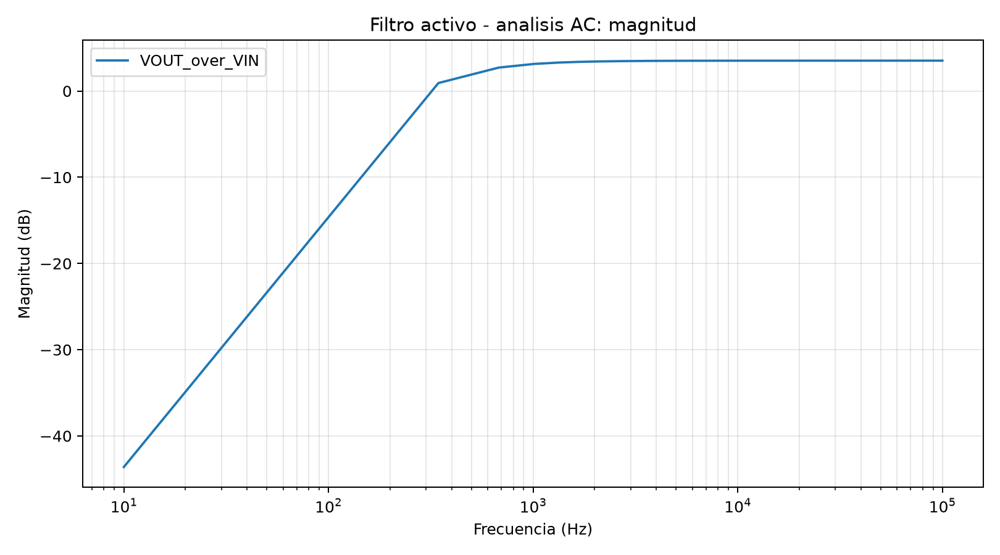
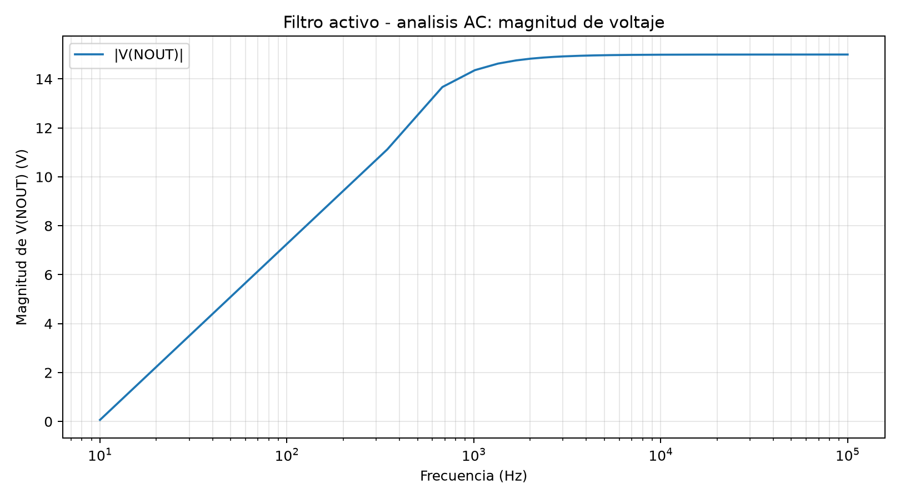
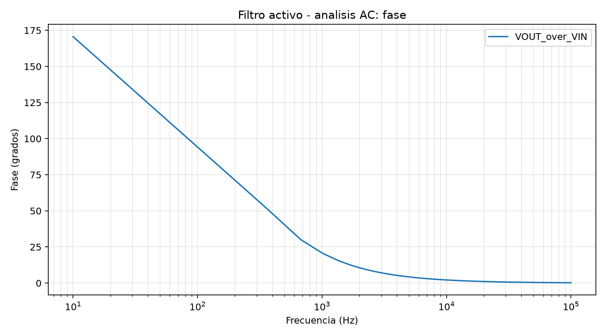

# Reporte de simulación de circuito

- **Fuente:** filtro_activo.cir
- **Método:** MNA
- **Ejecución:** <sin run_id>
- **Estado:** PASS

## Netlist original

```spice
* Filtro activo; valores modificados segun solicitud del usuario
V1 IN 0 AC 10 0
C1 IN N1 0.50u
C2 N1 NP 0.50u
RG1 N1 OUT 3k
RG2 NP 0 1.5k
RB OUT NM 1.5k
RA NM 0 3k
.OPAMP U1 NP NM OUT IDEAL
.AC LIN 300 10 100k
.END

```

## Componentes normalizados

| Componente | Tipo | Desde | Hacia | Valor SI | Unidad | Rama | L?nea |
| ---------- | ---- | ----- | ----- | -------: | ------ | ---- | ----: |
| V1         | V    | IN    | 0     |       10 | volt   | B1   |     2 |
| C1         | C    | IN    | N1    |    5e-07 | farad  | B2   |     3 |
| C2         | C    | N1    | NP    |    5e-07 | farad  | B3   |     4 |
| RG1        | R    | N1    | OUT   |     3000 | ohm    | B4   |     5 |
| RG2        | R    | NP    | 0     |     1500 | ohm    | B5   |     6 |
| RB         | R    | OUT   | NM    |     1500 | ohm    | B6   |     7 |
| RA         | R    | NM    | 0     |     3000 | ohm    | B7   |     8 |

## Amplificadores operacionales ideales

Modelo MNA ideal lineal: corrientes de entrada nulas, restriccion V(n+)=V(n-) y corriente auxiliar en la salida. No modela rieles ni saturacion.

| Op-amp | Entrada + | Entrada - | Salida | Linea |
| ------ | --------- | --------- | ------ | ----: |
| U1     | NP        | NM        | OUT    |     9 |

## Nodos

| Nodo | Referencia | Índice completo | Índice reducido |
| ---- | :--------: | --------------: | --------------: |
| 0    |     sí     |               0 |            None |
| IN   |     no     |               1 |               0 |
| N1   |     no     |               2 |               1 |
| NM   |     no     |               3 |               2 |
| NP   |     no     |               4 |               3 |
| OUT  |     no     |               5 |               4 |

## Topología

Conectado: **True**

| Desde | Hacia | Rama | Componente |
| ----- | ----- | ---- | ---------- |
| IN    | 0     | B1   | V1         |
| IN    | N1    | B2   | C1         |
| N1    | NP    | B3   | C2         |
| N1    | OUT   | B4   | RG1        |
| NM    | 0     | B7   | RA         |
| NP    | 0     | B5   | RG2        |
| OUT   | NM    | B6   | RB         |

## Matriz de incidencia reducida

|     | B1  | B2  | B3  | B4  | B5  | B6  | B7  |
| --- | --- | --- | --- | --- | --- | --- | --- |
| IN  | 1   | 1   | 0   | 0   | 0   | 0   | 0   |
| N1  | 0   | -1  | 1   | 1   | 0   | 0   | 0   |
| NM  | 0   | 0   | 0   | 0   | 0   | -1  | 1   |
| NP  | 0   | 0   | -1  | 0   | 1   | 0   | 0   |
| OUT | 0   | 0   | 0   | -1  | 0   | 1   | 0   |

## Ecuaciones constitutivas

| Rama | Componente | Ecuación      | Línea de origen |
| ---- | ---------- | ------------- | --------------: |
| B1   | V1         | V = E         |               2 |
| B2   | C1         | s*C*V - I = 0 |               3 |
| B3   | C2         | s*C*V - I = 0 |               4 |
| B4   | RG1        | V - R*I = 0   |               5 |
| B5   | RG2        | V - R*I = 0   |               6 |
| B6   | RB         | V - R*I = 0   |               7 |
| B7   | RA         | V - R*I = 0   |               8 |

### Matriz Y

|     | B1  | B2                 | B3                 | B4  | B5  | B6  | B7  |
| --- | --- | ------------------ | ------------------ | --- | --- | --- | --- |
| B1  | 1   | 0                  | 0                  | 0   | 0   | 0   | 0   |
| B2  | 0   | 0 + j3.1415927e-05 | 0                  | 0   | 0   | 0   | 0   |
| B3  | 0   | 0                  | 0 + j3.1415927e-05 | 0   | 0   | 0   | 0   |
| B4  | 0   | 0                  | 0                  | 1   | 0   | 0   | 0   |
| B5  | 0   | 0                  | 0                  | 0   | 1   | 0   | 0   |
| B6  | 0   | 0                  | 0                  | 0   | 0   | 1   | 0   |
| B7  | 0   | 0                  | 0                  | 0   | 0   | 0   | 1   |

### Matriz Z

|     | B1  | B2  | B3  | B4    | B5    | B6    | B7    |
| --- | --- | --- | --- | ----- | ----- | ----- | ----- |
| B1  | 0   | 0   | 0   | 0     | 0     | 0     | 0     |
| B2  | 0   | -1  | 0   | 0     | 0     | 0     | 0     |
| B3  | 0   | 0   | -1  | 0     | 0     | 0     | 0     |
| B4  | 0   | 0   | 0   | -3000 | 0     | 0     | 0     |
| B5  | 0   | 0   | 0   | 0     | -1500 | 0     | 0     |
| B6  | 0   | 0   | 0   | 0     | 0     | -1500 | 0     |
| B7  | 0   | 0   | 0   | 0     | 0     | 0     | -3000 |

### Vector W

| Label | Value |
| ----- | ----- |
| B1    | 10    |
| B2    | 0     |
| B3    | 0     |
| B4    | 0     |
| B5    | 0     |
| B6    | 0     |
| B7    | 0     |

## Sistema ensamblado

Formulación: `MNA`; dimensiones: `7 × 7`.

|                | V(NIN)             | V(NN1)                         | V(NNM)         | V(NNP)                         | V(NOUT)        | I(V1) | I(U1) |
| -------------- | ------------------ | ------------------------------ | -------------- | ------------------------------ | -------------- | ----- | ----- |
| KCL(NIN)       | 0 + j3.1415927e-05 | 0 - j3.1415927e-05             | 0              | 0                              | 0              | 1     | 0     |
| KCL(NN1)       | 0 - j3.1415927e-05 | 0.00033333333 + j6.2831853e-05 | 0              | 0 - j3.1415927e-05             | -0.00033333333 | 0     | 0     |
| KCL(NNM)       | 0                  | 0                              | 0.001          | 0                              | -0.00066666667 | 0     | 0     |
| KCL(NNP)       | 0                  | 0 - j3.1415927e-05             | 0              | 0.00066666667 + j3.1415927e-05 | 0              | 0     | 0     |
| KCL(NOUT)      | 0                  | -0.00033333333                 | -0.00066666667 | 0                              | 0.001          | 0     | 1     |
| VSOURCE(V1)    | 1                  | 0                              | 0              | 0                              | 0              | 0     | 0     |
| OPAMP_DIFF(U1) | 0                  | 0                              | -1             | 1                              | 0              | 0     | 0     |

### Vector del lado derecho

| Label          | Value |
| -------------- | ----- |
| KCL(NIN)       | -0    |
| KCL(NN1)       | -0    |
| KCL(NNM)       | -0    |
| KCL(NNP)       | -0    |
| KCL(NOUT)      | -0    |
| VSOURCE(V1)    | 10    |
| OPAMP_DIFF(U1) | 0     |

## Resultados AC

Barrido `LIN`; estado global: **PASS**.

| Frecuencia (Hz) | Estado | Transferencias calculadas                                                  |
| --------------: | ------ | -------------------------------------------------------------------------- |
|              10 | PASS   | VOUT_over_VIN: magnitud=0.0066017197, fase=170.59328 grados, dB=-43.606858 |
|       344.41472 | PASS   | VOUT_over_VIN: magnitud=1.1121782, fase=53.078848 grados, dB=0.92348762    |
|       678.82943 | PASS   | VOUT_over_VIN: magnitud=1.3670634, fase=29.906007 grados, dB=2.7157733     |
|       1013.2441 | PASS   | VOUT_over_VIN: magnitud=1.436116, fase=20.542259 grados, dB=3.1437903      |
|       1347.6589 | PASS   | VOUT_over_VIN: magnitud=1.4629499, fase=15.590143 grados, dB=3.304589      |
|       1682.0736 | PASS   | VOUT_over_VIN: magnitud=1.4759251, fase=12.546541 grados, dB=3.3812861     |
|       2016.4883 | PASS   | VOUT_over_VIN: magnitud=1.4831348, fase=10.49163 grados, dB=3.4236126      |
|        2350.903 | PASS   | VOUT_over_VIN: magnitud=1.4875407, fase=9.0127 grados, dB=3.4493769        |
|       2685.3177 | PASS   | VOUT_over_VIN: magnitud=1.4904251, fase=7.8980343 grados, dB=3.4662029     |
|       3019.7324 | PASS   | VOUT_over_VIN: magnitud=1.4924144, fase=7.0281155 grados, dB=3.4777884     |
|       3354.1472 | PASS   | VOUT_over_VIN: magnitud=1.4938434, fase=6.3304593 grados, dB=3.4861016     |
|       3688.5619 | PASS   | VOUT_over_VIN: magnitud=1.4949042, fase=5.7585877 grados, dB=3.492267      |
|       4022.9766 | PASS   | VOUT_over_VIN: magnitud=1.4957129, fase=5.281341 grados, dB=3.496965       |
|       4357.3913 | PASS   | VOUT_over_VIN: magnitud=1.4963436, fase=4.8770548 grados, dB=3.5006266     |
|        4691.806 | PASS   | VOUT_over_VIN: magnitud=1.4968448, fase=4.5302024 grados, dB=3.5035354     |
|       5026.2207 | PASS   | VOUT_over_VIN: magnitud=1.4972497, fase=4.2293675 grados, dB=3.5058844     |
|       5360.6355 | PASS   | VOUT_over_VIN: magnitud=1.4975814, fase=3.9659689 grados, dB=3.5078085     |
|       5695.0502 | PASS   | VOUT_over_VIN: magnitud=1.4978565, fase=3.7334327 grados, dB=3.5094043     |
|       6029.4649 | PASS   | VOUT_over_VIN: magnitud=1.4980873, fase=3.5266381 grados, dB=3.5107424     |
|       6363.8796 | PASS   | VOUT_over_VIN: magnitud=1.4982827, fase=3.3415374 grados, dB=3.5118754     |
|       6698.2943 | PASS   | VOUT_over_VIN: magnitud=1.4984497, fase=3.1748887 grados, dB=3.5128432     |
|        7032.709 | PASS   | VOUT_over_VIN: magnitud=1.4985934, fase=3.024065 grados, dB=3.5136764      |
|       7367.1237 | PASS   | VOUT_over_VIN: magnitud=1.4987181, fase=2.8869153 grados, dB=3.5143989     |
|       7701.5385 | PASS   | VOUT_over_VIN: magnitud=1.4988269, fase=2.7616615 grados, dB=3.5150294     |
|       8035.9532 | PASS   | VOUT_over_VIN: magnitud=1.4989224, fase=2.6468207 grados, dB=3.5155829     |
|       8370.3679 | PASS   | VOUT_over_VIN: magnitud=1.4990067, fase=2.5411465 grados, dB=3.5160714     |
|       8704.7826 | PASS   | VOUT_over_VIN: magnitud=1.4990815, fase=2.4435839 grados, dB=3.5165048     |
|       9039.1973 | PASS   | VOUT_over_VIN: magnitud=1.4991481, fase=2.3532338 grados, dB=3.516891      |
|        9373.612 | PASS   | VOUT_over_VIN: magnitud=1.4992078, fase=2.269325 grados, dB=3.5172366      |
|       9708.0268 | PASS   | VOUT_over_VIN: magnitud=1.4992614, fase=2.1911926 grados, dB=3.5175471     |
|       10042.441 | PASS   | VOUT_over_VIN: magnitud=1.4993097, fase=2.1182601 grados, dB=3.5178272     |
|       10376.856 | PASS   | VOUT_over_VIN: magnitud=1.4993535, fase=2.0500252 grados, dB=3.5180806     |
|       10711.271 | PASS   | VOUT_over_VIN: magnitud=1.4993932, fase=1.9860483 grados, dB=3.5183107     |
|       11045.686 | PASS   | VOUT_over_VIN: magnitud=1.4994294, fase=1.9259429 grados, dB=3.5185202     |
|         11380.1 | PASS   | VOUT_over_VIN: magnitud=1.4994624, fase=1.8693681 grados, dB=3.5187116     |
|       11714.515 | PASS   | VOUT_over_VIN: magnitud=1.4994926, fase=1.8160217 grados, dB=3.5188867     |
|        12048.93 | PASS   | VOUT_over_VIN: magnitud=1.4995204, fase=1.765635 grados, dB=3.5190475      |
|       12383.344 | PASS   | VOUT_over_VIN: magnitud=1.4995459, fase=1.7179685 grados, dB=3.5191955     |
|       12717.759 | PASS   | VOUT_over_VIN: magnitud=1.4995695, fase=1.6728076 grados, dB=3.5193319     |
|       13052.174 | PASS   | VOUT_over_VIN: magnitud=1.4995913, fase=1.6299599 grados, dB=3.519458      |
|       13386.589 | PASS   | VOUT_over_VIN: magnitud=1.4996114, fase=1.5892521 grados, dB=3.5195748     |
|       13721.003 | PASS   | VOUT_over_VIN: magnitud=1.4996301, fase=1.5505279 grados, dB=3.5196831     |
|       14055.418 | PASS   | VOUT_over_VIN: magnitud=1.4996475, fase=1.5136457 grados, dB=3.5197838     |
|       14389.833 | PASS   | VOUT_over_VIN: magnitud=1.4996637, fase=1.4784772 grados, dB=3.5198776     |
|       14724.247 | PASS   | VOUT_over_VIN: magnitud=1.4996788, fase=1.4449056 grados, dB=3.519965      |
|       15058.662 | PASS   | VOUT_over_VIN: magnitud=1.4996929, fase=1.4128246 grados, dB=3.5200467     |
|       15393.077 | PASS   | VOUT_over_VIN: magnitud=1.4997061, fase=1.3821371 grados, dB=3.5201231     |
|       15727.492 | PASS   | VOUT_over_VIN: magnitud=1.4997185, fase=1.3527543 grados, dB=3.5201947     |
|       16061.906 | PASS   | VOUT_over_VIN: magnitud=1.4997301, fase=1.3245946 grados, dB=3.5202619     |
|       16396.321 | PASS   | VOUT_over_VIN: magnitud=1.499741, fase=1.2975833 grados, dB=3.520325       |
|       16730.736 | PASS   | VOUT_over_VIN: magnitud=1.4997512, fase=1.2716515 grados, dB=3.5203844     |
|       17065.151 | PASS   | VOUT_over_VIN: magnitud=1.4997609, fase=1.2467359 grados, dB=3.5204403     |
|       17399.565 | PASS   | VOUT_over_VIN: magnitud=1.49977, fase=1.2227777 grados, dB=3.520493        |
|        17733.98 | PASS   | VOUT_over_VIN: magnitud=1.4997786, fase=1.1997229 grados, dB=3.5205428     |
|       18068.395 | PASS   | VOUT_over_VIN: magnitud=1.4997867, fase=1.1775213 grados, dB=3.5205898     |
|       18402.809 | PASS   | VOUT_over_VIN: magnitud=1.4997944, fase=1.1561265 grados, dB=3.5206343     |
|       18737.224 | PASS   | VOUT_over_VIN: magnitud=1.4998016, fase=1.1354952 grados, dB=3.5206764     |
|       19071.639 | PASS   | VOUT_over_VIN: magnitud=1.4998085, fase=1.1155872 grados, dB=3.5207163     |
|       19406.054 | PASS   | VOUT_over_VIN: magnitud=1.4998151, fase=1.0963653 grados, dB=3.5207542     |
|       19740.468 | PASS   | VOUT_over_VIN: magnitud=1.4998213, fase=1.0777945 grados, dB=3.5207902     |
|       20074.883 | PASS   | VOUT_over_VIN: magnitud=1.4998272, fase=1.0598423 grados, dB=3.5208244     |
|       20409.298 | PASS   | VOUT_over_VIN: magnitud=1.4998328, fase=1.0424783 grados, dB=3.5208569     |
|       20743.712 | PASS   | VOUT_over_VIN: magnitud=1.4998381, fase=1.0256741 grados, dB=3.5208879     |
|       21078.127 | PASS   | VOUT_over_VIN: magnitud=1.4998432, fase=1.009403 grados, dB=3.5209174      |
|       21412.542 | PASS   | VOUT_over_VIN: magnitud=1.4998481, fase=0.9936401 grados, dB=3.5209455     |
|       21746.957 | PASS   | VOUT_over_VIN: magnitud=1.4998527, fase=0.97836189 grados, dB=3.5209724    |
|       22081.371 | PASS   | VOUT_over_VIN: magnitud=1.4998572, fase=0.96354637 grados, dB=3.520998     |
|       22415.786 | PASS   | VOUT_over_VIN: magnitud=1.4998614, fase=0.94917285 grados, dB=3.5210225    |
|       22750.201 | PASS   | VOUT_over_VIN: magnitud=1.4998654, fase=0.93522184 grados, dB=3.5210459    |
|       23084.615 | PASS   | VOUT_over_VIN: magnitud=1.4998693, fase=0.92167497 grados, dB=3.5210683    |
|        23419.03 | PASS   | VOUT_over_VIN: magnitud=1.499873, fase=0.90851494 grados, dB=3.5210898     |
|       23753.445 | PASS   | VOUT_over_VIN: magnitud=1.4998766, fase=0.89572541 grados, dB=3.5211103    |
|        24087.86 | PASS   | VOUT_over_VIN: magnitud=1.49988, fase=0.88329096 grados, dB=3.52113        |
|       24422.274 | PASS   | VOUT_over_VIN: magnitud=1.4998832, fase=0.871197 grados, dB=3.521149       |
|       24756.689 | PASS   | VOUT_over_VIN: magnitud=1.4998864, fase=0.85942973 grados, dB=3.5211671    |
|       25091.104 | PASS   | VOUT_over_VIN: magnitud=1.4998894, fase=0.84797609 grados, dB=3.5211845    |
|       25425.518 | PASS   | VOUT_over_VIN: magnitud=1.4998923, fase=0.83682371 grados, dB=3.5212013    |
|       25759.933 | PASS   | VOUT_over_VIN: magnitud=1.499895, fase=0.82596086 grados, dB=3.5212174     |
|       26094.348 | PASS   | VOUT_over_VIN: magnitud=1.4998977, fase=0.81537641 grados, dB=3.5212328    |
|       26428.763 | PASS   | VOUT_over_VIN: magnitud=1.4999003, fase=0.80505979 grados, dB=3.5212477    |
|       26763.177 | PASS   | VOUT_over_VIN: magnitud=1.4999028, fase=0.79500097 grados, dB=3.5212621    |
|       27097.592 | PASS   | VOUT_over_VIN: magnitud=1.4999051, fase=0.7851904 grados, dB=3.5212759     |
|       27432.007 | PASS   | VOUT_over_VIN: magnitud=1.4999074, fase=0.77561899 grados, dB=3.5212892    |
|       27766.421 | PASS   | VOUT_over_VIN: magnitud=1.4999097, fase=0.76627812 grados, dB=3.521302     |
|       28100.836 | PASS   | VOUT_over_VIN: magnitud=1.4999118, fase=0.75715956 grados, dB=3.5213144    |
|       28435.251 | PASS   | VOUT_over_VIN: magnitud=1.4999139, fase=0.74825545 grados, dB=3.5213263    |
|       28769.666 | PASS   | VOUT_over_VIN: magnitud=1.4999158, fase=0.73955833 grados, dB=3.5213379    |
|        29104.08 | PASS   | VOUT_over_VIN: magnitud=1.4999178, fase=0.73106105 grados, dB=3.521349     |
|       29438.495 | PASS   | VOUT_over_VIN: magnitud=1.4999196, fase=0.72275681 grados, dB=3.5213598    |
|        29772.91 | PASS   | VOUT_over_VIN: magnitud=1.4999214, fase=0.71463911 grados, dB=3.5213702    |
|       30107.324 | PASS   | VOUT_over_VIN: magnitud=1.4999232, fase=0.70670172 grados, dB=3.5213802    |
|       30441.739 | PASS   | VOUT_over_VIN: magnitud=1.4999248, fase=0.69893872 grados, dB=3.5213899    |
|       30776.154 | PASS   | VOUT_over_VIN: magnitud=1.4999265, fase=0.6913444 grados, dB=3.5213993     |
|       31110.569 | PASS   | VOUT_over_VIN: magnitud=1.499928, fase=0.68391334 grados, dB=3.5214084     |
|       31444.983 | PASS   | VOUT_over_VIN: magnitud=1.4999296, fase=0.67664033 grados, dB=3.5214173    |
|       31779.398 | PASS   | VOUT_over_VIN: magnitud=1.499931, fase=0.66952037 grados, dB=3.5214258     |
|       32113.813 | PASS   | VOUT_over_VIN: magnitud=1.4999325, fase=0.66254869 grados, dB=3.5214341    |
|       32448.227 | PASS   | VOUT_over_VIN: magnitud=1.4999338, fase=0.65572071 grados, dB=3.5214421    |
|       32782.642 | PASS   | VOUT_over_VIN: magnitud=1.4999352, fase=0.64903201 grados, dB=3.5214499    |
|       33117.057 | PASS   | VOUT_over_VIN: magnitud=1.4999365, fase=0.6424784 grados, dB=3.5214574     |
|       33451.472 | PASS   | VOUT_over_VIN: magnitud=1.4999378, fase=0.6360558 grados, dB=3.5214647     |
|       33785.886 | PASS   | VOUT_over_VIN: magnitud=1.499939, fase=0.62976034 grados, dB=3.5214718     |
|       34120.301 | PASS   | VOUT_over_VIN: magnitud=1.4999402, fase=0.62358828 grados, dB=3.5214787    |
|       34454.716 | PASS   | VOUT_over_VIN: magnitud=1.4999413, fase=0.61753603 grados, dB=3.5214854    |
|        34789.13 | PASS   | VOUT_over_VIN: magnitud=1.4999424, fase=0.61160012 grados, dB=3.5214919    |
|       35123.545 | PASS   | VOUT_over_VIN: magnitud=1.4999435, fase=0.60577723 grados, dB=3.5214982    |
|        35457.96 | PASS   | VOUT_over_VIN: magnitud=1.4999446, fase=0.60006418 grados, dB=3.5215044    |
|       35792.375 | PASS   | VOUT_over_VIN: magnitud=1.4999456, fase=0.59445788 grados, dB=3.5215103    |
|       36126.789 | PASS   | VOUT_over_VIN: magnitud=1.4999466, fase=0.58895536 grados, dB=3.5215161    |
|       36461.204 | PASS   | VOUT_over_VIN: magnitud=1.4999476, fase=0.58355377 grados, dB=3.5215218    |
|       36795.619 | PASS   | VOUT_over_VIN: magnitud=1.4999486, fase=0.57825037 grados, dB=3.5215273    |
|       37130.033 | PASS   | VOUT_over_VIN: magnitud=1.4999495, fase=0.57304248 grados, dB=3.5215326    |
|       37464.448 | PASS   | VOUT_over_VIN: magnitud=1.4999504, fase=0.56792757 grados, dB=3.5215378    |
|       37798.863 | PASS   | VOUT_over_VIN: magnitud=1.4999512, fase=0.56290316 grados, dB=3.5215429    |
|       38133.278 | PASS   | VOUT_over_VIN: magnitud=1.4999521, fase=0.55796687 grados, dB=3.5215478    |
|       38467.692 | PASS   | VOUT_over_VIN: magnitud=1.4999529, fase=0.5531164 grados, dB=3.5215526     |
|       38802.107 | PASS   | VOUT_over_VIN: magnitud=1.4999537, fase=0.54834953 grados, dB=3.5215573    |
|       39136.522 | PASS   | VOUT_over_VIN: magnitud=1.4999545, fase=0.54366412 grados, dB=3.5215618    |
|       39470.936 | PASS   | VOUT_over_VIN: magnitud=1.4999553, fase=0.53905811 grados, dB=3.5215663    |
|       39805.351 | PASS   | VOUT_over_VIN: magnitud=1.499956, fase=0.53452948 grados, dB=3.5215706     |
|       40139.766 | PASS   | VOUT_over_VIN: magnitud=1.4999568, fase=0.53007631 grados, dB=3.5215748    |
|       40474.181 | PASS   | VOUT_over_VIN: magnitud=1.4999575, fase=0.52569672 grados, dB=3.521579     |
|       40808.595 | PASS   | VOUT_over_VIN: magnitud=1.4999582, fase=0.52138891 grados, dB=3.521583     |
|        41143.01 | PASS   | VOUT_over_VIN: magnitud=1.4999589, fase=0.51715112 grados, dB=3.5215869    |
|       41477.425 | PASS   | VOUT_over_VIN: magnitud=1.4999595, fase=0.51298167 grados, dB=3.5215907    |
|       41811.839 | PASS   | VOUT_over_VIN: magnitud=1.4999602, fase=0.50887891 grados, dB=3.5215945    |
|       42146.254 | PASS   | VOUT_over_VIN: magnitud=1.4999608, fase=0.50484125 grados, dB=3.5215981    |
|       42480.669 | PASS   | VOUT_over_VIN: magnitud=1.4999614, fase=0.50086716 grados, dB=3.5216017    |
|       42815.084 | PASS   | VOUT_over_VIN: magnitud=1.499962, fase=0.49695515 grados, dB=3.5216051     |
|       43149.498 | PASS   | VOUT_over_VIN: magnitud=1.4999626, fase=0.49310378 grados, dB=3.5216085    |
|       43483.913 | PASS   | VOUT_over_VIN: magnitud=1.4999632, fase=0.48931164 grados, dB=3.5216119    |
|       43818.328 | PASS   | VOUT_over_VIN: magnitud=1.4999637, fase=0.48557738 grados, dB=3.5216151    |
|       44152.742 | PASS   | VOUT_over_VIN: magnitud=1.4999643, fase=0.48189968 grados, dB=3.5216183    |
|       44487.157 | PASS   | VOUT_over_VIN: magnitud=1.4999648, fase=0.47827728 grados, dB=3.5216214    |
|       44821.572 | PASS   | VOUT_over_VIN: magnitud=1.4999653, fase=0.47470892 grados, dB=3.5216244    |
|       45155.987 | PASS   | VOUT_over_VIN: magnitud=1.4999658, fase=0.47119342 grados, dB=3.5216274    |
|       45490.401 | PASS   | VOUT_over_VIN: magnitud=1.4999663, fase=0.4677296 grados, dB=3.5216303     |
|       45824.816 | PASS   | VOUT_over_VIN: magnitud=1.4999668, fase=0.46431634 grados, dB=3.5216331    |
|       46159.231 | PASS   | VOUT_over_VIN: magnitud=1.4999673, fase=0.46095253 grados, dB=3.5216359    |
|       46493.645 | PASS   | VOUT_over_VIN: magnitud=1.4999678, fase=0.45763711 grados, dB=3.5216386    |
|        46828.06 | PASS   | VOUT_over_VIN: magnitud=1.4999682, fase=0.45436905 grados, dB=3.5216412    |
|       47162.475 | PASS   | VOUT_over_VIN: magnitud=1.4999687, fase=0.45114732 grados, dB=3.5216438    |
|        47496.89 | PASS   | VOUT_over_VIN: magnitud=1.4999691, fase=0.44797096 grados, dB=3.5216464    |
|       47831.304 | PASS   | VOUT_over_VIN: magnitud=1.4999696, fase=0.44483902 grados, dB=3.5216489    |
|       48165.719 | PASS   | VOUT_over_VIN: magnitud=1.49997, fase=0.44175056 grados, dB=3.5216513      |
|       48500.134 | PASS   | VOUT_over_VIN: magnitud=1.4999704, fase=0.4387047 grados, dB=3.5216537     |
|       48834.548 | PASS   | VOUT_over_VIN: magnitud=1.4999708, fase=0.43570054 grados, dB=3.521656     |
|       49168.963 | PASS   | VOUT_over_VIN: magnitud=1.4999712, fase=0.43273725 grados, dB=3.5216583    |
|       49503.378 | PASS   | VOUT_over_VIN: magnitud=1.4999716, fase=0.429814 grados, dB=3.5216606      |
|       49837.793 | PASS   | VOUT_over_VIN: magnitud=1.499972, fase=0.42692998 grados, dB=3.5216628     |
|       50172.207 | PASS   | VOUT_over_VIN: magnitud=1.4999723, fase=0.4240844 grados, dB=3.5216649     |
|       50506.622 | PASS   | VOUT_over_VIN: magnitud=1.4999727, fase=0.4212765 grados, dB=3.5216671     |
|       50841.037 | PASS   | VOUT_over_VIN: magnitud=1.4999731, fase=0.41850554 grados, dB=3.5216691    |
|       51175.452 | PASS   | VOUT_over_VIN: magnitud=1.4999734, fase=0.41577079 grados, dB=3.5216712    |
|       51509.866 | PASS   | VOUT_over_VIN: magnitud=1.4999737, fase=0.41307155 grados, dB=3.5216732    |
|       51844.281 | PASS   | VOUT_over_VIN: magnitud=1.4999741, fase=0.41040714 grados, dB=3.5216751    |
|       52178.696 | PASS   | VOUT_over_VIN: magnitud=1.4999744, fase=0.40777687 grados, dB=3.521677     |
|        52513.11 | PASS   | VOUT_over_VIN: magnitud=1.4999747, fase=0.40518011 grados, dB=3.5216789    |
|       52847.525 | PASS   | VOUT_over_VIN: magnitud=1.4999751, fase=0.4026162 grados, dB=3.5216808     |
|        53181.94 | PASS   | VOUT_over_VIN: magnitud=1.4999754, fase=0.40008454 grados, dB=3.5216826    |
|       53516.355 | PASS   | VOUT_over_VIN: magnitud=1.4999757, fase=0.39758452 grados, dB=3.5216843    |
|       53850.769 | PASS   | VOUT_over_VIN: magnitud=1.499976, fase=0.39511555 grados, dB=3.5216861     |
|       54185.184 | PASS   | VOUT_over_VIN: magnitud=1.4999763, fase=0.39267706 grados, dB=3.5216878    |
|       54519.599 | PASS   | VOUT_over_VIN: magnitud=1.4999766, fase=0.39026848 grados, dB=3.5216895    |
|       54854.013 | PASS   | VOUT_over_VIN: magnitud=1.4999769, fase=0.38788926 grados, dB=3.5216911    |
|       55188.428 | PASS   | VOUT_over_VIN: magnitud=1.4999771, fase=0.38553888 grados, dB=3.5216927    |
|       55522.843 | PASS   | VOUT_over_VIN: magnitud=1.4999774, fase=0.38321681 grados, dB=3.5216943    |
|       55857.258 | PASS   | VOUT_over_VIN: magnitud=1.4999777, fase=0.38092254 grados, dB=3.5216959    |
|       56191.672 | PASS   | VOUT_over_VIN: magnitud=1.4999779, fase=0.37865558 grados, dB=3.5216974    |
|       56526.087 | PASS   | VOUT_over_VIN: magnitud=1.4999782, fase=0.37641545 grados, dB=3.5216989    |
|       56860.502 | PASS   | VOUT_over_VIN: magnitud=1.4999785, fase=0.37420166 grados, dB=3.5217004    |
|       57194.916 | PASS   | VOUT_over_VIN: magnitud=1.4999787, fase=0.37201376 grados, dB=3.5217019    |
|       57529.331 | PASS   | VOUT_over_VIN: magnitud=1.499979, fase=0.3698513 grados, dB=3.5217033      |
|       57863.746 | PASS   | VOUT_over_VIN: magnitud=1.4999792, fase=0.36771383 grados, dB=3.5217047    |
|       58198.161 | PASS   | VOUT_over_VIN: magnitud=1.4999794, fase=0.36560092 grados, dB=3.5217061    |
|       58532.575 | PASS   | VOUT_over_VIN: magnitud=1.4999797, fase=0.36351216 grados, dB=3.5217074    |
|        58866.99 | PASS   | VOUT_over_VIN: magnitud=1.4999799, fase=0.36144713 grados, dB=3.5217088    |
|       59201.405 | PASS   | VOUT_over_VIN: magnitud=1.4999801, fase=0.35940543 grados, dB=3.5217101    |
|       59535.819 | PASS   | VOUT_over_VIN: magnitud=1.4999803, fase=0.35738666 grados, dB=3.5217114    |
|       59870.234 | PASS   | VOUT_over_VIN: magnitud=1.4999806, fase=0.35539045 grados, dB=3.5217127    |
|       60204.649 | PASS   | VOUT_over_VIN: magnitud=1.4999808, fase=0.35341641 grados, dB=3.5217139    |
|       60539.064 | PASS   | VOUT_over_VIN: magnitud=1.499981, fase=0.35146418 grados, dB=3.5217151     |
|       60873.478 | PASS   | VOUT_over_VIN: magnitud=1.4999812, fase=0.3495334 grados, dB=3.5217163     |
|       61207.893 | PASS   | VOUT_over_VIN: magnitud=1.4999814, fase=0.34762372 grados, dB=3.5217175    |
|       61542.308 | PASS   | VOUT_over_VIN: magnitud=1.4999816, fase=0.34573479 grados, dB=3.5217187    |
|       61876.722 | PASS   | VOUT_over_VIN: magnitud=1.4999818, fase=0.34386628 grados, dB=3.5217198    |
|       62211.137 | PASS   | VOUT_over_VIN: magnitud=1.499982, fase=0.34201785 grados, dB=3.521721      |
|       62545.552 | PASS   | VOUT_over_VIN: magnitud=1.4999822, fase=0.3401892 grados, dB=3.5217221     |
|       62879.967 | PASS   | VOUT_over_VIN: magnitud=1.4999824, fase=0.33837999 grados, dB=3.5217232    |
|       63214.381 | PASS   | VOUT_over_VIN: magnitud=1.4999826, fase=0.33658992 grados, dB=3.5217242    |
|       63548.796 | PASS   | VOUT_over_VIN: magnitud=1.4999828, fase=0.3348187 grados, dB=3.5217253     |
|       63883.211 | PASS   | VOUT_over_VIN: magnitud=1.4999829, fase=0.33306601 grados, dB=3.5217263    |
|       64217.625 | PASS   | VOUT_over_VIN: magnitud=1.4999831, fase=0.33133158 grados, dB=3.5217274    |
|        64552.04 | PASS   | VOUT_over_VIN: magnitud=1.4999833, fase=0.32961513 grados, dB=3.5217284    |
|       64886.455 | PASS   | VOUT_over_VIN: magnitud=1.4999835, fase=0.32791636 grados, dB=3.5217294    |
|        65220.87 | PASS   | VOUT_over_VIN: magnitud=1.4999836, fase=0.32623501 grados, dB=3.5217304    |
|       65555.284 | PASS   | VOUT_over_VIN: magnitud=1.4999838, fase=0.32457082 grados, dB=3.5217313    |
|       65889.699 | PASS   | VOUT_over_VIN: magnitud=1.499984, fase=0.32292352 grados, dB=3.5217323     |
|       66224.114 | PASS   | VOUT_over_VIN: magnitud=1.4999841, fase=0.32129286 grados, dB=3.5217332    |
|       66558.528 | PASS   | VOUT_over_VIN: magnitud=1.4999843, fase=0.31967858 grados, dB=3.5217341    |
|       66892.943 | PASS   | VOUT_over_VIN: magnitud=1.4999844, fase=0.31808044 grados, dB=3.521735     |
|       67227.358 | PASS   | VOUT_over_VIN: magnitud=1.4999846, fase=0.31649821 grados, dB=3.5217359    |
|       67561.773 | PASS   | VOUT_over_VIN: magnitud=1.4999847, fase=0.31493163 grados, dB=3.5217368    |
|       67896.187 | PASS   | VOUT_over_VIN: magnitud=1.4999849, fase=0.31338049 grados, dB=3.5217377    |
|       68230.602 | PASS   | VOUT_over_VIN: magnitud=1.499985, fase=0.31184455 grados, dB=3.5217385     |
|       68565.017 | PASS   | VOUT_over_VIN: magnitud=1.4999852, fase=0.31032359 grados, dB=3.5217394    |
|       68899.431 | PASS   | VOUT_over_VIN: magnitud=1.4999853, fase=0.3088174 grados, dB=3.5217402     |
|       69233.846 | PASS   | VOUT_over_VIN: magnitud=1.4999855, fase=0.30732576 grados, dB=3.521741     |
|       69568.261 | PASS   | VOUT_over_VIN: magnitud=1.4999856, fase=0.30584846 grados, dB=3.5217418    |
|       69902.676 | PASS   | VOUT_over_VIN: magnitud=1.4999857, fase=0.30438529 grados, dB=3.5217426    |
|        70237.09 | PASS   | VOUT_over_VIN: magnitud=1.4999859, fase=0.30293606 grados, dB=3.5217434    |
|       70571.505 | PASS   | VOUT_over_VIN: magnitud=1.499986, fase=0.30150056 grados, dB=3.5217442     |
|        70905.92 | PASS   | VOUT_over_VIN: magnitud=1.4999861, fase=0.3000786 grados, dB=3.521745      |
|       71240.334 | PASS   | VOUT_over_VIN: magnitud=1.4999863, fase=0.29866999 grados, dB=3.5217457    |
|       71574.749 | PASS   | VOUT_over_VIN: magnitud=1.4999864, fase=0.29727455 grados, dB=3.5217464    |
|       71909.164 | PASS   | VOUT_over_VIN: magnitud=1.4999865, fase=0.29589208 grados, dB=3.5217472    |
|       72243.579 | PASS   | VOUT_over_VIN: magnitud=1.4999867, fase=0.29452241 grados, dB=3.5217479    |
|       72577.993 | PASS   | VOUT_over_VIN: magnitud=1.4999868, fase=0.29316536 grados, dB=3.5217486    |
|       72912.408 | PASS   | VOUT_over_VIN: magnitud=1.4999869, fase=0.29182077 grados, dB=3.5217493    |
|       73246.823 | PASS   | VOUT_over_VIN: magnitud=1.499987, fase=0.29048844 grados, dB=3.52175       |
|       73581.237 | PASS   | VOUT_over_VIN: magnitud=1.4999871, fase=0.28916823 grados, dB=3.5217507    |
|       73915.652 | PASS   | VOUT_over_VIN: magnitud=1.4999873, fase=0.28785997 grados, dB=3.5217514    |
|       74250.067 | PASS   | VOUT_over_VIN: magnitud=1.4999874, fase=0.28656349 grados, dB=3.521752     |
|       74584.482 | PASS   | VOUT_over_VIN: magnitud=1.4999875, fase=0.28527863 grados, dB=3.5217527    |
|       74918.896 | PASS   | VOUT_over_VIN: magnitud=1.4999876, fase=0.28400525 grados, dB=3.5217533    |
|       75253.311 | PASS   | VOUT_over_VIN: magnitud=1.4999877, fase=0.28274318 grados, dB=3.521754     |
|       75587.726 | PASS   | VOUT_over_VIN: magnitud=1.4999878, fase=0.28149228 grados, dB=3.5217546    |
|        75922.14 | PASS   | VOUT_over_VIN: magnitud=1.4999879, fase=0.2802524 grados, dB=3.5217552     |
|       76256.555 | PASS   | VOUT_over_VIN: magnitud=1.499988, fase=0.27902339 grados, dB=3.5217558     |
|        76590.97 | PASS   | VOUT_over_VIN: magnitud=1.4999881, fase=0.27780512 grados, dB=3.5217564    |
|       76925.385 | PASS   | VOUT_over_VIN: magnitud=1.4999882, fase=0.27659744 grados, dB=3.521757     |
|       77259.799 | PASS   | VOUT_over_VIN: magnitud=1.4999883, fase=0.27540021 grados, dB=3.5217576    |
|       77594.214 | PASS   | VOUT_over_VIN: magnitud=1.4999884, fase=0.2742133 grados, dB=3.5217582     |
|       77928.629 | PASS   | VOUT_over_VIN: magnitud=1.4999885, fase=0.27303658 grados, dB=3.5217588    |
|       78263.043 | PASS   | VOUT_over_VIN: magnitud=1.4999886, fase=0.27186992 grados, dB=3.5217593    |
|       78597.458 | PASS   | VOUT_over_VIN: magnitud=1.4999887, fase=0.27071318 grados, dB=3.5217599    |
|       78931.873 | PASS   | VOUT_over_VIN: magnitud=1.4999888, fase=0.26956624 grados, dB=3.5217604    |
|       79266.288 | PASS   | VOUT_over_VIN: magnitud=1.4999889, fase=0.26842899 grados, dB=3.521761     |
|       79600.702 | PASS   | VOUT_over_VIN: magnitud=1.499989, fase=0.26730128 grados, dB=3.5217615     |
|       79935.117 | PASS   | VOUT_over_VIN: magnitud=1.4999891, fase=0.26618302 grados, dB=3.5217621    |
|       80269.532 | PASS   | VOUT_over_VIN: magnitud=1.4999892, fase=0.26507407 grados, dB=3.5217626    |
|       80603.946 | PASS   | VOUT_over_VIN: magnitud=1.4999893, fase=0.26397432 grados, dB=3.5217631    |
|       80938.361 | PASS   | VOUT_over_VIN: magnitud=1.4999894, fase=0.26288366 grados, dB=3.5217636    |
|       81272.776 | PASS   | VOUT_over_VIN: magnitud=1.4999895, fase=0.26180197 grados, dB=3.5217641    |
|       81607.191 | PASS   | VOUT_over_VIN: magnitud=1.4999895, fase=0.26072915 grados, dB=3.5217646    |
|       81941.605 | PASS   | VOUT_over_VIN: magnitud=1.4999896, fase=0.25966509 grados, dB=3.5217651    |
|        82276.02 | PASS   | VOUT_over_VIN: magnitud=1.4999897, fase=0.25860968 grados, dB=3.5217656    |
|       82610.435 | PASS   | VOUT_over_VIN: magnitud=1.4999898, fase=0.25756281 grados, dB=3.5217661    |
|       82944.849 | PASS   | VOUT_over_VIN: magnitud=1.4999899, fase=0.25652438 grados, dB=3.5217666    |
|       83279.264 | PASS   | VOUT_over_VIN: magnitud=1.49999, fase=0.25549429 grados, dB=3.521767       |
|       83613.679 | PASS   | VOUT_over_VIN: magnitud=1.49999, fase=0.25447244 grados, dB=3.5217675      |
|       83948.094 | PASS   | VOUT_over_VIN: magnitud=1.4999901, fase=0.25345874 grados, dB=3.5217679    |
|       84282.508 | PASS   | VOUT_over_VIN: magnitud=1.4999902, fase=0.25245307 grados, dB=3.5217684    |
|       84616.923 | PASS   | VOUT_over_VIN: magnitud=1.4999903, fase=0.25145536 grados, dB=3.5217688    |
|       84951.338 | PASS   | VOUT_over_VIN: magnitud=1.4999903, fase=0.2504655 grados, dB=3.5217693     |
|       85285.753 | PASS   | VOUT_over_VIN: magnitud=1.4999904, fase=0.24948341 grados, dB=3.5217697    |
|       85620.167 | PASS   | VOUT_over_VIN: magnitud=1.4999905, fase=0.24850898 grados, dB=3.5217702    |
|       85954.582 | PASS   | VOUT_over_VIN: magnitud=1.4999906, fase=0.24754214 grados, dB=3.5217706    |
|       86288.997 | PASS   | VOUT_over_VIN: magnitud=1.4999906, fase=0.24658279 grados, dB=3.521771     |
|       86623.411 | PASS   | VOUT_over_VIN: magnitud=1.4999907, fase=0.24563085 grados, dB=3.5217714    |
|       86957.826 | PASS   | VOUT_over_VIN: magnitud=1.4999908, fase=0.24468623 grados, dB=3.5217718    |
|       87292.241 | PASS   | VOUT_over_VIN: magnitud=1.4999909, fase=0.24374885 grados, dB=3.5217722    |
|       87626.656 | PASS   | VOUT_over_VIN: magnitud=1.4999909, fase=0.24281862 grados, dB=3.5217726    |
|        87961.07 | PASS   | VOUT_over_VIN: magnitud=1.499991, fase=0.24189547 grados, dB=3.521773      |
|       88295.485 | PASS   | VOUT_over_VIN: magnitud=1.4999911, fase=0.2409793 grados, dB=3.5217734     |
|         88629.9 | PASS   | VOUT_over_VIN: magnitud=1.4999911, fase=0.24007006 grados, dB=3.5217738    |
|       88964.314 | PASS   | VOUT_over_VIN: magnitud=1.4999912, fase=0.23916764 grados, dB=3.5217742    |
|       89298.729 | PASS   | VOUT_over_VIN: magnitud=1.4999913, fase=0.23827199 grados, dB=3.5217746    |
|       89633.144 | PASS   | VOUT_over_VIN: magnitud=1.4999913, fase=0.23738302 grados, dB=3.521775     |
|       89967.559 | PASS   | VOUT_over_VIN: magnitud=1.4999914, fase=0.23650066 grados, dB=3.5217753    |
|       90301.973 | PASS   | VOUT_over_VIN: magnitud=1.4999915, fase=0.23562483 grados, dB=3.5217757    |
|       90636.388 | PASS   | VOUT_over_VIN: magnitud=1.4999915, fase=0.23475547 grados, dB=3.5217761    |
|       90970.803 | PASS   | VOUT_over_VIN: magnitud=1.4999916, fase=0.2338925 grados, dB=3.5217764     |
|       91305.217 | PASS   | VOUT_over_VIN: magnitud=1.4999916, fase=0.23303585 grados, dB=3.5217768    |
|       91639.632 | PASS   | VOUT_over_VIN: magnitud=1.4999917, fase=0.23218545 grados, dB=3.5217771    |
|       91974.047 | PASS   | VOUT_over_VIN: magnitud=1.4999918, fase=0.23134123 grados, dB=3.5217775    |
|       92308.462 | PASS   | VOUT_over_VIN: magnitud=1.4999918, fase=0.23050314 grados, dB=3.5217778    |
|       92642.876 | PASS   | VOUT_over_VIN: magnitud=1.4999919, fase=0.22967109 grados, dB=3.5217782    |
|       92977.291 | PASS   | VOUT_over_VIN: magnitud=1.4999919, fase=0.22884503 grados, dB=3.5217785    |
|       93311.706 | PASS   | VOUT_over_VIN: magnitud=1.499992, fase=0.22802489 grados, dB=3.5217789     |
|        93646.12 | PASS   | VOUT_over_VIN: magnitud=1.4999921, fase=0.2272106 grados, dB=3.5217792     |
|       93980.535 | PASS   | VOUT_over_VIN: magnitud=1.4999921, fase=0.22640212 grados, dB=3.5217795    |
|        94314.95 | PASS   | VOUT_over_VIN: magnitud=1.4999922, fase=0.22559936 grados, dB=3.5217798    |
|       94649.365 | PASS   | VOUT_over_VIN: magnitud=1.4999922, fase=0.22480228 grados, dB=3.5217802    |
|       94983.779 | PASS   | VOUT_over_VIN: magnitud=1.4999923, fase=0.22401081 grados, dB=3.5217805    |
|       95318.194 | PASS   | VOUT_over_VIN: magnitud=1.4999923, fase=0.22322489 grados, dB=3.5217808    |
|       95652.609 | PASS   | VOUT_over_VIN: magnitud=1.4999924, fase=0.22244447 grados, dB=3.5217811    |
|       95987.023 | PASS   | VOUT_over_VIN: magnitud=1.4999924, fase=0.22166949 grados, dB=3.5217814    |
|       96321.438 | PASS   | VOUT_over_VIN: magnitud=1.4999925, fase=0.22089989 grados, dB=3.5217817    |
|       96655.853 | PASS   | VOUT_over_VIN: magnitud=1.4999925, fase=0.22013561 grados, dB=3.521782     |
|       96990.268 | PASS   | VOUT_over_VIN: magnitud=1.4999926, fase=0.2193766 grados, dB=3.5217823     |
|       97324.682 | PASS   | VOUT_over_VIN: magnitud=1.4999926, fase=0.21862281 grados, dB=3.5217826    |
|       97659.097 | PASS   | VOUT_over_VIN: magnitud=1.4999927, fase=0.21787419 grados, dB=3.5217829    |
|       97993.512 | PASS   | VOUT_over_VIN: magnitud=1.4999927, fase=0.21713067 grados, dB=3.5217832    |
|       98327.926 | PASS   | VOUT_over_VIN: magnitud=1.4999928, fase=0.21639221 grados, dB=3.5217835    |
|       98662.341 | PASS   | VOUT_over_VIN: magnitud=1.4999928, fase=0.21565875 grados, dB=3.5217837    |
|       98996.756 | PASS   | VOUT_over_VIN: magnitud=1.4999929, fase=0.21493025 grados, dB=3.521784     |
|       99331.171 | PASS   | VOUT_over_VIN: magnitud=1.4999929, fase=0.21420666 grados, dB=3.5217843    |
|       99665.585 | PASS   | VOUT_over_VIN: magnitud=1.499993, fase=0.21348792 grados, dB=3.5217846     |
|          100000 | PASS   | VOUT_over_VIN: magnitud=1.499993, fase=0.21277399 grados, dB=3.5217848     |

### Vector de voltajes nodales Vn por frecuencia

Fasores complejos en V; se excluye el nodo de referencia 0. Los puntos sin solucion conservan su estado y se indican como `n/a`.

| Frecuencia (Hz) | Estado | V(NIN) (V) |               V(NN1) (V) |                   V(NNM) (V) |                   V(NNP) (V) |                V(NOUT) (V) |
| --------------: | ------ | ---------: | -----------------------: | ---------------------------: | ---------------------------: | -------------------------: |
|              10 | PASS   |         10 | 0.10922706 + j0.92858674 | -0.043419642 + j0.0071933063 | -0.043419642 + j0.0071933063 | -0.065129464 + j0.01078996 |
|       344.41472 | PASS   |         10 |   8.1062515 + j3.1833511 |       4.4540172 + j5.9276351 |       4.4540172 + j5.9276351 |     6.6810258 + j8.8914527 |
|       678.82943 | PASS   |         10 |   9.3206701 + j2.0742662 |       7.9002092 + j4.5439241 |       7.9002092 + j4.5439241 |     11.850314 + j6.8158861 |
|       1013.2441 | PASS   |         10 |   9.6689211 + j1.4819031 |       8.9653239 + j3.3595362 |       8.9653239 + j3.3595362 |     13.447986 + j5.0393044 |
|       1347.6589 | PASS   |         10 |   9.8069107 + j1.1419225 |       9.3941748 + j2.6211587 |       9.3941748 + j2.6211587 |     14.091262 + j3.9317381 |
|       1682.0736 | PASS   |         10 |  9.8741889 + j0.92577414 |       9.6045318 + j2.1374601 |       9.6045318 + j2.1374601 |     14.406798 + j3.2061902 |
|       2016.4883 | PASS   |         10 |  9.9117315 + j0.77731634 |       9.7222603 + j1.8004454 |       9.7222603 + j1.8004454 |      14.58339 + j2.7006681 |
|        2350.903 | PASS   |         10 |  9.9347299 + j0.66941168 |       9.7944997 + j1.5535219 |       9.7944997 + j1.5535219 |      14.69175 + j2.3302829 |
|       2685.3177 | PASS   |         10 |  9.9498095 + j0.58757939 |       9.8419143 + j1.3653343 |       9.8419143 + j1.3653343 |     14.762871 + j2.0480015 |
|       3019.7324 | PASS   |         10 |  9.9602204 + j0.52345028 |       9.8746714 + j1.2173761 |       9.8746714 + j1.2173761 |     14.812007 + j1.8260642 |
|       3354.1472 | PASS   |         10 |  9.9677047 + j0.47187071 |       9.8982312 + j1.0981014 |       9.8982312 + j1.0981014 |     14.847347 + j1.6471521 |
|       3688.5619 | PASS   |         10 |   9.973263 + j0.42950129 |      9.9157341 + j0.99996323 |      9.9157341 + j0.99996323 |     14.873601 + j1.4999448 |
|       4022.9766 | PASS   |         10 |  9.9775026 + j0.39408641 |      9.9290882 + j0.91783242 |      9.9290882 + j0.91783242 |     14.893632 + j1.3767486 |
|       4357.3913 | PASS   |         10 |  9.9808096 + j0.36404901 |       9.9395064 + j0.8481067 |       9.9395064 + j0.8481067 |        14.90926 + j1.27216 |
|        4691.806 | PASS   |         10 |  9.9834383 + j0.33825403 |       9.9477893 + j0.7881845 |       9.9477893 + j0.7881845 |     14.921684 + j1.1822767 |
|       5026.2207 | PASS   |         10 |  9.9855622 + j0.31586411 |      9.9544823 + j0.73614147 |      9.9544823 + j0.73614147 |     14.931724 + j1.1042122 |
|       5360.6355 | PASS   |         10 |  9.9873026 + j0.29624816 |      9.9599674 + j0.69052431 |      9.9599674 + j0.69052431 |     14.939951 + j1.0357865 |
|       5695.0502 | PASS   |         10 |  9.9887465 + j0.27892169 |      9.9645184 + j0.65021543 |      9.9645184 + j0.65021543 |    14.946778 + j0.97532315 |
|       6029.4649 | PASS   |         10 |  9.9899575 + j0.26350664 |      9.9683358 + j0.61434152 |      9.9683358 + j0.61434152 |    14.952504 + j0.92151228 |
|       6363.8796 | PASS   |         10 |  9.9909832 + j0.24970372 |      9.9715692 + j0.58221044 |      9.9715692 + j0.58221044 |    14.957354 + j0.87331565 |
|       6698.2943 | PASS   |         10 |  9.9918595 + j0.23727294 |      9.9743317 + j0.55326665 |      9.9743317 + j0.55326665 |    14.961498 + j0.82989998 |
|        7032.709 | PASS   |         10 |  9.9926141 + j0.22601962 |      9.9767105 + j0.52705919 |      9.9767105 + j0.52705919 |    14.965066 + j0.79058879 |
|       7367.1237 | PASS   |         10 |  9.9932685 + j0.21578423 |      9.9787735 + j0.50321818 |      9.9787735 + j0.50321818 |     14.96816 + j0.75482727 |
|       7701.5385 | PASS   |         10 |  9.9938396 + j0.20643476 |      9.9805742 + j0.48143742 |      9.9805742 + j0.48143742 |    14.970861 + j0.72215614 |
|       8035.9532 | PASS   |         10 |  9.9943411 + j0.19786107 |       9.9821552 + j0.4614613 |       9.9821552 + j0.4614613 |    14.973233 + j0.69219195 |
|       8370.3679 | PASS   |         10 |  9.9947837 + j0.18997054 |      9.9835508 + j0.44307474 |      9.9835508 + j0.44307474 |    14.975326 + j0.66461211 |
|       8704.7826 | PASS   |         10 |  9.9951764 + j0.18268471 |        9.984789 + j0.4260955 |        9.984789 + j0.4260955 |    14.977183 + j0.63914325 |
|       9039.1973 | PASS   |         10 |  9.9955264 + j0.17593668 |      9.9858924 + j0.41036813 |      9.9858924 + j0.41036813 |     14.978839 + j0.6155522 |
|        9373.612 | PASS   |         10 |  9.9958396 + j0.16966906 |      9.9868801 + j0.39575926 |      9.9868801 + j0.39575926 |     14.98032 + j0.59363889 |
|       9708.0268 | PASS   |         10 |   9.996121 + j0.16383236 |      9.9877676 + j0.38215377 |      9.9877676 + j0.38215377 |    14.981651 + j0.57323065 |
|       10042.441 | PASS   |         10 |  9.9963749 + j0.15838363 |       9.988568 + j0.36945182 |       9.988568 + j0.36945182 |    14.982852 + j0.55417773 |
|       10376.856 | PASS   |         10 |  9.9966046 + j0.15328545 |      9.9892924 + j0.35756637 |      9.9892924 + j0.35756637 |    14.983939 + j0.53634955 |
|       10711.271 | PASS   |         10 |  9.9968132 + j0.14850508 |         9.98995 + j0.3464212 |         9.98995 + j0.3464212 |    14.984925 + j0.51963181 |
|       11045.686 | PASS   |         10 |   9.9970031 + j0.1440137 |       9.9905489 + j0.3359493 |       9.9905489 + j0.3359493 |    14.985823 + j0.50392395 |
|         11380.1 | PASS   |         10 |  9.9971765 + j0.13978589 |      9.9910958 + j0.32609149 |      9.9910958 + j0.32609149 |    14.986644 + j0.48913723 |
|       11714.515 | PASS   |         10 |  9.9973353 + j0.13579912 |      9.9915966 + j0.31679532 |      9.9915966 + j0.31679532 |    14.987395 + j0.47519298 |
|        12048.93 | PASS   |         10 |  9.9974811 + j0.13203337 |      9.9920564 + j0.30801416 |      9.9920564 + j0.30801416 |    14.988085 + j0.46202124 |
|       12383.344 | PASS   |         10 |  9.9976153 + j0.12847074 |      9.9924794 + j0.29970638 |      9.9924794 + j0.29970638 |    14.988719 + j0.44955958 |
|       12717.759 | PASS   |         10 |   9.997739 + j0.12509525 |      9.9928695 + j0.29183474 |      9.9928695 + j0.29183474 |    14.989304 + j0.43775212 |
|       13052.174 | PASS   |         10 |  9.9978533 + j0.12189253 |        9.99323 + j0.28436579 |        9.99323 + j0.28436579 |    14.989845 + j0.42654869 |
|       13386.589 | PASS   |         10 |  9.9979592 + j0.11884966 |      9.9935638 + j0.27726941 |      9.9935638 + j0.27726941 |    14.990346 + j0.41590412 |
|       13721.003 | PASS   |         10 |  9.9980574 + j0.11595495 |      9.9938736 + j0.27051842 |      9.9938736 + j0.27051842 |     14.99081 + j0.40577763 |
|       14055.418 | PASS   |         10 |  9.9981487 + j0.11319786 |      9.9941615 + j0.26408821 |      9.9941615 + j0.26408821 |    14.991242 + j0.39613232 |
|       14389.833 | PASS   |         10 |   9.9982337 + j0.1105688 |      9.9944296 + j0.25795646 |      9.9944296 + j0.25795646 |    14.991644 + j0.38693469 |
|       14724.247 | PASS   |         10 |   9.998313 + j0.10805905 |      9.9946797 + j0.25210287 |      9.9946797 + j0.25210287 |     14.99202 + j0.37815431 |
|       15058.662 | PASS   |         10 |  9.9983871 + j0.10566068 |      9.9949133 + j0.24650894 |      9.9949133 + j0.24650894 |     14.99237 + j0.36976341 |
|       15393.077 | PASS   |         10 |  9.9984564 + j0.10336643 |      9.9951318 + j0.24115778 |      9.9951318 + j0.24115778 |    14.992698 + j0.36173667 |
|       15727.492 | PASS   |         10 |  9.9985213 + j0.10116967 |      9.9953365 + j0.23603391 |      9.9953365 + j0.23603391 |    14.993005 + j0.35405087 |
|       16061.906 | PASS   |         10 | 9.9985822 + j0.099064317 |      9.9955287 + j0.23112318 |      9.9955287 + j0.23112318 |    14.993293 + j0.34668477 |
|       16396.321 | PASS   |         10 | 9.9986394 + j0.097044784 |      9.9957091 + j0.22641255 |      9.9957091 + j0.22641255 |    14.993564 + j0.33961882 |
|       16730.736 | PASS   |         10 | 9.9986933 + j0.095105928 |      9.9958789 + j0.22189003 |      9.9958789 + j0.22189003 |    14.993818 + j0.33283505 |
|       17065.151 | PASS   |         10 |  9.998744 + j0.093243011 |       9.9960388 + j0.2175446 |       9.9960388 + j0.2175446 |     14.994058 + j0.3263169 |
|       17399.565 | PASS   |         10 | 9.9987918 + j0.091451658 |      9.9961895 + j0.21336604 |      9.9961895 + j0.21336604 |    14.994284 + j0.32004906 |
|        17733.98 | PASS   |         10 | 9.9988369 + j0.089727823 |      9.9963319 + j0.20934494 |      9.9963319 + j0.20934494 |    14.994498 + j0.31401741 |
|       18068.395 | PASS   |         10 | 9.9988795 + j0.088067762 |      9.9964663 + j0.20547255 |      9.9964663 + j0.20547255 |      14.9947 + j0.30820882 |
|       18402.809 | PASS   |         10 | 9.9989199 + j0.086467999 |      9.9965936 + j0.20174078 |      9.9965936 + j0.20174078 |     14.99489 + j0.30261117 |
|       18737.224 | PASS   |         10 |  9.9989581 + j0.08492531 |       9.996714 + j0.19814211 |       9.996714 + j0.19814211 |    14.995071 + j0.29721317 |
|       19071.639 | PASS   |         10 | 9.9989943 + j0.083436692 |      9.9968282 + j0.19466955 |      9.9968282 + j0.19466955 |    14.995242 + j0.29200432 |
|       19406.054 | PASS   |         10 | 9.9990287 + j0.081999354 |      9.9969366 + j0.19131657 |      9.9969366 + j0.19131657 |    14.995405 + j0.28697486 |
|       19740.468 | PASS   |         10 |  9.9990613 + j0.08061069 |      9.9970395 + j0.18807712 |      9.9970395 + j0.18807712 |    14.995559 + j0.28211568 |
|       20074.883 | PASS   |         10 |  9.9990923 + j0.07926827 |      9.9971373 + j0.18494552 |      9.9971373 + j0.18494552 |    14.995706 + j0.27741828 |
|       20409.298 | PASS   |         10 | 9.9991218 + j0.077969822 |      9.9972303 + j0.18191647 |      9.9972303 + j0.18191647 |    14.995845 + j0.27287471 |
|       20743.712 | PASS   |         10 | 9.9991499 + j0.076713221 |      9.9973189 + j0.17898503 |      9.9973189 + j0.17898503 |    14.995978 + j0.26847754 |
|       21078.127 | PASS   |         10 | 9.9991766 + j0.075496476 |      9.9974032 + j0.17614654 |      9.9974032 + j0.17614654 |    14.996105 + j0.26421981 |
|       21412.542 | PASS   |         10 |  9.9992021 + j0.07431772 |      9.9974837 + j0.17339666 |      9.9974837 + j0.17339666 |    14.996226 + j0.26009499 |
|       21746.957 | PASS   |         10 | 9.9992265 + j0.073175202 |       9.9975605 + j0.1707313 |       9.9975605 + j0.1707313 |    14.996341 + j0.25609695 |
|       22081.371 | PASS   |         10 | 9.9992497 + j0.072067277 |      9.9976338 + j0.16814663 |      9.9976338 + j0.16814663 |    14.996451 + j0.25221994 |
|       22415.786 | PASS   |         10 | 9.9992719 + j0.070992397 |      9.9977039 + j0.16563903 |      9.9977039 + j0.16563903 |    14.996556 + j0.24845854 |
|       22750.201 | PASS   |         10 | 9.9992932 + j0.069949105 |      9.9977709 + j0.16320511 |      9.9977709 + j0.16320511 |    14.996656 + j0.24480767 |
|       23084.615 | PASS   |         10 |  9.9993135 + j0.06893603 |       9.997835 + j0.16084168 |       9.997835 + j0.16084168 |    14.996752 + j0.24126251 |
|        23419.03 | PASS   |         10 |  9.999333 + j0.067951877 |       9.9978963 + j0.1585457 |       9.9978963 + j0.1585457 |    14.996845 + j0.23781855 |
|       23753.445 | PASS   |         10 | 9.9993516 + j0.066995426 |      9.9979552 + j0.15631434 |      9.9979552 + j0.15631434 |    14.996933 + j0.23447152 |
|        24087.86 | PASS   |         10 | 9.9993695 + j0.066065523 |      9.9980115 + j0.15414491 |      9.9980115 + j0.15414491 |    14.997017 + j0.23121737 |
|       24422.274 | PASS   |         10 | 9.9993866 + j0.065161078 |      9.9980656 + j0.15203486 |      9.9980656 + j0.15203486 |     14.997098 + j0.2280523 |
|       24756.689 | PASS   |         10 | 9.9994031 + j0.064281061 |       9.9981175 + j0.1499818 |       9.9981175 + j0.1499818 |    14.997176 + j0.22497269 |
|       25091.104 | PASS   |         10 | 9.9994189 + j0.063424494 |      9.9981673 + j0.14798343 |      9.9981673 + j0.14798343 |    14.997251 + j0.22197514 |
|       25425.518 | PASS   |         10 | 9.9994341 + j0.062590452 |      9.9982152 + j0.14603761 |      9.9982152 + j0.14603761 |    14.997323 + j0.21905641 |
|       25759.933 | PASS   |         10 |  9.9994487 + j0.06177806 |      9.9982613 + j0.14414229 |      9.9982613 + j0.14414229 |    14.997392 + j0.21621343 |
|       26094.348 | PASS   |         10 | 9.9994627 + j0.060986484 |      9.9983055 + j0.14229552 |      9.9983055 + j0.14229552 |    14.997458 + j0.21344328 |
|       26428.763 | PASS   |         10 | 9.9994762 + j0.060214935 |      9.9983481 + j0.14049548 |      9.9983481 + j0.14049548 |    14.997522 + j0.21074322 |
|       26763.177 | PASS   |         10 | 9.9994892 + j0.059462663 |       9.9983892 + j0.1387404 |       9.9983892 + j0.1387404 |     14.997584 + j0.2081106 |
|       27097.592 | PASS   |         10 | 9.9995018 + j0.058728953 |      9.9984287 + j0.13702862 |      9.9984287 + j0.13702862 |    14.997643 + j0.20554293 |
|       27432.007 | PASS   |         10 | 9.9995138 + j0.058013128 |      9.9984667 + j0.13535856 |      9.9984667 + j0.13535856 |      14.9977 + j0.20303785 |
|       27766.421 | PASS   |         10 | 9.9995255 + j0.057314541 |      9.9985034 + j0.13372872 |      9.9985034 + j0.13372872 |    14.997755 + j0.20059308 |
|       28100.836 | PASS   |         10 | 9.9995367 + j0.056632577 |      9.9985389 + j0.13213766 |      9.9985389 + j0.13213766 |    14.997808 + j0.19820648 |
|       28435.251 | PASS   |         10 |  9.9995475 + j0.05596665 |         9.998573 + j0.130584 |         9.998573 + j0.130584 |       14.99786 + j0.195876 |
|       28769.666 | PASS   |         10 |    9.999558 + j0.0553162 |       9.998606 + j0.12906645 |       9.998606 + j0.12906645 |    14.997909 + j0.19359968 |
|        29104.08 | PASS   |         10 | 9.9995681 + j0.054680695 |      9.9986378 + j0.12758377 |      9.9986378 + j0.12758377 |    14.997957 + j0.19137565 |
|       29438.495 | PASS   |         10 | 9.9995778 + j0.054059625 |      9.9986686 + j0.12613476 |      9.9986686 + j0.12613476 |    14.998003 + j0.18920213 |
|        29772.91 | PASS   |         10 | 9.9995873 + j0.053452504 |      9.9986983 + j0.12471829 |      9.9986983 + j0.12471829 |    14.998048 + j0.18707743 |
|       30107.324 | PASS   |         10 | 9.9995964 + j0.052858868 |      9.9987271 + j0.12333327 |      9.9987271 + j0.12333327 |    14.998091 + j0.18499991 |
|       30441.739 | PASS   |         10 | 9.9996052 + j0.052278271 |      9.9987549 + j0.12197868 |      9.9987549 + j0.12197868 |    14.998132 + j0.18296802 |
|       30776.154 | PASS   |         10 | 9.9996137 + j0.051710289 |      9.9987818 + j0.12065352 |      9.9987818 + j0.12065352 |    14.998173 + j0.18098028 |
|       31110.569 | PASS   |         10 |  9.999622 + j0.051154516 |      9.9988079 + j0.11935684 |      9.9988079 + j0.11935684 |    14.998212 + j0.17903525 |
|       31444.983 | PASS   |         10 |   9.99963 + j0.050610562 |      9.9988331 + j0.11808773 |      9.9988331 + j0.11808773 |     14.99825 + j0.17713159 |
|       31779.398 | PASS   |         10 | 9.9996377 + j0.050078053 |      9.9988575 + j0.11684532 |      9.9988575 + j0.11684532 |    14.998286 + j0.17526798 |
|       32113.813 | PASS   |         10 | 9.9996452 + j0.049556633 |      9.9988812 + j0.11562878 |      9.9988812 + j0.11562878 |    14.998322 + j0.17344317 |
|       32448.227 | PASS   |         10 | 9.9996525 + j0.049045959 |      9.9989041 + j0.11443731 |      9.9989041 + j0.11443731 |    14.998356 + j0.17165596 |
|       32782.642 | PASS   |         10 | 9.9996596 + j0.048545701 |      9.9989264 + j0.11327014 |      9.9989264 + j0.11327014 |     14.99839 + j0.16990521 |
|       33117.057 | PASS   |         10 | 9.9996664 + j0.048055545 |      9.9989479 + j0.11212654 |      9.9989479 + j0.11212654 |     14.998422 + j0.1681898 |
|       33451.472 | PASS   |         10 | 9.9996731 + j0.047575188 |      9.9989689 + j0.11100579 |      9.9989689 + j0.11100579 |    14.998453 + j0.16650869 |
|       33785.886 | PASS   |         10 | 9.9996795 + j0.047104338 |      9.9989892 + j0.10990723 |      9.9989892 + j0.10990723 |    14.998484 + j0.16486085 |
|       34120.301 | PASS   |         10 | 9.9996857 + j0.046642716 |       9.9990089 + j0.1088302 |       9.9990089 + j0.1088302 |     14.998513 + j0.1632453 |
|       34454.716 | PASS   |         10 | 9.9996918 + j0.046190054 |       9.999028 + j0.10777407 |       9.999028 + j0.10777407 |     14.998542 + j0.1616611 |
|        34789.13 | PASS   |         10 | 9.9996977 + j0.045746092 |      9.9990466 + j0.10673823 |      9.9990466 + j0.10673823 |     14.99857 + j0.16010735 |
|       35123.545 | PASS   |         10 | 9.9997034 + j0.045310584 |      9.9990647 + j0.10572212 |      9.9990647 + j0.10572212 |    14.998597 + j0.15858319 |
|        35457.96 | PASS   |         10 |  9.999709 + j0.044883289 |      9.9990823 + j0.10472517 |      9.9990823 + j0.10472517 |    14.998623 + j0.15708776 |
|       35792.375 | PASS   |         10 | 9.9997144 + j0.044463978 |      9.9990993 + j0.10374685 |      9.9990993 + j0.10374685 |    14.998649 + j0.15562028 |
|       36126.789 | PASS   |         10 | 9.9997197 + j0.044052428 |      9.9991159 + j0.10278663 |      9.9991159 + j0.10278663 |    14.998674 + j0.15417995 |
|       36461.204 | PASS   |         10 | 9.9997248 + j0.043648427 |      9.9991321 + j0.10184403 |      9.9991321 + j0.10184403 |    14.998698 + j0.15276604 |
|       36795.619 | PASS   |         10 | 9.9997298 + j0.043251768 |      9.9991478 + j0.10091855 |      9.9991478 + j0.10091855 |    14.998722 + j0.15137783 |
|       37130.033 | PASS   |         10 | 9.9997346 + j0.042862253 |       9.999163 + j0.10000974 |       9.999163 + j0.10000974 |    14.998745 + j0.15001462 |
|       37464.448 | PASS   |         10 |  9.9997393 + j0.04247969 |     9.9991779 + j0.099117158 |     9.9991779 + j0.099117158 |    14.998767 + j0.14867574 |
|       37798.863 | PASS   |         10 | 9.9997439 + j0.042103897 |     9.9991924 + j0.098240361 |     9.9991924 + j0.098240361 |    14.998789 + j0.14736054 |
|       38133.278 | PASS   |         10 | 9.9997484 + j0.041734693 |      9.9992065 + j0.09737894 |      9.9992065 + j0.09737894 |     14.99881 + j0.14606841 |
|       38467.692 | PASS   |         10 | 9.9997528 + j0.041371908 |     9.9992202 + j0.096532494 |     9.9992202 + j0.096532494 |     14.99883 + j0.14479874 |
|       38802.107 | PASS   |         10 |  9.999757 + j0.041015376 |     9.9992336 + j0.095700635 |     9.9992336 + j0.095700635 |     14.99885 + j0.14355095 |
|       39136.522 | PASS   |         10 | 9.9997611 + j0.040664935 |     9.9992467 + j0.094882989 |     9.9992467 + j0.094882989 |     14.99887 + j0.14232448 |
|       39470.936 | PASS   |         10 | 9.9997652 + j0.040320432 |     9.9992594 + j0.094079196 |     9.9992594 + j0.094079196 |    14.998889 + j0.14111879 |
|       39805.351 | PASS   |         10 | 9.9997691 + j0.039981717 |     9.9992718 + j0.093288906 |     9.9992718 + j0.093288906 |    14.998908 + j0.13993336 |
|       40139.766 | PASS   |         10 | 9.9997729 + j0.039648645 |     9.9992838 + j0.092511782 |     9.9992838 + j0.092511782 |    14.998926 + j0.13876767 |
|       40474.181 | PASS   |         10 | 9.9997767 + j0.039321077 |     9.9992956 + j0.091747498 |     9.9992956 + j0.091747498 |    14.998943 + j0.13762125 |
|       40808.595 | PASS   |         10 | 9.9997803 + j0.038998876 |     9.9993071 + j0.090995738 |     9.9993071 + j0.090995738 |    14.998961 + j0.13649361 |
|        41143.01 | PASS   |         10 | 9.9997839 + j0.038681913 |     9.9993183 + j0.090256196 |     9.9993183 + j0.090256196 |    14.998978 + j0.13538429 |
|       41477.425 | PASS   |         10 |  9.9997873 + j0.03837006 |     9.9993293 + j0.089528578 |     9.9993293 + j0.089528578 |    14.998994 + j0.13429287 |
|       41811.839 | PASS   |         10 | 9.9997907 + j0.038063195 |       9.99934 + j0.088812597 |       9.99934 + j0.088812597 |      14.99901 + j0.1332189 |
|       42146.254 | PASS   |         10 |    9.999794 + j0.0377612 |     9.9993504 + j0.088107977 |     9.9993504 + j0.088107977 |    14.999026 + j0.13216196 |
|       42480.669 | PASS   |         10 | 9.9997973 + j0.037463958 |     9.9993606 + j0.087414448 |     9.9993606 + j0.087414448 |    14.999041 + j0.13112167 |
|       42815.084 | PASS   |         10 | 9.9998004 + j0.037171359 |     9.9993705 + j0.086731752 |     9.9993705 + j0.086731752 |    14.999056 + j0.13009763 |
|       43149.498 | PASS   |         10 | 9.9998035 + j0.036883296 |     9.9993803 + j0.086059635 |     9.9993803 + j0.086059635 |     14.99907 + j0.12908945 |
|       43483.913 | PASS   |         10 | 9.9998065 + j0.036599662 |     9.9993898 + j0.085397856 |     9.9993898 + j0.085397856 |    14.999085 + j0.12809678 |
|       43818.328 | PASS   |         10 | 9.9998094 + j0.036320358 |      9.999399 + j0.084746176 |      9.999399 + j0.084746176 |    14.999099 + j0.12711926 |
|       44152.742 | PASS   |         10 | 9.9998123 + j0.036045283 |     9.9994081 + j0.084104366 |     9.9994081 + j0.084104366 |    14.999112 + j0.12615655 |
|       44487.157 | PASS   |         10 | 9.9998151 + j0.035774344 |      9.999417 + j0.083472204 |      9.999417 + j0.083472204 |    14.999125 + j0.12520831 |
|       44821.572 | PASS   |         10 | 9.9998179 + j0.035507448 |     9.9994256 + j0.082849474 |     9.9994256 + j0.082849474 |    14.999138 + j0.12427421 |
|       45155.987 | PASS   |         10 | 9.9998206 + j0.035244504 |     9.9994341 + j0.082235966 |     9.9994341 + j0.082235966 |    14.999151 + j0.12335395 |
|       45490.401 | PASS   |         10 | 9.9998232 + j0.034985426 |     9.9994424 + j0.081631477 |     9.9994424 + j0.081631477 |    14.999164 + j0.12244722 |
|       45824.816 | PASS   |         10 | 9.9998258 + j0.034730129 |      9.9994505 + j0.08103581 |      9.9994505 + j0.08103581 |    14.999176 + j0.12155372 |
|       46159.231 | PASS   |         10 | 9.9998283 + j0.034478531 |     9.9994584 + j0.080448773 |     9.9994584 + j0.080448773 |    14.999188 + j0.12067316 |
|       46493.645 | PASS   |         10 | 9.9998307 + j0.034230552 |     9.9994662 + j0.079870179 |     9.9994662 + j0.079870179 |    14.999199 + j0.11980527 |
|        46828.06 | PASS   |         10 | 9.9998332 + j0.033986114 |     9.9994738 + j0.079299848 |     9.9994738 + j0.079299848 |    14.999211 + j0.11894977 |
|       47162.475 | PASS   |         10 | 9.9998355 + j0.033745143 |     9.9994812 + j0.078737604 |     9.9994812 + j0.078737604 |    14.999222 + j0.11810641 |
|        47496.89 | PASS   |         10 | 9.9998378 + j0.033507564 |     9.9994885 + j0.078183277 |     9.9994885 + j0.078183277 |    14.999233 + j0.11727491 |
|       47831.304 | PASS   |         10 | 9.9998401 + j0.033273308 |     9.9994956 + j0.077636699 |     9.9994956 + j0.077636699 |    14.999243 + j0.11645505 |
|       48165.719 | PASS   |         10 | 9.9998423 + j0.033042304 |     9.9995026 + j0.077097711 |     9.9995026 + j0.077097711 |    14.999254 + j0.11564657 |
|       48500.134 | PASS   |         10 | 9.9998445 + j0.032814485 |     9.9995095 + j0.076566154 |     9.9995095 + j0.076566154 |    14.999264 + j0.11484923 |
|       48834.548 | PASS   |         10 | 9.9998466 + j0.032589786 |     9.9995161 + j0.076041877 |     9.9995161 + j0.076041877 |    14.999274 + j0.11406282 |
|       49168.963 | PASS   |         10 | 9.9998487 + j0.032368143 |      9.9995227 + j0.07552473 |      9.9995227 + j0.07552473 |     14.999284 + j0.1132871 |
|       49503.378 | PASS   |         10 | 9.9998507 + j0.032149495 |      9.9995291 + j0.07501457 |      9.9995291 + j0.07501457 |    14.999294 + j0.11252185 |
|       49837.793 | PASS   |         10 | 9.9998527 + j0.031933781 |     9.9995354 + j0.074511255 |     9.9995354 + j0.074511255 |    14.999303 + j0.11176688 |
|       50172.207 | PASS   |         10 | 9.9998547 + j0.031720942 |     9.9995416 + j0.074014649 |     9.9995416 + j0.074014649 |    14.999312 + j0.11102197 |
|       50506.622 | PASS   |         10 | 9.9998566 + j0.031510922 |     9.9995477 + j0.073524619 |     9.9995477 + j0.073524619 |    14.999321 + j0.11028693 |
|       50841.037 | PASS   |         10 | 9.9998585 + j0.031303664 |     9.9995536 + j0.073041034 |     9.9995536 + j0.073041034 |     14.99933 + j0.10956155 |
|       51175.452 | PASS   |         10 | 9.9998603 + j0.031099115 |     9.9995594 + j0.072563769 |     9.9995594 + j0.072563769 |    14.999339 + j0.10884565 |
|       51509.866 | PASS   |         10 | 9.9998621 + j0.030897221 |       9.9995651 + j0.0720927 |       9.9995651 + j0.0720927 |    14.999348 + j0.10813905 |
|       51844.281 | PASS   |         10 | 9.9998639 + j0.030697932 |     9.9995707 + j0.071627708 |     9.9995707 + j0.071627708 |    14.999356 + j0.10744156 |
|       52178.696 | PASS   |         10 | 9.9998656 + j0.030501197 |     9.9995762 + j0.071168675 |     9.9995762 + j0.071168675 |    14.999364 + j0.10675301 |
|        52513.11 | PASS   |         10 | 9.9998673 + j0.030306968 |     9.9995816 + j0.070715489 |     9.9995816 + j0.070715489 |    14.999372 + j0.10607323 |
|       52847.525 | PASS   |         10 |  9.999869 + j0.030115197 |     9.9995868 + j0.070268037 |     9.9995868 + j0.070268037 |     14.99938 + j0.10540206 |
|        53181.94 | PASS   |         10 | 9.9998706 + j0.029925837 |      9.999592 + j0.069826212 |      9.999592 + j0.069826212 |    14.999388 + j0.10473932 |
|       53516.355 | PASS   |         10 | 9.9998723 + j0.029738844 |     9.9995971 + j0.069389908 |     9.9995971 + j0.069389908 |    14.999396 + j0.10408486 |
|       53850.769 | PASS   |         10 | 9.9998738 + j0.029554173 |     9.9996021 + j0.068959022 |     9.9996021 + j0.068959022 |    14.999403 + j0.10343853 |
|       54185.184 | PASS   |         10 | 9.9998754 + j0.029371781 |      9.999607 + j0.068533455 |      9.999607 + j0.068533455 |     14.99941 + j0.10280018 |
|       54519.599 | PASS   |         10 | 9.9998769 + j0.029191627 |     9.9996118 + j0.068113108 |     9.9996118 + j0.068113108 |    14.999418 + j0.10216966 |
|       54854.013 | PASS   |         10 | 9.9998784 + j0.029013669 |     9.9996165 + j0.067697885 |     9.9996165 + j0.067697885 |    14.999425 + j0.10154683 |
|       55188.428 | PASS   |         10 | 9.9998799 + j0.028837868 |     9.9996211 + j0.067287695 |     9.9996211 + j0.067287695 |    14.999432 + j0.10093154 |
|       55522.843 | PASS   |         10 | 9.9998813 + j0.028664184 |     9.9996257 + j0.066882445 |     9.9996257 + j0.066882445 |    14.999439 + j0.10032367 |
|       55857.258 | PASS   |         10 |  9.9998827 + j0.02849258 |     9.9996302 + j0.066482047 |     9.9996302 + j0.066482047 |    14.999445 + j0.09972307 |
|       56191.672 | PASS   |         10 | 9.9998841 + j0.028323018 |     9.9996346 + j0.066086414 |     9.9996346 + j0.066086414 |   14.999452 + j0.099129621 |
|       56526.087 | PASS   |         10 | 9.9998855 + j0.028155463 |     9.9996389 + j0.065695462 |     9.9996389 + j0.065695462 |   14.999458 + j0.098543193 |
|       56860.502 | PASS   |         10 | 9.9998868 + j0.027989878 |     9.9996431 + j0.065309108 |     9.9996431 + j0.065309108 |   14.999465 + j0.097963662 |
|       57194.916 | PASS   |         10 | 9.9998882 + j0.027826229 |     9.9996473 + j0.064927272 |     9.9996473 + j0.064927272 |   14.999471 + j0.097390908 |
|       57529.331 | PASS   |         10 | 9.9998895 + j0.027664483 |     9.9996513 + j0.064549875 |     9.9996513 + j0.064549875 |   14.999477 + j0.096824812 |
|       57863.746 | PASS   |         10 | 9.9998907 + j0.027504606 |     9.9996554 + j0.064176839 |     9.9996554 + j0.064176839 |   14.999483 + j0.096265259 |
|       58198.161 | PASS   |         10 |  9.999892 + j0.027346567 |     9.9996593 + j0.063808091 |     9.9996593 + j0.063808091 |   14.999489 + j0.095712136 |
|       58532.575 | PASS   |         10 | 9.9998932 + j0.027190333 |     9.9996632 + j0.063443555 |     9.9996632 + j0.063443555 |   14.999495 + j0.095165333 |
|        58866.99 | PASS   |         10 | 9.9998944 + j0.027035875 |      9.999667 + j0.063083161 |      9.999667 + j0.063083161 |   14.999501 + j0.094624742 |
|       59201.405 | PASS   |         10 | 9.9998956 + j0.026883161 |     9.9996708 + j0.062726838 |     9.9996708 + j0.062726838 |   14.999506 + j0.094090257 |
|       59535.819 | PASS   |         10 | 9.9998968 + j0.026732163 |     9.9996745 + j0.062374518 |     9.9996745 + j0.062374518 |   14.999512 + j0.093561777 |
|       59870.234 | PASS   |         10 | 9.9998979 + j0.026582851 |     9.9996781 + j0.062026133 |     9.9996781 + j0.062026133 |     14.999517 + j0.0930392 |
|       60204.649 | PASS   |         10 | 9.9998991 + j0.026435198 |     9.9996816 + j0.061681619 |     9.9996816 + j0.061681619 |   14.999522 + j0.092522428 |
|       60539.064 | PASS   |         10 | 9.9999002 + j0.026289177 |      9.9996852 + j0.06134091 |      9.9996852 + j0.06134091 |   14.999528 + j0.092011365 |
|       60873.478 | PASS   |         10 | 9.9999013 + j0.026144759 |     9.9996886 + j0.061003944 |     9.9996886 + j0.061003944 |   14.999533 + j0.091505916 |
|       61207.893 | PASS   |         10 |  9.9999023 + j0.02600192 |       9.999692 + j0.06067066 |       9.999692 + j0.06067066 |    14.999538 + j0.09100599 |
|       61542.308 | PASS   |         10 | 9.9999034 + j0.025860633 |     9.9996953 + j0.060340998 |     9.9996953 + j0.060340998 |   14.999543 + j0.090511497 |
|       61876.722 | PASS   |         10 | 9.9999044 + j0.025720873 |     9.9996986 + j0.060014899 |     9.9996986 + j0.060014899 |   14.999548 + j0.090022349 |
|       62211.137 | PASS   |         10 | 9.9999055 + j0.025582615 |     9.9997018 + j0.059692306 |     9.9997018 + j0.059692306 |   14.999553 + j0.089538459 |
|       62545.552 | PASS   |         10 | 9.9999065 + j0.025445836 |      9.999705 + j0.059373162 |      9.999705 + j0.059373162 |   14.999558 + j0.089059743 |
|       62879.967 | PASS   |         10 | 9.9999075 + j0.025310512 |     9.9997082 + j0.059057412 |     9.9997082 + j0.059057412 |   14.999562 + j0.088586118 |
|       63214.381 | PASS   |         10 | 9.9999084 + j0.025176619 |     9.9997112 + j0.058745003 |     9.9997112 + j0.058745003 |   14.999567 + j0.088117505 |
|       63548.796 | PASS   |         10 | 9.9999094 + j0.025044136 |     9.9997143 + j0.058435882 |     9.9997143 + j0.058435882 |   14.999571 + j0.087653823 |
|       63883.211 | PASS   |         10 | 9.9999103 + j0.024913039 |     9.9997173 + j0.058129997 |     9.9997173 + j0.058129997 |   14.999576 + j0.087194995 |
|       64217.625 | PASS   |         10 | 9.9999113 + j0.024783308 |     9.9997202 + j0.057827297 |     9.9997202 + j0.057827297 |    14.99958 + j0.086740946 |
|        64552.04 | PASS   |         10 | 9.9999122 + j0.024654921 |     9.9997231 + j0.057527734 |     9.9997231 + j0.057527734 |     14.999585 + j0.0862916 |
|       64886.455 | PASS   |         10 | 9.9999131 + j0.024527857 |     9.9997259 + j0.057231258 |     9.9997259 + j0.057231258 |   14.999589 + j0.085846887 |
|        65220.87 | PASS   |         10 |  9.999914 + j0.024402096 |     9.9997287 + j0.056937822 |     9.9997287 + j0.056937822 |   14.999593 + j0.085406733 |
|       65555.284 | PASS   |         10 | 9.9999149 + j0.024277618 |      9.9997315 + j0.05664738 |      9.9997315 + j0.05664738 |    14.999597 + j0.08497107 |
|       65889.699 | PASS   |         10 | 9.9999157 + j0.024154404 |     9.9997342 + j0.056359886 |     9.9997342 + j0.056359886 |   14.999601 + j0.084539828 |
|       66224.114 | PASS   |         10 | 9.9999166 + j0.024032434 |     9.9997369 + j0.056075295 |     9.9997369 + j0.056075295 |   14.999605 + j0.084112942 |
|       66558.528 | PASS   |         10 | 9.9999174 + j0.023911689 |     9.9997395 + j0.055793564 |     9.9997395 + j0.055793564 |   14.999609 + j0.083690345 |
|       66892.943 | PASS   |         10 | 9.9999182 + j0.023792152 |     9.9997421 + j0.055514649 |     9.9997421 + j0.055514649 |   14.999613 + j0.083271973 |
|       67227.358 | PASS   |         10 |  9.999919 + j0.023673804 |     9.9997447 + j0.055238509 |     9.9997447 + j0.055238509 |   14.999617 + j0.082857764 |
|       67561.773 | PASS   |         10 | 9.9999198 + j0.023556628 |     9.9997472 + j0.054965103 |     9.9997472 + j0.054965103 |   14.999621 + j0.082447654 |
|       67896.187 | PASS   |         10 | 9.9999206 + j0.023440605 |      9.9997497 + j0.05469439 |      9.9997497 + j0.05469439 |   14.999625 + j0.082041584 |
|       68230.602 | PASS   |         10 |  9.9999214 + j0.02332572 |      9.9997521 + j0.05442633 |      9.9997521 + j0.05442633 |   14.999628 + j0.081639495 |
|       68565.017 | PASS   |         10 | 9.9999222 + j0.023211956 |     9.9997545 + j0.054160885 |     9.9997545 + j0.054160885 |   14.999632 + j0.081241327 |
|       68899.431 | PASS   |         10 | 9.9999229 + j0.023099296 |     9.9997569 + j0.053898016 |     9.9997569 + j0.053898016 |   14.999635 + j0.080847025 |
|       69233.846 | PASS   |         10 | 9.9999237 + j0.022987724 |     9.9997593 + j0.053637687 |     9.9997593 + j0.053637687 |   14.999639 + j0.080456531 |
|       69568.261 | PASS   |         10 | 9.9999244 + j0.022877225 |     9.9997616 + j0.053379861 |     9.9997616 + j0.053379861 |   14.999642 + j0.080069791 |
|       69902.676 | PASS   |         10 | 9.9999251 + j0.022767783 |     9.9997639 + j0.053124501 |     9.9997639 + j0.053124501 |   14.999646 + j0.079686751 |
|        70237.09 | PASS   |         10 | 9.9999258 + j0.022659383 |     9.9997661 + j0.052871573 |     9.9997661 + j0.052871573 |   14.999649 + j0.079307359 |
|       70571.505 | PASS   |         10 | 9.9999265 + j0.022552011 |     9.9997683 + j0.052621041 |     9.9997683 + j0.052621041 |   14.999652 + j0.078931562 |
|        70905.92 | PASS   |         10 | 9.9999272 + j0.022445651 |     9.9997705 + j0.052372873 |     9.9997705 + j0.052372873 |    14.999656 + j0.07855931 |
|       71240.334 | PASS   |         10 |  9.9999279 + j0.02234029 |     9.9997726 + j0.052127035 |     9.9997726 + j0.052127035 |   14.999659 + j0.078190552 |
|       71574.749 | PASS   |         10 | 9.9999286 + j0.022235913 |     9.9997748 + j0.051883493 |     9.9997748 + j0.051883493 |    14.999662 + j0.07782524 |
|       71909.164 | PASS   |         10 | 9.9999292 + j0.022132507 |     9.9997768 + j0.051642217 |     9.9997768 + j0.051642217 |   14.999665 + j0.077463325 |
|       72243.579 | PASS   |         10 | 9.9999299 + j0.022030059 |     9.9997789 + j0.051403174 |     9.9997789 + j0.051403174 |   14.999668 + j0.077104761 |
|       72577.993 | PASS   |         10 | 9.9999305 + j0.021928554 |     9.9997809 + j0.051166334 |     9.9997809 + j0.051166334 |   14.999671 + j0.076749501 |
|       72912.408 | PASS   |         10 |  9.9999312 + j0.02182798 |     9.9997829 + j0.050931667 |     9.9997829 + j0.050931667 |     14.999674 + j0.0763975 |
|       73246.823 | PASS   |         10 | 9.9999318 + j0.021728325 |     9.9997849 + j0.050699142 |     9.9997849 + j0.050699142 |   14.999677 + j0.076048713 |
|       73581.237 | PASS   |         10 | 9.9999324 + j0.021629576 |      9.9997869 + j0.05046873 |      9.9997869 + j0.05046873 |    14.99968 + j0.075703096 |
|       73915.652 | PASS   |         10 |   9.999933 + j0.02153172 |     9.9997888 + j0.050240404 |     9.9997888 + j0.050240404 |   14.999683 + j0.075360606 |
|       74250.067 | PASS   |         10 | 9.9999336 + j0.021434745 |     9.9997907 + j0.050014134 |     9.9997907 + j0.050014134 |   14.999686 + j0.075021201 |
|       74584.482 | PASS   |         10 | 9.9999342 + j0.021338641 |     9.9997926 + j0.049789893 |     9.9997926 + j0.049789893 |   14.999689 + j0.074684839 |
|       74918.896 | PASS   |         10 | 9.9999348 + j0.021243394 |     9.9997944 + j0.049567653 |     9.9997944 + j0.049567653 |    14.999692 + j0.07435148 |
|       75253.311 | PASS   |         10 | 9.9999354 + j0.021148993 |     9.9997962 + j0.049347389 |     9.9997962 + j0.049347389 |   14.999694 + j0.074021084 |
|       75587.726 | PASS   |         10 |  9.999936 + j0.021055428 |      9.999798 + j0.049129074 |      9.999798 + j0.049129074 |   14.999697 + j0.073693611 |
|        75922.14 | PASS   |         10 | 9.9999365 + j0.020962687 |     9.9997998 + j0.048912682 |     9.9997998 + j0.048912682 |     14.9997 + j0.073369023 |
|       76256.555 | PASS   |         10 |  9.9999371 + j0.02087076 |     9.9998016 + j0.048698188 |     9.9998016 + j0.048698188 |   14.999702 + j0.073047281 |
|        76590.97 | PASS   |         10 | 9.9999376 + j0.020779635 |     9.9998033 + j0.048485566 |     9.9998033 + j0.048485566 |   14.999705 + j0.072728349 |
|       76925.385 | PASS   |         10 | 9.9999382 + j0.020689302 |      9.999805 + j0.048274793 |      9.999805 + j0.048274793 |    14.999707 + j0.07241219 |
|       77259.799 | PASS   |         10 | 9.9999387 + j0.020599752 |     9.9998067 + j0.048065845 |     9.9998067 + j0.048065845 |    14.99971 + j0.072098768 |
|       77594.214 | PASS   |         10 | 9.9999392 + j0.020510973 |     9.9998083 + j0.047858698 |     9.9998083 + j0.047858698 |   14.999713 + j0.071788047 |
|       77928.629 | PASS   |         10 | 9.9999398 + j0.020422956 |       9.99981 + j0.047653328 |       9.99981 + j0.047653328 |   14.999715 + j0.071479993 |
|       78263.043 | PASS   |         10 | 9.9999403 + j0.020335691 |     9.9998116 + j0.047449714 |     9.9998116 + j0.047449714 |   14.999717 + j0.071174571 |
|       78597.458 | PASS   |         10 | 9.9999408 + j0.020249169 |     9.9998132 + j0.047247832 |     9.9998132 + j0.047247832 |    14.99972 + j0.070871748 |
|       78931.873 | PASS   |         10 |  9.9999413 + j0.02016338 |     9.9998148 + j0.047047661 |     9.9998148 + j0.047047661 |   14.999722 + j0.070571491 |
|       79266.288 | PASS   |         10 | 9.9999418 + j0.020078315 |     9.9998163 + j0.046849178 |     9.9998163 + j0.046849178 |   14.999725 + j0.070273767 |
|       79600.702 | PASS   |         10 | 9.9999423 + j0.019993965 |     9.9998179 + j0.046652364 |     9.9998179 + j0.046652364 |   14.999727 + j0.069978545 |
|       79935.117 | PASS   |         10 |  9.9999427 + j0.01991032 |     9.9998194 + j0.046457195 |     9.9998194 + j0.046457195 |   14.999729 + j0.069685793 |
|       80269.532 | PASS   |         10 | 9.9999432 + j0.019827372 |     9.9998209 + j0.046263654 |     9.9998209 + j0.046263654 |    14.999731 + j0.06939548 |
|       80603.946 | PASS   |         10 | 9.9999437 + j0.019745113 |     9.9998224 + j0.046071717 |     9.9998224 + j0.046071717 |   14.999734 + j0.069107576 |
|       80938.361 | PASS   |         10 | 9.9999441 + j0.019663533 |     9.9998239 + j0.045881367 |     9.9998239 + j0.045881367 |   14.999736 + j0.068822051 |
|       81272.776 | PASS   |         10 | 9.9999446 + j0.019582625 |     9.9998253 + j0.045692584 |     9.9998253 + j0.045692584 |   14.999738 + j0.068538876 |
|       81607.191 | PASS   |         10 |  9.9999451 + j0.01950238 |     9.9998267 + j0.045505347 |     9.9998267 + j0.045505347 |    14.99974 + j0.068258021 |
|       81941.605 | PASS   |         10 | 9.9999455 + j0.019422789 |     9.9998281 + j0.045319639 |     9.9998281 + j0.045319639 |   14.999742 + j0.067979458 |
|        82276.02 | PASS   |         10 |  9.999946 + j0.019343846 |      9.9998295 + j0.04513544 |      9.9998295 + j0.04513544 |    14.999744 + j0.06770316 |
|       82610.435 | PASS   |         10 | 9.9999464 + j0.019265542 |     9.9998309 + j0.044952733 |     9.9998309 + j0.044952733 |   14.999746 + j0.067429099 |
|       82944.849 | PASS   |         10 | 9.9999468 + j0.019187869 |     9.9998323 + j0.044771499 |     9.9998323 + j0.044771499 |   14.999748 + j0.067157248 |
|       83279.264 | PASS   |         10 |  9.9999472 + j0.01911082 |      9.9998336 + j0.04459172 |      9.9998336 + j0.04459172 |     14.99975 + j0.06688758 |
|       83613.679 | PASS   |         10 | 9.9999477 + j0.019034387 |     9.9998349 + j0.044413379 |     9.9998349 + j0.044413379 |   14.999752 + j0.066620068 |
|       83948.094 | PASS   |         10 | 9.9999481 + j0.018958563 |     9.9998363 + j0.044236459 |     9.9998363 + j0.044236459 |   14.999754 + j0.066354688 |
|       84282.508 | PASS   |         10 | 9.9999485 + j0.018883341 |     9.9998376 + j0.044060943 |     9.9998376 + j0.044060943 |   14.999756 + j0.066091414 |
|       84616.923 | PASS   |         10 | 9.9999489 + j0.018808713 |     9.9998388 + j0.043886814 |     9.9998388 + j0.043886814 |   14.999758 + j0.065830221 |
|       84951.338 | PASS   |         10 | 9.9999493 + j0.018734673 |     9.9998401 + j0.043714056 |     9.9998401 + j0.043714056 |    14.99976 + j0.065571084 |
|       85285.753 | PASS   |         10 | 9.9999497 + j0.018661214 |     9.9998414 + j0.043542653 |     9.9998414 + j0.043542653 |   14.999762 + j0.065313979 |
|       85620.167 | PASS   |         10 | 9.9999501 + j0.018588328 |     9.9998426 + j0.043372589 |     9.9998426 + j0.043372589 |   14.999764 + j0.065058883 |
|       85954.582 | PASS   |         10 |  9.9999505 + j0.01851601 |     9.9998438 + j0.043203848 |     9.9998438 + j0.043203848 |   14.999766 + j0.064805771 |
|       86288.997 | PASS   |         10 | 9.9999509 + j0.018444252 |      9.999845 + j0.043036414 |      9.999845 + j0.043036414 |   14.999768 + j0.064554622 |
|       86623.411 | PASS   |         10 | 9.9999512 + j0.018373048 |     9.9998462 + j0.042870274 |     9.9998462 + j0.042870274 |   14.999769 + j0.064305411 |
|       86957.826 | PASS   |         10 | 9.9999516 + j0.018302392 |     9.9998474 + j0.042705411 |     9.9998474 + j0.042705411 |   14.999771 + j0.064058117 |
|       87292.241 | PASS   |         10 |  9.999952 + j0.018232277 |     9.9998486 + j0.042541812 |     9.9998486 + j0.042541812 |   14.999773 + j0.063812718 |
|       87626.656 | PASS   |         10 | 9.9999523 + j0.018162697 |     9.9998497 + j0.042379461 |     9.9998497 + j0.042379461 |   14.999775 + j0.063569191 |
|        87961.07 | PASS   |         10 | 9.9999527 + j0.018093646 |     9.9998509 + j0.042218344 |     9.9998509 + j0.042218344 |   14.999776 + j0.063327517 |
|       88295.485 | PASS   |         10 | 9.9999531 + j0.018025119 |      9.999852 + j0.042058448 |      9.999852 + j0.042058448 |   14.999778 + j0.063087673 |
|         88629.9 | PASS   |         10 | 9.9999534 + j0.017957108 |     9.9998531 + j0.041899759 |     9.9998531 + j0.041899759 |    14.99978 + j0.062849638 |
|       88964.314 | PASS   |         10 | 9.9999538 + j0.017889609 |     9.9998542 + j0.041742262 |     9.9998542 + j0.041742262 |   14.999781 + j0.062613394 |
|       89298.729 | PASS   |         10 | 9.9999541 + j0.017822615 |     9.9998553 + j0.041585946 |     9.9998553 + j0.041585946 |   14.999783 + j0.062378918 |
|       89633.144 | PASS   |         10 | 9.9999545 + j0.017756121 |     9.9998564 + j0.041430795 |     9.9998564 + j0.041430795 |   14.999785 + j0.062146193 |
|       89967.559 | PASS   |         10 | 9.9999548 + j0.017690122 |     9.9998574 + j0.041276798 |     9.9998574 + j0.041276798 |   14.999786 + j0.061915197 |
|       90301.973 | PASS   |         10 | 9.9999551 + j0.017624611 |     9.9998585 + j0.041123941 |     9.9998585 + j0.041123941 |   14.999788 + j0.061685912 |
|       90636.388 | PASS   |         10 | 9.9999555 + j0.017559584 |     9.9998595 + j0.040972213 |     9.9998595 + j0.040972213 |   14.999789 + j0.061458319 |
|       90970.803 | PASS   |         10 | 9.9999558 + j0.017495035 |     9.9998606 + j0.040821599 |     9.9998606 + j0.040821599 |   14.999791 + j0.061232399 |
|       91305.217 | PASS   |         10 | 9.9999561 + j0.017430958 |     9.9998616 + j0.040672089 |     9.9998616 + j0.040672089 |   14.999792 + j0.061008134 |
|       91639.632 | PASS   |         10 | 9.9999564 + j0.017367349 |     9.9998626 + j0.040523671 |     9.9998626 + j0.040523671 |   14.999794 + j0.060785506 |
|       91974.047 | PASS   |         10 | 9.9999567 + j0.017304203 |     9.9998636 + j0.040376331 |     9.9998636 + j0.040376331 |   14.999795 + j0.060564497 |
|       92308.462 | PASS   |         10 | 9.9999571 + j0.017241515 |     9.9998646 + j0.040230059 |     9.9998646 + j0.040230059 |   14.999797 + j0.060345089 |
|       92642.876 | PASS   |         10 | 9.9999574 + j0.017179279 |     9.9998656 + j0.040084843 |     9.9998656 + j0.040084843 |   14.999798 + j0.060127265 |
|       92977.291 | PASS   |         10 |  9.9999577 + j0.01711749 |     9.9998665 + j0.039940672 |     9.9998665 + j0.039940672 |     14.9998 + j0.059911007 |
|       93311.706 | PASS   |         10 |  9.999958 + j0.017056145 |     9.9998675 + j0.039797533 |     9.9998675 + j0.039797533 |     14.999801 + j0.0596963 |
|        93646.12 | PASS   |         10 | 9.9999583 + j0.016995237 |     9.9998684 + j0.039655418 |     9.9998684 + j0.039655418 |   14.999803 + j0.059483126 |
|       93980.535 | PASS   |         10 | 9.9999586 + j0.016934763 |     9.9998694 + j0.039514313 |     9.9998694 + j0.039514313 |    14.999804 + j0.05927147 |
|        94314.95 | PASS   |         10 | 9.9999589 + j0.016874718 |     9.9998703 + j0.039374209 |     9.9998703 + j0.039374209 |   14.999805 + j0.059061314 |
|       94649.365 | PASS   |         10 | 9.9999592 + j0.016815097 |     9.9998712 + j0.039235095 |     9.9998712 + j0.039235095 |   14.999807 + j0.058852643 |
|       94983.779 | PASS   |         10 | 9.9999594 + j0.016755896 |     9.9998721 + j0.039096961 |     9.9998721 + j0.039096961 |   14.999808 + j0.058645441 |
|       95318.194 | PASS   |         10 | 9.9999597 + j0.016697111 |      9.999873 + j0.038959796 |      9.999873 + j0.038959796 |   14.999809 + j0.058439694 |
|       95652.609 | PASS   |         10 |   9.99996 + j0.016638736 |      9.9998739 + j0.03882359 |      9.9998739 + j0.03882359 |   14.999811 + j0.058235385 |
|       95987.023 | PASS   |         10 | 9.9999603 + j0.016580768 |     9.9998748 + j0.038688333 |     9.9998748 + j0.038688333 |   14.999812 + j0.058032499 |
|       96321.438 | PASS   |         10 | 9.9999606 + j0.016523203 |     9.9998756 + j0.038554015 |     9.9998756 + j0.038554015 |   14.999813 + j0.057831022 |
|       96655.853 | PASS   |         10 | 9.9999608 + j0.016466036 |     9.9998765 + j0.038420626 |     9.9998765 + j0.038420626 |    14.999815 + j0.05763094 |
|       96990.268 | PASS   |         10 | 9.9999611 + j0.016409263 |     9.9998773 + j0.038288158 |     9.9998773 + j0.038288158 |   14.999816 + j0.057432237 |
|       97324.682 | PASS   |         10 |  9.9999614 + j0.01635288 |       9.9998782 + j0.0381566 |       9.9998782 + j0.0381566 |   14.999817 + j0.057234899 |
|       97659.097 | PASS   |         10 | 9.9999616 + j0.016296884 |      9.999879 + j0.038025942 |      9.999879 + j0.038025942 |   14.999819 + j0.057038913 |
|       97993.512 | PASS   |         10 | 9.9999619 + j0.016241269 |     9.9998798 + j0.037896177 |     9.9998798 + j0.037896177 |    14.99982 + j0.056844265 |
|       98327.926 | PASS   |         10 | 9.9999622 + j0.016186033 |     9.9998806 + j0.037767294 |     9.9998806 + j0.037767294 |    14.999821 + j0.05665094 |
|       98662.341 | PASS   |         10 | 9.9999624 + j0.016131172 |     9.9998815 + j0.037639284 |     9.9998815 + j0.037639284 |   14.999822 + j0.056458926 |
|       98996.756 | PASS   |         10 | 9.9999627 + j0.016076681 |      9.9998823 + j0.03751214 |      9.9998823 + j0.03751214 |    14.999823 + j0.05626821 |
|       99331.171 | PASS   |         10 | 9.9999629 + j0.016022556 |      9.999883 + j0.037385851 |      9.999883 + j0.037385851 |   14.999825 + j0.056078777 |
|       99665.585 | PASS   |         10 | 9.9999632 + j0.015968796 |      9.9998838 + j0.03726041 |      9.9998838 + j0.03726041 |   14.999826 + j0.055890616 |
|          100000 | PASS   |         10 | 9.9999634 + j0.015915394 |     9.9998846 + j0.037135808 |     9.9998846 + j0.037135808 |   14.999827 + j0.055703713 |

## Advertencias y limitaciones

- La representacion Tableau Y/Z/W es parcial; U1 ideal se resuelve con MNA.
- No se proporciono referencia SPICE para comparacion externa.

## Artefactos y reproducibilidad

- `filtro_activo.cir`
- `netlist_validation.json`
- `parsed.json`
- `circuit.json`
- `topology.json`
- `incidence.json`
- `tableau_constitutive_10Hz.json`
- `mna_system_10Hz.json`
- `ac_results.json`
- `graph.png`
- `esquematico_filtro_activo.png`
- `tableau_parcial_YZW_10Hz.png`
- `mna_system_10Hz.png`
- `plots/magnitude.png`
- `plots/magnitude_voltage.png`
- `plots/phase.png`

## Graficas y valores representados

Las series se toman directamente de `ac_results.json`: magnitud en dB y fase de `VOUT_over_VIN`, y magnitud en voltios de `V(NOUT)` reportada por el solver.







### Datos graficados por frecuencia

| Frecuencia (Hz) | Estado | Magnitud VOUT/VIN (dB) | Magnitud V(NOUT) (V) | Fase VOUT/VIN (grados) |
|---:|:---:|---:|---:|---:|
| 10 | PASS | -43.606858 | 0.066017197 | 170.59328 |
| 344.41472 | PASS | 0.92348762 | 11.121782 | 53.078848 |
| 678.82943 | PASS | 2.7157733 | 13.670634 | 29.906007 |
| 1013.2441 | PASS | 3.1437903 | 14.36116 | 20.542259 |
| 1347.6589 | PASS | 3.304589 | 14.629499 | 15.590143 |
| 1682.0736 | PASS | 3.3812861 | 14.759251 | 12.546541 |
| 2016.4883 | PASS | 3.4236126 | 14.831348 | 10.49163 |
| 2350.903 | PASS | 3.4493769 | 14.875407 | 9.0127 |
| 2685.3177 | PASS | 3.4662029 | 14.904251 | 7.8980343 |
| 3019.7324 | PASS | 3.4777884 | 14.924144 | 7.0281155 |
| 3354.1472 | PASS | 3.4861016 | 14.938434 | 6.3304593 |
| 3688.5619 | PASS | 3.492267 | 14.949042 | 5.7585877 |
| 4022.9766 | PASS | 3.496965 | 14.957129 | 5.281341 |
| 4357.3913 | PASS | 3.5006266 | 14.963436 | 4.8770548 |
| 4691.806 | PASS | 3.5035354 | 14.968448 | 4.5302024 |
| 5026.2207 | PASS | 3.5058844 | 14.972497 | 4.2293675 |
| 5360.6355 | PASS | 3.5078085 | 14.975814 | 3.9659689 |
| 5695.0502 | PASS | 3.5094043 | 14.978565 | 3.7334327 |
| 6029.4649 | PASS | 3.5107424 | 14.980873 | 3.5266381 |
| 6363.8796 | PASS | 3.5118754 | 14.982827 | 3.3415374 |
| 6698.2943 | PASS | 3.5128432 | 14.984497 | 3.1748887 |
| 7032.709 | PASS | 3.5136764 | 14.985934 | 3.024065 |
| 7367.1237 | PASS | 3.5143989 | 14.987181 | 2.8869153 |
| 7701.5385 | PASS | 3.5150294 | 14.988269 | 2.7616615 |
| 8035.9532 | PASS | 3.5155829 | 14.989224 | 2.6468207 |
| 8370.3679 | PASS | 3.5160714 | 14.990067 | 2.5411465 |
| 8704.7826 | PASS | 3.5165048 | 14.990815 | 2.4435839 |
| 9039.1973 | PASS | 3.516891 | 14.991481 | 2.3532338 |
| 9373.612 | PASS | 3.5172366 | 14.992078 | 2.269325 |
| 9708.0268 | PASS | 3.5175471 | 14.992614 | 2.1911926 |
| 10042.441 | PASS | 3.5178272 | 14.993097 | 2.1182601 |
| 10376.856 | PASS | 3.5180806 | 14.993535 | 2.0500252 |
| 10711.271 | PASS | 3.5183107 | 14.993932 | 1.9860483 |
| 11045.686 | PASS | 3.5185202 | 14.994294 | 1.9259429 |
| 11380.1 | PASS | 3.5187116 | 14.994624 | 1.8693681 |
| 11714.515 | PASS | 3.5188867 | 14.994926 | 1.8160217 |
| 12048.93 | PASS | 3.5190475 | 14.995204 | 1.765635 |
| 12383.344 | PASS | 3.5191955 | 14.995459 | 1.7179685 |
| 12717.759 | PASS | 3.5193319 | 14.995695 | 1.6728076 |
| 13052.174 | PASS | 3.519458 | 14.995913 | 1.6299599 |
| 13386.589 | PASS | 3.5195748 | 14.996114 | 1.5892521 |
| 13721.003 | PASS | 3.5196831 | 14.996301 | 1.5505279 |
| 14055.418 | PASS | 3.5197838 | 14.996475 | 1.5136457 |
| 14389.833 | PASS | 3.5198776 | 14.996637 | 1.4784772 |
| 14724.247 | PASS | 3.519965 | 14.996788 | 1.4449056 |
| 15058.662 | PASS | 3.5200467 | 14.996929 | 1.4128246 |
| 15393.077 | PASS | 3.5201231 | 14.997061 | 1.3821371 |
| 15727.492 | PASS | 3.5201947 | 14.997185 | 1.3527543 |
| 16061.906 | PASS | 3.5202619 | 14.997301 | 1.3245946 |
| 16396.321 | PASS | 3.520325 | 14.99741 | 1.2975833 |
| 16730.736 | PASS | 3.5203844 | 14.997512 | 1.2716515 |
| 17065.151 | PASS | 3.5204403 | 14.997609 | 1.2467359 |
| 17399.565 | PASS | 3.520493 | 14.9977 | 1.2227777 |
| 17733.98 | PASS | 3.5205428 | 14.997786 | 1.1997229 |
| 18068.395 | PASS | 3.5205898 | 14.997867 | 1.1775213 |
| 18402.809 | PASS | 3.5206343 | 14.997944 | 1.1561265 |
| 18737.224 | PASS | 3.5206764 | 14.998016 | 1.1354952 |
| 19071.639 | PASS | 3.5207163 | 14.998085 | 1.1155872 |
| 19406.054 | PASS | 3.5207542 | 14.998151 | 1.0963653 |
| 19740.468 | PASS | 3.5207902 | 14.998213 | 1.0777945 |
| 20074.883 | PASS | 3.5208244 | 14.998272 | 1.0598423 |
| 20409.298 | PASS | 3.5208569 | 14.998328 | 1.0424783 |
| 20743.712 | PASS | 3.5208879 | 14.998381 | 1.0256741 |
| 21078.127 | PASS | 3.5209174 | 14.998432 | 1.009403 |
| 21412.542 | PASS | 3.5209455 | 14.998481 | 0.9936401 |
| 21746.957 | PASS | 3.5209724 | 14.998527 | 0.97836189 |
| 22081.371 | PASS | 3.520998 | 14.998572 | 0.96354637 |
| 22415.786 | PASS | 3.5210225 | 14.998614 | 0.94917285 |
| 22750.201 | PASS | 3.5210459 | 14.998654 | 0.93522184 |
| 23084.615 | PASS | 3.5210683 | 14.998693 | 0.92167497 |
| 23419.03 | PASS | 3.5210898 | 14.99873 | 0.90851494 |
| 23753.445 | PASS | 3.5211103 | 14.998766 | 0.89572541 |
| 24087.86 | PASS | 3.52113 | 14.9988 | 0.88329096 |
| 24422.274 | PASS | 3.521149 | 14.998832 | 0.871197 |
| 24756.689 | PASS | 3.5211671 | 14.998864 | 0.85942973 |
| 25091.104 | PASS | 3.5211845 | 14.998894 | 0.84797609 |
| 25425.518 | PASS | 3.5212013 | 14.998923 | 0.83682371 |
| 25759.933 | PASS | 3.5212174 | 14.99895 | 0.82596086 |
| 26094.348 | PASS | 3.5212328 | 14.998977 | 0.81537641 |
| 26428.763 | PASS | 3.5212477 | 14.999003 | 0.80505979 |
| 26763.177 | PASS | 3.5212621 | 14.999028 | 0.79500097 |
| 27097.592 | PASS | 3.5212759 | 14.999051 | 0.7851904 |
| 27432.007 | PASS | 3.5212892 | 14.999074 | 0.77561899 |
| 27766.421 | PASS | 3.521302 | 14.999097 | 0.76627812 |
| 28100.836 | PASS | 3.5213144 | 14.999118 | 0.75715956 |
| 28435.251 | PASS | 3.5213263 | 14.999139 | 0.74825545 |
| 28769.666 | PASS | 3.5213379 | 14.999158 | 0.73955833 |
| 29104.08 | PASS | 3.521349 | 14.999178 | 0.73106105 |
| 29438.495 | PASS | 3.5213598 | 14.999196 | 0.72275681 |
| 29772.91 | PASS | 3.5213702 | 14.999214 | 0.71463911 |
| 30107.324 | PASS | 3.5213802 | 14.999232 | 0.70670172 |
| 30441.739 | PASS | 3.5213899 | 14.999248 | 0.69893872 |
| 30776.154 | PASS | 3.5213993 | 14.999265 | 0.6913444 |
| 31110.569 | PASS | 3.5214084 | 14.99928 | 0.68391334 |
| 31444.983 | PASS | 3.5214173 | 14.999296 | 0.67664033 |
| 31779.398 | PASS | 3.5214258 | 14.99931 | 0.66952037 |
| 32113.813 | PASS | 3.5214341 | 14.999325 | 0.66254869 |
| 32448.227 | PASS | 3.5214421 | 14.999338 | 0.65572071 |
| 32782.642 | PASS | 3.5214499 | 14.999352 | 0.64903201 |
| 33117.057 | PASS | 3.5214574 | 14.999365 | 0.6424784 |
| 33451.472 | PASS | 3.5214647 | 14.999378 | 0.6360558 |
| 33785.886 | PASS | 3.5214718 | 14.99939 | 0.62976034 |
| 34120.301 | PASS | 3.5214787 | 14.999402 | 0.62358828 |
| 34454.716 | PASS | 3.5214854 | 14.999413 | 0.61753603 |
| 34789.13 | PASS | 3.5214919 | 14.999424 | 0.61160012 |
| 35123.545 | PASS | 3.5214982 | 14.999435 | 0.60577723 |
| 35457.96 | PASS | 3.5215044 | 14.999446 | 0.60006418 |
| 35792.375 | PASS | 3.5215103 | 14.999456 | 0.59445788 |
| 36126.789 | PASS | 3.5215161 | 14.999466 | 0.58895536 |
| 36461.204 | PASS | 3.5215218 | 14.999476 | 0.58355377 |
| 36795.619 | PASS | 3.5215273 | 14.999486 | 0.57825037 |
| 37130.033 | PASS | 3.5215326 | 14.999495 | 0.57304248 |
| 37464.448 | PASS | 3.5215378 | 14.999504 | 0.56792757 |
| 37798.863 | PASS | 3.5215429 | 14.999512 | 0.56290316 |
| 38133.278 | PASS | 3.5215478 | 14.999521 | 0.55796687 |
| 38467.692 | PASS | 3.5215526 | 14.999529 | 0.5531164 |
| 38802.107 | PASS | 3.5215573 | 14.999537 | 0.54834953 |
| 39136.522 | PASS | 3.5215618 | 14.999545 | 0.54366412 |
| 39470.936 | PASS | 3.5215663 | 14.999553 | 0.53905811 |
| 39805.351 | PASS | 3.5215706 | 14.99956 | 0.53452948 |
| 40139.766 | PASS | 3.5215748 | 14.999568 | 0.53007631 |
| 40474.181 | PASS | 3.521579 | 14.999575 | 0.52569672 |
| 40808.595 | PASS | 3.521583 | 14.999582 | 0.52138891 |
| 41143.01 | PASS | 3.5215869 | 14.999589 | 0.51715112 |
| 41477.425 | PASS | 3.5215907 | 14.999595 | 0.51298167 |
| 41811.839 | PASS | 3.5215945 | 14.999602 | 0.50887891 |
| 42146.254 | PASS | 3.5215981 | 14.999608 | 0.50484125 |
| 42480.669 | PASS | 3.5216017 | 14.999614 | 0.50086716 |
| 42815.084 | PASS | 3.5216051 | 14.99962 | 0.49695515 |
| 43149.498 | PASS | 3.5216085 | 14.999626 | 0.49310378 |
| 43483.913 | PASS | 3.5216119 | 14.999632 | 0.48931164 |
| 43818.328 | PASS | 3.5216151 | 14.999637 | 0.48557738 |
| 44152.742 | PASS | 3.5216183 | 14.999643 | 0.48189968 |
| 44487.157 | PASS | 3.5216214 | 14.999648 | 0.47827728 |
| 44821.572 | PASS | 3.5216244 | 14.999653 | 0.47470892 |
| 45155.987 | PASS | 3.5216274 | 14.999658 | 0.47119342 |
| 45490.401 | PASS | 3.5216303 | 14.999663 | 0.4677296 |
| 45824.816 | PASS | 3.5216331 | 14.999668 | 0.46431634 |
| 46159.231 | PASS | 3.5216359 | 14.999673 | 0.46095253 |
| 46493.645 | PASS | 3.5216386 | 14.999678 | 0.45763711 |
| 46828.06 | PASS | 3.5216412 | 14.999682 | 0.45436905 |
| 47162.475 | PASS | 3.5216438 | 14.999687 | 0.45114732 |
| 47496.89 | PASS | 3.5216464 | 14.999691 | 0.44797096 |
| 47831.304 | PASS | 3.5216489 | 14.999696 | 0.44483902 |
| 48165.719 | PASS | 3.5216513 | 14.9997 | 0.44175056 |
| 48500.134 | PASS | 3.5216537 | 14.999704 | 0.4387047 |
| 48834.548 | PASS | 3.521656 | 14.999708 | 0.43570054 |
| 49168.963 | PASS | 3.5216583 | 14.999712 | 0.43273725 |
| 49503.378 | PASS | 3.5216606 | 14.999716 | 0.429814 |
| 49837.793 | PASS | 3.5216628 | 14.99972 | 0.42692998 |
| 50172.207 | PASS | 3.5216649 | 14.999723 | 0.4240844 |
| 50506.622 | PASS | 3.5216671 | 14.999727 | 0.4212765 |
| 50841.037 | PASS | 3.5216691 | 14.999731 | 0.41850554 |
| 51175.452 | PASS | 3.5216712 | 14.999734 | 0.41577079 |
| 51509.866 | PASS | 3.5216732 | 14.999737 | 0.41307155 |
| 51844.281 | PASS | 3.5216751 | 14.999741 | 0.41040714 |
| 52178.696 | PASS | 3.521677 | 14.999744 | 0.40777687 |
| 52513.11 | PASS | 3.5216789 | 14.999747 | 0.40518011 |
| 52847.525 | PASS | 3.5216808 | 14.999751 | 0.4026162 |
| 53181.94 | PASS | 3.5216826 | 14.999754 | 0.40008454 |
| 53516.355 | PASS | 3.5216843 | 14.999757 | 0.39758452 |
| 53850.769 | PASS | 3.5216861 | 14.99976 | 0.39511555 |
| 54185.184 | PASS | 3.5216878 | 14.999763 | 0.39267706 |
| 54519.599 | PASS | 3.5216895 | 14.999766 | 0.39026848 |
| 54854.013 | PASS | 3.5216911 | 14.999769 | 0.38788926 |
| 55188.428 | PASS | 3.5216927 | 14.999771 | 0.38553888 |
| 55522.843 | PASS | 3.5216943 | 14.999774 | 0.38321681 |
| 55857.258 | PASS | 3.5216959 | 14.999777 | 0.38092254 |
| 56191.672 | PASS | 3.5216974 | 14.999779 | 0.37865558 |
| 56526.087 | PASS | 3.5216989 | 14.999782 | 0.37641545 |
| 56860.502 | PASS | 3.5217004 | 14.999785 | 0.37420166 |
| 57194.916 | PASS | 3.5217019 | 14.999787 | 0.37201376 |
| 57529.331 | PASS | 3.5217033 | 14.99979 | 0.3698513 |
| 57863.746 | PASS | 3.5217047 | 14.999792 | 0.36771383 |
| 58198.161 | PASS | 3.5217061 | 14.999794 | 0.36560092 |
| 58532.575 | PASS | 3.5217074 | 14.999797 | 0.36351216 |
| 58866.99 | PASS | 3.5217088 | 14.999799 | 0.36144713 |
| 59201.405 | PASS | 3.5217101 | 14.999801 | 0.35940543 |
| 59535.819 | PASS | 3.5217114 | 14.999803 | 0.35738666 |
| 59870.234 | PASS | 3.5217127 | 14.999806 | 0.35539045 |
| 60204.649 | PASS | 3.5217139 | 14.999808 | 0.35341641 |
| 60539.064 | PASS | 3.5217151 | 14.99981 | 0.35146418 |
| 60873.478 | PASS | 3.5217163 | 14.999812 | 0.3495334 |
| 61207.893 | PASS | 3.5217175 | 14.999814 | 0.34762372 |
| 61542.308 | PASS | 3.5217187 | 14.999816 | 0.34573479 |
| 61876.722 | PASS | 3.5217198 | 14.999818 | 0.34386628 |
| 62211.137 | PASS | 3.521721 | 14.99982 | 0.34201785 |
| 62545.552 | PASS | 3.5217221 | 14.999822 | 0.3401892 |
| 62879.967 | PASS | 3.5217232 | 14.999824 | 0.33837999 |
| 63214.381 | PASS | 3.5217242 | 14.999826 | 0.33658992 |
| 63548.796 | PASS | 3.5217253 | 14.999828 | 0.3348187 |
| 63883.211 | PASS | 3.5217263 | 14.999829 | 0.33306601 |
| 64217.625 | PASS | 3.5217274 | 14.999831 | 0.33133158 |
| 64552.04 | PASS | 3.5217284 | 14.999833 | 0.32961513 |
| 64886.455 | PASS | 3.5217294 | 14.999835 | 0.32791636 |
| 65220.87 | PASS | 3.5217304 | 14.999836 | 0.32623501 |
| 65555.284 | PASS | 3.5217313 | 14.999838 | 0.32457082 |
| 65889.699 | PASS | 3.5217323 | 14.99984 | 0.32292352 |
| 66224.114 | PASS | 3.5217332 | 14.999841 | 0.32129286 |
| 66558.528 | PASS | 3.5217341 | 14.999843 | 0.31967858 |
| 66892.943 | PASS | 3.521735 | 14.999844 | 0.31808044 |
| 67227.358 | PASS | 3.5217359 | 14.999846 | 0.31649821 |
| 67561.773 | PASS | 3.5217368 | 14.999847 | 0.31493163 |
| 67896.187 | PASS | 3.5217377 | 14.999849 | 0.31338049 |
| 68230.602 | PASS | 3.5217385 | 14.99985 | 0.31184455 |
| 68565.017 | PASS | 3.5217394 | 14.999852 | 0.31032359 |
| 68899.431 | PASS | 3.5217402 | 14.999853 | 0.3088174 |
| 69233.846 | PASS | 3.521741 | 14.999855 | 0.30732576 |
| 69568.261 | PASS | 3.5217418 | 14.999856 | 0.30584846 |
| 69902.676 | PASS | 3.5217426 | 14.999857 | 0.30438529 |
| 70237.09 | PASS | 3.5217434 | 14.999859 | 0.30293606 |
| 70571.505 | PASS | 3.5217442 | 14.99986 | 0.30150056 |
| 70905.92 | PASS | 3.521745 | 14.999861 | 0.3000786 |
| 71240.334 | PASS | 3.5217457 | 14.999863 | 0.29866999 |
| 71574.749 | PASS | 3.5217464 | 14.999864 | 0.29727455 |
| 71909.164 | PASS | 3.5217472 | 14.999865 | 0.29589208 |
| 72243.579 | PASS | 3.5217479 | 14.999867 | 0.29452241 |
| 72577.993 | PASS | 3.5217486 | 14.999868 | 0.29316536 |
| 72912.408 | PASS | 3.5217493 | 14.999869 | 0.29182077 |
| 73246.823 | PASS | 3.52175 | 14.99987 | 0.29048844 |
| 73581.237 | PASS | 3.5217507 | 14.999871 | 0.28916823 |
| 73915.652 | PASS | 3.5217514 | 14.999873 | 0.28785997 |
| 74250.067 | PASS | 3.521752 | 14.999874 | 0.28656349 |
| 74584.482 | PASS | 3.5217527 | 14.999875 | 0.28527863 |
| 74918.896 | PASS | 3.5217533 | 14.999876 | 0.28400525 |
| 75253.311 | PASS | 3.521754 | 14.999877 | 0.28274318 |
| 75587.726 | PASS | 3.5217546 | 14.999878 | 0.28149228 |
| 75922.14 | PASS | 3.5217552 | 14.999879 | 0.2802524 |
| 76256.555 | PASS | 3.5217558 | 14.99988 | 0.27902339 |
| 76590.97 | PASS | 3.5217564 | 14.999881 | 0.27780512 |
| 76925.385 | PASS | 3.521757 | 14.999882 | 0.27659744 |
| 77259.799 | PASS | 3.5217576 | 14.999883 | 0.27540021 |
| 77594.214 | PASS | 3.5217582 | 14.999884 | 0.2742133 |
| 77928.629 | PASS | 3.5217588 | 14.999885 | 0.27303658 |
| 78263.043 | PASS | 3.5217593 | 14.999886 | 0.27186992 |
| 78597.458 | PASS | 3.5217599 | 14.999887 | 0.27071318 |
| 78931.873 | PASS | 3.5217604 | 14.999888 | 0.26956624 |
| 79266.288 | PASS | 3.521761 | 14.999889 | 0.26842899 |
| 79600.702 | PASS | 3.5217615 | 14.99989 | 0.26730128 |
| 79935.117 | PASS | 3.5217621 | 14.999891 | 0.26618302 |
| 80269.532 | PASS | 3.5217626 | 14.999892 | 0.26507407 |
| 80603.946 | PASS | 3.5217631 | 14.999893 | 0.26397432 |
| 80938.361 | PASS | 3.5217636 | 14.999894 | 0.26288366 |
| 81272.776 | PASS | 3.5217641 | 14.999895 | 0.26180197 |
| 81607.191 | PASS | 3.5217646 | 14.999895 | 0.26072915 |
| 81941.605 | PASS | 3.5217651 | 14.999896 | 0.25966509 |
| 82276.02 | PASS | 3.5217656 | 14.999897 | 0.25860968 |
| 82610.435 | PASS | 3.5217661 | 14.999898 | 0.25756281 |
| 82944.849 | PASS | 3.5217666 | 14.999899 | 0.25652438 |
| 83279.264 | PASS | 3.521767 | 14.9999 | 0.25549429 |
| 83613.679 | PASS | 3.5217675 | 14.9999 | 0.25447244 |
| 83948.094 | PASS | 3.5217679 | 14.999901 | 0.25345874 |
| 84282.508 | PASS | 3.5217684 | 14.999902 | 0.25245307 |
| 84616.923 | PASS | 3.5217688 | 14.999903 | 0.25145536 |
| 84951.338 | PASS | 3.5217693 | 14.999903 | 0.2504655 |
| 85285.753 | PASS | 3.5217697 | 14.999904 | 0.24948341 |
| 85620.167 | PASS | 3.5217702 | 14.999905 | 0.24850898 |
| 85954.582 | PASS | 3.5217706 | 14.999906 | 0.24754214 |
| 86288.997 | PASS | 3.521771 | 14.999906 | 0.24658279 |
| 86623.411 | PASS | 3.5217714 | 14.999907 | 0.24563085 |
| 86957.826 | PASS | 3.5217718 | 14.999908 | 0.24468623 |
| 87292.241 | PASS | 3.5217722 | 14.999909 | 0.24374885 |
| 87626.656 | PASS | 3.5217726 | 14.999909 | 0.24281862 |
| 87961.07 | PASS | 3.521773 | 14.99991 | 0.24189547 |
| 88295.485 | PASS | 3.5217734 | 14.999911 | 0.2409793 |
| 88629.9 | PASS | 3.5217738 | 14.999911 | 0.24007006 |
| 88964.314 | PASS | 3.5217742 | 14.999912 | 0.23916764 |
| 89298.729 | PASS | 3.5217746 | 14.999913 | 0.23827199 |
| 89633.144 | PASS | 3.521775 | 14.999913 | 0.23738302 |
| 89967.559 | PASS | 3.5217753 | 14.999914 | 0.23650066 |
| 90301.973 | PASS | 3.5217757 | 14.999915 | 0.23562483 |
| 90636.388 | PASS | 3.5217761 | 14.999915 | 0.23475547 |
| 90970.803 | PASS | 3.5217764 | 14.999916 | 0.2338925 |
| 91305.217 | PASS | 3.5217768 | 14.999916 | 0.23303585 |
| 91639.632 | PASS | 3.5217771 | 14.999917 | 0.23218545 |
| 91974.047 | PASS | 3.5217775 | 14.999918 | 0.23134123 |
| 92308.462 | PASS | 3.5217778 | 14.999918 | 0.23050314 |
| 92642.876 | PASS | 3.5217782 | 14.999919 | 0.22967109 |
| 92977.291 | PASS | 3.5217785 | 14.999919 | 0.22884503 |
| 93311.706 | PASS | 3.5217789 | 14.99992 | 0.22802489 |
| 93646.12 | PASS | 3.5217792 | 14.999921 | 0.2272106 |
| 93980.535 | PASS | 3.5217795 | 14.999921 | 0.22640212 |
| 94314.95 | PASS | 3.5217798 | 14.999922 | 0.22559936 |
| 94649.365 | PASS | 3.5217802 | 14.999922 | 0.22480228 |
| 94983.779 | PASS | 3.5217805 | 14.999923 | 0.22401081 |
| 95318.194 | PASS | 3.5217808 | 14.999923 | 0.22322489 |
| 95652.609 | PASS | 3.5217811 | 14.999924 | 0.22244447 |
| 95987.023 | PASS | 3.5217814 | 14.999924 | 0.22166949 |
| 96321.438 | PASS | 3.5217817 | 14.999925 | 0.22089989 |
| 96655.853 | PASS | 3.521782 | 14.999925 | 0.22013561 |
| 96990.268 | PASS | 3.5217823 | 14.999926 | 0.2193766 |
| 97324.682 | PASS | 3.5217826 | 14.999926 | 0.21862281 |
| 97659.097 | PASS | 3.5217829 | 14.999927 | 0.21787419 |
| 97993.512 | PASS | 3.5217832 | 14.999927 | 0.21713067 |
| 98327.926 | PASS | 3.5217835 | 14.999928 | 0.21639221 |
| 98662.341 | PASS | 3.5217837 | 14.999928 | 0.21565875 |
| 98996.756 | PASS | 3.521784 | 14.999929 | 0.21493025 |
| 99331.171 | PASS | 3.5217843 | 14.999929 | 0.21420666 |
| 99665.585 | PASS | 3.5217846 | 14.99993 | 0.21348792 |
| 100000 | PASS | 3.5217848 | 14.99993 | 0.21277399 |
